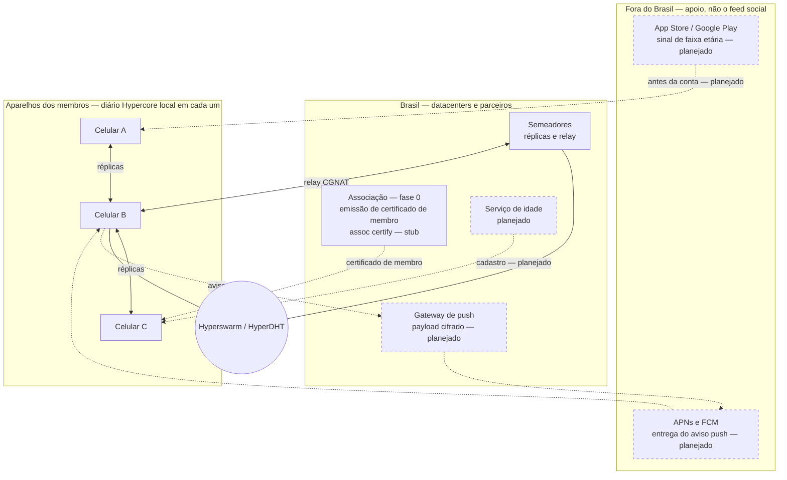
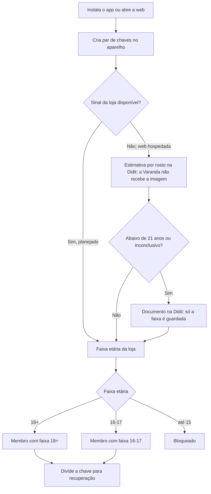
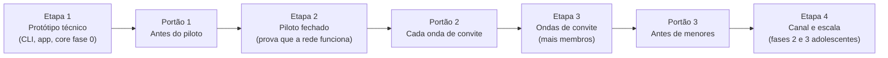

# Varanda — Documento de Design

19 de outubro de 2026 · Rodrigo S Pavezi

> Cópia em Markdown do documento de design (Claude Docs), exportada em 22 de outubro de 2026. Os três diagramas do original foram recriados em Mermaid abaixo.

A Varanda (varanda.app) é uma rede social que roda nos aparelhos dos próprios brasileiros: cada pessoa guarda as suas publicações e as de quem segue, e parceiros no Brasil mantêm semeadores sempre ligados. A idade é verificada antes de a conta existir, pelo sinal de idade das lojas de aplicativos, e o desenho segue a LGPD e o ECA Digital. É um rascunho para discussão; os pontos jurídicos ainda precisam de parecer de advogado.

## Objetivos e restrições

A rede precisa funcionar sem servidor central, nos celulares dos brasileiros, e cumprir a lei brasileira desde o primeiro usuário.

| Requisito | O que significa na prática |
| --- | --- |
| Roda nos aparelhos dos brasileiros | Cada celular guarda e repassa as próprias publicações e as de quem a pessoa segue; os semeadores guardam cópias dos diários públicos admitidos, e nenhum servidor tem os demais dados |
| Funciona com o celular desligado | Semeadores sempre ligados, mantidos por parceiros no Brasil, guardam cópias e ajudam nas conexões |
| Verificação de idade (ECA Digital) | A faixa etária é confirmada antes de a identidade valer na rede; na web hospedada, uma chave local nasce antes só para provar quem é o dono, e o vínculo com a conta e o certificado esperam o resultado da idade; autodeclaração não basta |
| LGPD | Coleta mínima, dados no Brasil sempre que possível, direitos dos titulares atendidos, encarregado nomeado |
| Recuperação de login | Perder o celular não pode significar perder a conta |
| Custo baixo | Nenhuma conta de servidor por usuário; a infraestrutura é doada por parceiros |
| Remoção de conteúdo | Atender notificações (decisão do STF sobre o Art. 19 do Marco Civil) e ordens judiciais |

**Fora do escopo do MVP:** pagamentos e carteiras (evita as regras do Banco Central para ativos virtuais), publicidade. Quem tem 16 ou 17 anos entra, por enquanto, com as mesmas regras de quem tem 18 ou mais; o modo restritivo para adolescentes (issue #74) ainda está pendente.

## Nomes no app

A rede se chama Varanda, no domínio varanda.app, e cada parte do app leva um nome da conversa brasileira na frente de casa.

| Nome no app | O que é | O que muda no desenho |
| --- | --- | --- |
| A Rua | O feed dos diários que a pessoa segue | Continua com os diários seguidos; a descoberta fica na Espiadinha |
| Comunidades (e seus grupos) | Conversas em grupo dentro de comunidades, e salas de áudio ao vivo | Comunidades e grupos públicos de texto entram no piloto web: cada aparelho de quem participa escreve o próprio núcleo, sem diário compartilhado (`docs/protocol.md` seção 10). Todo grupo pertence a uma comunidade, escolhida na criação e que não muda; a comunidade nasce com o grupo Geral e comporta até 32 grupos, públicos ou privados, sob uma mesma moderação. Grupos privados de texto são cifrados de ponta a ponta: só os aparelhos de quem participa leem as mensagens, e entrar sempre pede aprovação. Salas de áudio ao vivo ficam fora, pois pedem transmissão em tempo real entre aparelhos |
| Comunidade | Conjunto de até 32 grupos, públicos ou privados, sob uma mesma moderação; é sempre pública | Só no nó hospedado (versão web hospedada e app instalado): tem raiz própria e um núcleo de escritor por aparelho de cada membro, e a lista de grupos vem de registros de criação nesses núcleos |
| Espiadinha | Espiar o que quem você não segue está publicando | No piloto web: uma publicação por diário por rodada, até três rodadas, sem algoritmo de engajamento; cidade e estado ficam para depois |
| Gente da Gente | O selo de membro real e construtivo, no lugar do selo azul corporativo | "Real" já vem do certificado de membro; "construtivo" precisa de critério e de quem concede, e o selo não deve revelar a faixa etária |

Os pontos em aberto de cada nome estão em Perguntas em aberto.

### Espiadinha: regra democrática

A Espiadinha mostra a publicação mais recente de cada diário que você não segue, da mais nova para a mais antiga; depois a segunda e, por fim, a terceira mais recente de cada um, do mesmo jeito: sem curtidas, sem sugestões e sem pesos escondidos.

"Mais recente" é a publicação (publicação, resposta, citação ou republicação ainda valendo; curtidas não aparecem) com maior `seq`, a última escrita. Os seguidos não entram, porque já estão em A Rua; o próprio diário é buscado como qualquer outro, para que o pedido ao semeador não identifique a pessoa, mas as publicações dele nunca aparecem na própria Espiadinha (já estão em A Rua); nas Espiadinhas das outras pessoas ele aparece como qualquer outro. Dentro de cada rodada, vale a data `at` informada pelo autor, com desempate pela chave do diário. A igualdade é por diário certificado, não por pessoa: publicar mais não dá mais lugares na rodada, e cada diário tem no máximo três publicações. A regra está em [packages/core/lib/peek.js](../packages/core/lib/peek.js). A lista exclui os bloqueados e o conjunto efetivo de seguidos, vindo dos registros `follow` do diário mais as operações pendentes; o diário próprio é buscado, mas não aparece. A pesquisa por assunto na Espiadinha ordena só pela data e inclui também os autores seguidos. Não se coleta cidade nem estado.

O navegador calcula a página a partir do inventário já enviado pelo semeador. Uma conexão curta, anônima no sentido de usar uma chave Noise efêmera e não anunciar a identidade, busca os outros diários; o semeador vê o mesmo IP pedindo o complemento dos seguidos, que já conhece pelo inventário da sincronização, e pode correlacionar as conexões. Ele registra uma linha `peer` por conexão; os logs têm rotação por tamanho em [deploy/seeder/compose.yaml](../deploy/seeder/compose.yaml). A leitura não chama a associação nem o serviço de conta. Nenhuma página de descoberta ou nova cópia de conteúdo é guardada em servidor; continuam existindo as réplicas e os logs normais do semeador. No aparelho, os registros dos diários espiados ficam só na memória do navegador: recarregar descarta; no nó, o retrato vence em 5 minutos, com descarte por temporizador mesmo sem outra leitura. As linhas já exibidas podem permanecer na interface até atualizar ou recarregar. Fotos usam a mesma rota `/media` de A Rua, sob demanda, conferidas por SHA-256, com endereços `blob:` mantidos só em memória; as fotos de quem a pessoa não segue são buscadas com `no-store` (`apps/app/src/media/fetch.js`), então não ficam no cache HTTP; só as próprias e as dos seguidos usam o cache longo.

O semeador pode omitir inventário, blocos ou um estado assinado mais novo, mas não forjar nem escolher a publicação dentro do histórico verificado. A janela usa o comprimento assinado que Hypercore verifica com o bloco 0, nunca o anunciado. Cada janela posterior precisa reproduzir o mesmo comprimento e `treeHash`; se mudou, seus blocos são descartados e o diário para de avançar nesse retrato, com a página incompleta. Certificados e registros de @nome são verificados de novo contra os emissores revogados em toda página. Qualquer nó pode refazer a regra com o mesmo inventário, históricos e filtros ([protocol.md](protocol.md), seção 6).

Limites do piloto: 30 itens na primeira página e 31 nas seguintes, custo linear no número de diários, até 64 blocos examinados por diário (registros que não são publicações podem esconder posts antigos). As buscas seguem ordem aleatória por retrato para distribuir o efeito dos cortes. Inventário que não completa em 5 s, corte pelo prazo de 25 s, orçamento de 16 MiB por página ou de 32 MiB de registros retidos deixam a lista incompleta; os núcleos em RAM usam páginas de 64 KiB. Os nomes são a melhor informação nos blocos lidos, podendo faltar ou estar antigos. A data vem do autor (mais de 24 h no futuro é ignorada), e um bloqueio novo só retira linhas já mostradas na próxima carga. Há uma conexão externa curta extra por página que precisa buscar dados, além da sincronização: ela disputa as 32 vagas externas do semeador, e cada membro hospedado já ocupa uma com sua sincronização. Medido em laço local (Apple M4 Pro, Node 24), com os limites de produção (64 no total, 32 externas), 40 membros conectados dão 32 admitidos e 8 recusados; com as vagas externas ocupadas (32 por padrão; o operador ajusta com `VARANDA_MAX_EXTERNAL`), a leitura da Espiadinha ou dos Avisos falha em poucos milissegundos com "Semeador ocupado; tente novamente em instantes." (o semeador fecha o WebSocket com o código 1013), e uma conexão curta segura uma vaga por cerca de 10 a 20 ms (cada ida e volta de rede soma a isso). Reaproveitar a ligação da sincronização para a espiadinha e uma subcota para conexões anônimas foram avaliados e não foram feitos. Os quadros recebidos do semeador também têm teto no navegador (detalhes em [protocol.md](protocol.md), seção 4). A Espiadinha não interrompe essa sincronização; só a consulta inicial da chave própria pode interromper uma vez quando ainda não está no cache. Só uma leitura da Espiadinha roda por vez, e desconectar libera a vaga imediatamente.

## Arquitetura

Os celulares guardam e trocam as publicações, e parceiros e serviços no Brasil dão apoio. Cada celular guarda só o próprio diário e os de quem a pessoa segue; o semeador guarda a cópia de todo diário que admitiu (os diários públicos dos membros). Fora desses diários públicos, nenhum componente tem todos os dados.

**Índice de engajamento do semeador.** Como o semeador já guarda todo diário admitido, ele monta em memória, a cada início, um índice de respostas, citações, curtidas, republicações e das publicações de cada membro, para que a conversa completa e as contagens apareçam mesmo de quem a pessoa não segue. O mesmo índice lista quem curtiu e quem republicou: ele só diz onde procurar e quantos são; cada publicação, nome ou bio mostrado é lido do diário do autor e conferido pelo nó (na versão web, uma leitura sob demanda na memória, sem guardar nada). Os celulares continuam guardando só os diários seguidos. Contagens e completude são afirmações do semeador; o índice tem limite de memória e avisa quando está incompleto. Detalhes em [protocol.md](protocol.md), seções 5 e 7. O semeador guarda também as palavras de cada publicação pública, só para dizer onde procurar na pesquisa por assunto da Espiadinha; o nó confere as palavras no texto que ele mesmo leu e verificou.

**Índice de nomes do semeador.** Para achar uma pessoa por nome ou @nome e seguir, o semeador guarda em memória, alimentado pela mesma varredura do índice de engajamento, só os tokens dobrados do nome (sem acentos, em minúsculas) e o @nome já conferido (assinatura e delegação do emissor); nunca o nome original, a bio, o e-mail nem a conta. A busca aceita de 1 a 4 palavras (mínimo de 2 letras), casa começo de palavras, devolve até 20 pessoas e fica atrás da mesma moderação: bloqueados nunca aparecem, e um @nome de emissor revogado deixa de casar na hora. O app confere o nome e o @nome de cada linha no diário da pessoa antes de mostrá-la. O semeador vê o texto dobrado da busca na rota (sem registrar), e a ordem, as omissões e a completude são afirmações dele. Não há opção de sair nesta versão. Detalhes em [protocol.md](protocol.md), seções 5 e 7.

Legenda: linhas sólidas = réplicas P2P (também entre outros pares) e descoberta na DHT (cada aparelho); linhas tracejadas = apoio (certificado de membro, idade, push). Nós com borda tracejada e etiqueta *(planejado)* são pós-fase-0; na fase 0, o certificado de membro vem de `assoc certify` (operador local, `method: stub`) no nó Associação. O conteúdo social não passa por servidor central: só cópias entre aparelhos e semeadores.

Só dois fluxos saem do Brasil: o sinal de idade das lojas e a entrega de avisos pela Apple e pelo Google.

**Tecnologia proposta: Holepunch**

- **Bare:** roda JavaScript no desktop e no celular, a base do app.
- **Hypercore:** o diário de cada pessoa, um registro assinado em que só se acrescenta.
- **Hyperswarm / HyperDHT:** acha quem tem cada diário e conecta os aparelhos atravessando NAT.
- **Keet**, o app de conversas da Holepunch, já mostra P2P funcionando em celulares. As APIs ainda mudam, então fixamos versões.

## Como funciona

Cada pessoa tem um diário assinado de publicações no próprio celular; quem a segue baixa uma cópia e repassa para outros, como num torrent.

**Cadastro**

1. A pessoa instala o app (iOS ou Android), que cria a identidade dela, um par de chaves, no próprio aparelho.
2. O app pede à loja (Apple ou Google) o sinal de faixa etária. Sem sinal, oferece a estimativa de idade por rosto.
3. O serviço de idade emite um certificado de membro para a chave pública, assinado pela associação. Guarda só a chave, a faixa, o método e a data.
4. A chave é dividida em partes para recuperação (ver Identidade e recuperação de login).

**Publicar**

1. O app assina a publicação e a acrescenta ao diário da pessoa, no aparelho.
2. O app anuncia o diário numa tabela distribuída (DHT) e entrega as novidades a seguidores online e aos semeadores.
3. Fotos e vídeos ficam em arquivos separados, baixados só quando alguém abre. Hoje: só fotos e GIFs, só pela versão web, num núcleo de fotos por aparelho; o semeador as serve por HTTP (vídeo espera a comparação com listas de hashes, em Moderação). Os grupos também levam fotos: num grupo público elas ficam como as do diário; num grupo privado a foto é cifrada no aparelho e o semeador guarda só o cifrado. Mostrar e enviar fotos nas conversas em todas as plataformas fica para uma versão posterior.

**Quem a pessoa segue é público.** A lista de seguidos fica no próprio diário (registros `follow`), para chegar igual a todos os aparelhos da pessoa. Por isso qualquer um que tenha o diário vê quem ela segue; o app diz isso em Seguindo.

**Curtidas e republicações são públicas.** Curtidas e republicações são registros públicos do diário (`like` e `repost`). Na versão web hospedada, o app lista, para quem pode ver a publicação, as pessoas cujo registro o nó conferiu.

**Contagens e listas de seguidores são públicas.** Quem usa o site da associação ou o app ligado à instalação vê, em qualquer conta, "N seguindo" e "N seguidores", e cada número abre a lista (Seguindo, Seguidores). Os registros de seguir já eram públicos em cada diário; o semeador só os reúne. A contagem e as listas do semeador incluem só membros admitidos e visíveis nesse semeador (contas de fora da associação nunca aparecem), então podem ser menores que o "N seguindo" do Diário, que conta todo seguir do nó local; os tetos de 4096 seguidos e de 64 contas de fora por diário só fazem a lista Seguindo ser marcada como incompleta. Sob os números do perfil, uma nota ("A contagem pode estar incompleta.") e, na lista, uma nota ("A lista pode estar incompleta.") aparece enquanto o semeador ainda lê os diários. Cada linha é um registro de seguir assinado e conferido no app com `diary.peek` antes de aparecer: o semeador pode omitir linhas, não forjar uma. O semeador fica sabendo de qual perfil a lista foi aberta. Termos e Política de Privacidade passam à versão 12, com novo aceite. Com configuração manual não há lista do semeador.

**Quem foi seguido é avisado, em particular.** Quem começa a seguir alguém aparece para essa pessoa em Avisos, que o app abre pelo sino no canto direito da barra do topo, numa linha que abre o perfil de quem seguiu, onde fica o "Seguir". Isso é só dentro do app (versão web hospedada), e sem contagem nem lista de seguidores dentro de Avisos (a contagem e a lista públicas de seguidores ficam nos perfis, veja abaixo): só quem acabou de seguir e ainda não foi seguido de volta, e a linha some depois que a pessoa segue de volta. O semeador responde apenas à própria pessoa (ela prova que tem a chave do diário) e o app confere cada seguidor no diário assinado dele. Respostas, citações e menções (`@nome` no texto da publicação) também aparecem em Avisos, com as mesmas regras: só dentro do app, na versão web hospedada, sem contagem e sem lista; o app confere cada uma na publicação assinada e no próprio diário. A lista de Avisos não usa push. Os avisos da versão web hospedada, em Notificações, são um caminho à parte (seguir, resposta, curtida e republicação) e não incluem citação nem menção. O aviso cifrado nativo (APNs e FCM) continua um desenho futuro.

**Ler e sincronizar**

1. O app conecta direto aos aparelhos de quem a pessoa segue. Se o CGNAT da operadora impedir, passa por um semeador.
2. Baixa só as novidades dos diários seguidos, de preferência no Wi-Fi, para poupar o plano de dados. Uma conversa ou um perfil de quem a pessoa não segue é lido sob demanda (hoje só na versão web), na memória, pelo índice do semeador (acima), e não fica guardado.
3. Apps e semeadores só aceitam diários com certificado de membro válido.

**Notificações**

1. Na versão web hospedada, a pessoa liga os avisos em Ajustes ("Avisos no aparelho"). Vêm desligados. São quatro eventos: alguém começou a seguir, respondeu, curtiu ou republicou. Cada aviso é uma frase com o nome e a ação. Citação, menção e o crescimento de um diário seguido não geram push. O app nativo, o `varanda-serve` e a CLI ficam na lista de Avisos.
2. O semeador, ao ver um desses registros num diário que serve, manda o candidato em loopback ao serviço de conta. O semeador não vê a inscrição do aparelho.
3. O serviço de conta monta "nome + ação" e cifra de ponta a ponta (RFC 8291). O serviço de push do navegador vê só o texto cifrado e o endereço do aparelho. O texto cifrado tem sempre o mesmo tamanho, mas o momento da entrega é visível para o serviço de push e pode ser cruzado com os registros públicos. O aparelho decifra e mostra. O aviso nativo pela Apple (APNs) e pelo Google (FCM) continua um desenho futuro.

## Identidade e recuperação de login

A chave de cada pessoa é dividida em três partes e quaisquer duas assinam: ninguém sozinho controla a conta, e perder o celular não apaga a identidade.

| Parte | Quem guarda | Para que serve |
| --- | --- | --- |
| 1 | O celular, no chip seguro do aparelho | Uso diário |
| 2 | Um parceiro guardião (provedor regional ou universidade) | Assina junto no dia a dia e ajuda na recuperação |
| 3 | Backup da pessoa, cifrado com passkey (sincronizada pelo iCloud ou Google) | Recuperação, ou assinar sem o guardião se ele sair do ar |

- **Celular perdido:** backup e guardião reconstroem uma nova parte no aparelho novo. A identidade e os seguidores continuam os mesmos.
- **Como o guardião confirma que é você:** passkey, e-mail e o registro da verificação de idade. Nunca só SMS, porque golpes de troca de chip são comuns no Brasil.
- **Técnica:** assinatura por limiar FROST ([RFC 9591](https://www.rfc-editor.org/rfc/rfc9591)), que suporta o tipo de chave (Ed25519) usado pelo Hypercore. O [FROSTR](https://opensats.org/projects/frostr) já aplica a mesma ideia a chaves Nostr.
- **No MVP:** a chave continua vindo da passkey com que a conta foi criada, e o backup é essa mesma raiz embrulhada (cifrada) para outras chaves. Em Ajustes > Passkeys e recuperação a pessoa pode cadastrar até quatro outras passkeys e um código de recuperação; cada um só desembrulha a raiz original, que gera as mesmas chaves, então a identidade e os seguidores continuam os mesmos. O serviço de conta guarda só o texto cifrado, que não consegue abrir, num arquivo à parte (`recovery.json`, ver `docs/protocol.md`, "Web member storage (B2)" e "Files and replicas"). Sem nenhuma passkey e sem o código, a conta não volta. O guardião e a assinatura por limiar FROST entram na fase 2.
- **Continuar conectado na versão web (troca consciente).** Na web, a chave vem da passkey. Antes ela ficava só na memória da página e cada recarga pedia a passkey de novo; agora a página guarda o resultado da passkey cifrado (AES-GCM com uma chave do navegador que não pode ser exportada, preso ao endereço e à identidade) e a pessoa continua conectada até tocar "Sair" ou ficar 30 dias sem abrir o app (aí a passkey é pedida de novo; cada abertura renova o prazo). Ganha-se uso de rede social de verdade (abrir e já estar dentro). Perde-se isto: a chave que cifra a sessão fica no mesmo perfil do navegador que a sessão cifrada, então uma cópia do perfil dá a identidade até "Sair" ou os 30 dias sem uso; um script que rode na origem da página pode usar a sessão guardada e agir como o membro; e quem pega o aparelho desbloqueado publica em nome dele. A cifra impede só que o resultado da passkey fique gravado em claro e que o registro, copiado sozinho, abra em outro endereço ou para outra identidade. Detalhes em `docs/rpc.md` seção 11.
- **Limite:** dois guardiões juntos poderiam assinar. Por isso a pessoa sempre guarda uma parte, e os guardiões são organizações independentes.

## Verificação de idade

A idade é confirmada antes de a identidade valer na rede, e a rede guarda só a faixa etária, nunca documento ou foto.

**Idade mínima: 16 anos.** Decisão do dono do produto (2026-10-29), com base no ECA Digital; é uma regra adotada pela Varanda, não um limite fixado pela lei, e está sujeita a parecer jurídico.

**Web hospedada (Didit).** O nó do navegador cria a chave local antes, só para provar quem é o dono nas rotas de idade; o vínculo com a conta Google e o certificado esperam o resultado. A verificação usa o fluxo hospedado da Didit: estimativa por rosto, com o documento como alternativa configurada no fluxo (workflow) da Didit. Uma estimativa por rosto abaixo de 21 anos nunca libera: pede documento. Só o documento pode recusar (menos de 16). O serviço de conta guarda no `age.json` só a faixa (`16-17` ou `18+`), o método (`didit`) e a data. O certificado v2 continua com `ageBand: 'unchecked'`. Todo membro da web hospedada, inclusive quem já tinha vínculo, fica bloqueado até verificar. O sinal da loja e a credencial do gov.br continuam planejados. O app nativo não muda: segue o certificado dado pelo operador.

**Lembrada por conta.** Decisão do dono do produto (2026-11-04): a verificação é lembrada por conta, independente do aparelho, com duas provas assinadas pela chave do emissor do serviço de conta e conferidas pelo nó a cada leitura. O atestado `age-verified` diz que o serviço tem uma faixa registrada para aquele membro desde uma data (contas vinculadas antes do `since`); o atestado `age-since` traz o `since` da instalação (`VARANDA_AGE_SINCE`, nunca antes do início do dia UTC seguinte à primeira faixa, da última vez em que a verificação foi religada nem do vínculo mais recente sem faixa mais 1 ms), e o certificado v2 de membro do mesmo emissor com data igual ou posterior a ele (e até a data em que o `since` foi assinado, que o serviço renova a cada pedido) prova que a conta passou, porque o serviço não emite certificado para uma chave sem faixa registrada. O app só repassa os dois ao nó (`age.proof`) e abre a porta pelo que o `node.info` informa. O formato do certificado não muda: o v2 continua com `ageBand: 'unchecked'`. Nenhum atestado carrega a faixa, a data de nascimento, o método ou o provedor. O aparelho guarda só recusas, por membro e instalação, que fecham a porta mesmo sem internet; nada que ele guarda abre a porta. A próxima resposta do serviço vale sobre as duas provas.

Na web hospedada, as saídas 18+ e 16-17 existem e viram membro com a faixa guardada no `age.json`; até 15 anos fica bloqueado. O modo restritivo para 16 e 17 anos (issue #74) e a conta vinculada a um responsável ainda não existem.

| Método | Quando entra | O que a rede recebe | Custo |
| --- | --- | --- | --- |
| Sinal da loja ([Apple](https://9to5mac.com/2026/02/24/apple-expands-age-assurance-tools-as-new-app-store-requirements-roll-out-in-several-regions/) e [Google](https://www.drweb.de/alterspruefung-android-play-age-signals/)) | Padrão, no cadastro e a cada abertura do app | Só a faixa; no Google, 0–12, 13–15, 16–17 ou 18+ | Grátis |
| Estimativa por rosto | Sem sinal da loja, por exemplo quando a pessoa não autoriza compartilhar | Só a faixa; a imagem é apagada na hora | Cobrado por checagem; orçar com fornecedores |
| Documento e selfie | Resultado inconclusivo ou contestação | Só a faixa; o documento não é guardado | O mais caro; orçar |
| Credencial etária do gov.br (planejada) | Quando existir, vira o método preferido, ao lado do sinal da loja | Só se a pessoa está na faixa exigida, sem data de nascimento | A definir pelo governo |

**gov.br para idade, não para login.** O governo está montando uma credencial etária ligada ao gov.br, em que o serviço só fica sabendo se a pessoa está na faixa exigida ([TeleSíntese, 17/06/2026](https://telesintese.com.br/eca-digital-acelera-criacao-de-infraestrutura-nacional-de-credenciais-verificaveis/)). Ainda não há data de lançamento, nem regra clara sobre o uso por plataformas privadas.

Usar o gov.br como login seria diferente: a rede receberia CPF e nome de cada membro, cada publicação ficaria ligada a uma identidade oficial, e o gov.br veria cada entrada na rede. Isso cria um ponto central numa rede feita para não ter nenhum. O ideal é a credencial ser apresentada direto do celular, sem consultar o governo a cada uso.

**Regras que o desenho segue**

- Autodeclaração não basta, e informar só o CPF conta como autodeclaração ([orientação preliminar da ANPD](https://dataprivacy.com.br/escopo-e-afericao-de-idade-entenda-as-propostas-de-guias-da-anpd/)).
- Na estimativa por rosto, resultado perto do limite não libera o acesso: vai para documento e selfie.
- Se o sinal da loja e a avaliação do app divergirem, vale o resultado mais protetor (Decreto nº 12.880/2026).
- Para conteúdo impróprio para menores, a lei pede verificação confiável "a cada acesso" ([Senado](https://www12.senado.leg.br/noticias/materias/2026/03/17/eca-digital-para-protecao-on-line-de-criancas-e-adolescentes-entra-em-vigor)); o app reconsulta o sinal da loja sempre que abre, sem custo.
- A pessoa pode contestar o resultado e usar outro método.

**Fases 2 e 3: adolescentes**

- **16 e 17 anos:** privacidade mais restritiva ligada por padrão, sem contato de adultos não aprovados e sem compartilhar localização.
- **Até 16 anos:** conta vinculada à de um responsável, com ferramentas de supervisão (bloquear contato de adultos não autorizados, limitar uso excessivo, controlar recomendações). O vínculo não dá acesso às mensagens privadas. Se isso inclui quem tem 16 está em Perguntas em aberto.

**Fiscalização:** multas a partir de janeiro de 2027, de até 10% do faturamento no Brasil, limitadas a R$ 50 milhões por infração ([Exame](https://exame.com/tecnologia/examelab/verificacao-de-idade-nas-redes-o-que-o-eca-digital-exige-e-como-funciona-em-cada-app/)).

## LGPD

**Hipóteses de desenho, não parecer.** As tabelas, bases legais e fluxos desta seção expressam o que o produto *pretende* fazer para cumprir a LGPD e o ECA Digital. São hipóteses para engenharia e para discussão com advogados; **não substituem parecer jurídico formal**. Onde o texto pede “parecer jurídico” ou lista itens em Perguntas em aberto, a validação legal ainda não foi fechada.

A proposta é que a associação que publica o app e mantém os serviços compartilhados seja a controladora, e que o desenho reduza ao mínimo o que ela vê. Quem é controlador numa rede P2P é uma dessas hipóteses e ainda precisa de parecer jurídico.

| Dado | Onde fica | Base legal proposta | Retenção |
| --- | --- | --- | --- |
| Publicações e perfil (inclui a foto do perfil, uma imagem 512x512 sem metadados) | Celulares de quem segue e semeadores no Brasil e, só em memória enquanto a aba Espiadinha está aberta, no navegador de quem espia. Nome e @nome podem ser encontrados pela busca do semeador, sem opção de sair por enquanto; o semeador guarda só tokens dobrados em memória | Execução de contrato (Art. 7º, V) | Até a pessoa apagar; na Espiadinha, até recarregar ou atualizar a lista, e no nó até 5 minutos; o índice de nomes some ao reiniciar o semeador |
| Lista de quem a pessoa segue (registros `follow` no diário), curtidas e republicações (registros `like` e `repost`) e fotos das publicações | Os mesmos lugares do diário: é pública para quem tem o diário. O app guarda a lista de quem curtiu ou republicou só na memória, enquanto a tela está aberta | Execução de contrato (Art. 7º, V) | Até a pessoa apagar; a lista na tela, só enquanto ela está aberta |
| Depoimentos (registro `testimonial` lacrado no diário de quem escreve; registro `testimonial-show` no diário de quem recebe, com o texto, até 400 caracteres) | O `testimonial` fica no diário de quem escreve, nos mesmos lugares do diário, e mostra a qualquer um só que a pessoa escreveu um depoimento lacrado para outra: o texto pendente vai cifrado de ponta a ponta para a chave de mensagens de quem recebe, e só o aparelho dessa pessoa o abre. O `testimonial-show` fica no diário de quem recebe, público como uma publicação, só se essa pessoa escolher mostrar o depoimento no perfil. O índice do semeador guarda só onde estão esses registros, nunca o texto nem o lacre. As duas pessoas podem denunciar a conta da outra | Execução de contrato (Art. 7º, V) | Até quem escreveu retirar (apagar o `testimonial`, o que esconde o depoimento mostrado) ou quem recebeu tirar do perfil (apagar o `testimonial-show`), com os limites da exclusão em P2P |
| Publicações, perfil e fotos de uma página (diário de negócio ou projeto) | Os mesmos lugares do diário de uma pessoa (aparelhos de quem segue a página, semeadores no Brasil e, em memória, o navegador na Espiadinha) e, além deles, uma cópia completa (publicações, perfil, fotos e quem a página segue) no armazenamento do serviço de conta, que assina, grava e replica a página para o semeador em nome do dono e dos administradores | Execução de contrato (Art. 7º, V) | Até apagarem, como no diário de uma pessoa |
| Lista pública de administradores da página (registros `page-roster` e `page-accept`: @nomes do dono e de quem aceitou) | No diário da página, público para quem o tem | Execução de contrato (Art. 7º, V) | Segue a retenção do diário da página; remover um administrador não apaga o registro anterior |
| Quem a página segue (registros `follow` no diário da página) | No diário da página, público como a lista de uma pessoa | Execução de contrato (Art. 7º, V) | Até apagarem |
| Chave de assinatura da página | Serviço de conta, no Brasil, modo 0600, volume `account-data`; nunca no aparelho nem no semeador. Hipótese de desenho: a guarda pelo serviço é a base para escrever em nome do dono e dos administradores, e ainda precisa de parecer jurídico | Execução de contrato (a confirmar em parecer) | Enquanto a página existir |
| Mensagens de uma página (Conversas como página) | Serviço de conta, no Brasil: a chave de mensagens da página e as mensagens enviadas e recebidas pela página, cifradas em repouso sob uma chave derivada da chave do serviço, mas legíveis pelo serviço, ao contrário das mensagens pessoais. Quem administra lê pelo serviço; um administrador removido perde o acesso na remoção. Hipótese de desenho, ainda sem parecer jurídico | Execução de contrato (a confirmar em parecer) | Enquanto a página existir |
| Caixa dos grupos privados e chaves de escrita da página (`page-keys`: um par X25519 por página, nunca o da caixa de mensagens, e os pares Ed25519 de cada núcleo de escritor da página em comunidades e grupos) | Serviço de conta, no Brasil, modo 0600, volume `account-data`, com a chave de assinatura da página; nunca no aparelho nem no semeador. O serviço pode ler as publicações da página em grupos privados. Ao sair de um grupo, o segredo do escritor é apagado. Hipótese de desenho, ainda sem parecer jurídico | Execução de contrato (a confirmar em parecer) | Enquanto a página existir; apagadas no encerramento ou na mudança de chave |
| Avisos de uma página (quem começou a seguir e as menções) | Serviço de conta, no Brasil: o serviço lê os avisos endereçados à página, pelo semeador, em nome de quem a administra, e responde só ao dono e aos administradores. Não guarda a lista. Nenhum Web Push vai para uma página. Hipótese de desenho, ainda sem parecer jurídico | Execução de contrato (a confirmar em parecer) | Só em memória, durante a leitura |
| Chave de delegado de página de um nó core (`private/page-actor.json`) | Só no aparelho do nó core, modo 0600; o diário do nó recebe o registro público `page-delegate` com a chave pública. O serviço de conta guarda o vínculo (delegado, diário) e o aceite dos Termos do delegado. Nunca a chave secreta | Execução de contrato | Enquanto o nó existir; o vínculo vale até o administrador sair da página |
| Pontos de leitura das Conversas de cada página (cursores do pool, um por página) | Serviço de conta, no Brasil, junto das mensagens da página. Só guardam até onde o serviço já leu o pool global; não têm texto nem chave | Execução de contrato | Enquanto a página existir; apagados no encerramento |
| Mensagens diretas | Texto e chaves secretas só nos aparelhos dos participantes, cifrados de ponta a ponta; a chave pública de mensagens fica no diário (registro `dm-key`), como o perfil. O aviso push de mensagem nova é global e não leva nome nem texto; a supressão do aviso no aparelho que enviou acontece só nesse aparelho, e o servidor não fica sabendo quem enviou | Execução de contrato | Até apagarem no aparelho |
| Envelopes de mensagens diretas | Semeador: envelopes cifrados de tamanho fixo, sem remetente nem destinatário, num conjunto comum | Execução de contrato | 7 dias |
| Selos de envio | Semeador: chave do membro e contagem diária de selos (dia de Brasília), nunca o destinatário; à parte, o resumo (hash) de cada selo já usado, sem chave de ninguém, para impedir o reuso | Execução de contrato | Contagem: dia atual e anterior. Resumos: 14 dias |
| Pedaços de mídia das conversas (blobs) | Semeador, num conjunto comum: pedaços de tamanho fixo de texto cifrado, cada um com um id aleatório de blob e um selo, sem remetente, destinatário, chave nem nome de arquivo (a chave só viaja dentro da mensagem direta selada). Não há conta nem identificador na busca (`GET /blob/<id>/<índice>`); o Caddy não guarda registro de acesso. Os selos de blob são contados por diário e por dia de Brasília (1024 por dia), à parte dos de mensagem, e o resumo de cada selo usado fica 14 dias para impedir o reuso. Os Termos e a Política descrevem fotos e GIFs nas conversas desde a versão 17 | Execução de contrato | 7 dias a partir do primeiro pedaço, sem renovação; blob incompleto, 1 hora. Contagem de selos: dia atual e anteriores próximos. Resumos: 14 dias |
| Denúncia de mensagem direta | Serviço de conta: só a mensagem escolhida, motivo e texto do denunciante, chave do denunciante e a chave de quem enviou; nunca o resto da conversa. Sempre uma pessoa decide | Moderação e pedido legal (a base legal ainda precisa de parecer) | Mesma retenção das outras denúncias |
| Fotos e GIFs das mensagens diretas (até 4 por mensagem, escolhidos da galeria) | Cifrados no aparelho de quem envia e postos no semeador como pedaços de mídia das conversas (linha acima), sob um id aleatório; a chave e o descritor só viajam dentro da mensagem direta selada. Os aparelhos que abrem a foto guardam uma cópia cifrada num cache local (256 MiB no navegador, os mais antigos saem primeiro). A associação não vê a imagem nem sabe de quem é ou para quem | Execução de contrato (Art. 7º, V) | Semeador: 7 dias. Cache local: apagado ao trancar a sessão, em Sair e ao apagar os dados do app |
| Imagem anexada a uma denúncia (mensagem direta ou mensagem de grupo privado com foto: a primeira imagem, decifrada no aparelho e regravada como JPEG de até 700 KB, que a pessoa denunciante vê antes de enviar; a denúncia de grupo público aponta para a mensagem, sem imagem) | Serviço de conta, no Brasil (`report-media/<id da denúncia>`, modo 0600, junto da linha em `moderation.json`, no máximo 2000 imagens). O painel a mostra como "não conferida": é a palavra de quem denunciou, como a citação. Uma denúncia com imagem sempre é decidida por uma pessoa | Moderação e pedido legal (a base legal ainda precisa de parecer) | Segue a denúncia: em aberto (issue #38); a decisão não apaga a imagem, que fica como prova |
| Mensagens de voz das conversas (mensagens diretas e grupos; `audio/mp4` de até 2 minutos e 1,5 MiB, uma por mensagem, sem vídeo) | Gravadas no app só depois que a pessoa começa a gravar (o microfone é pedido nesse momento e não grava em segundo plano). Guardadas e protegidas como as fotos da mesma conversa: mensagem direta, cifrada no aparelho e posta no semeador como pedaços de mídia das conversas, sob um id aleatório, com cópia cifrada nos aparelhos que a abriram; grupo público, no núcleo de fotos de quem escreveu, pública como o texto; grupo privado, cifrada, com a chave só dentro da mensagem selada do grupo. Um arquivo que declara faixa de vídeo é recusado pelos bytes | Execução de contrato (Art. 7º, V) | Como as fotos da mesma conversa: semeador 7 dias nas mensagens diretas; nos grupos, sair e ocultar mantêm as cópias |
| Áudio anexado a uma denúncia (mensagem direta ou mensagem de grupo privado com mensagem de voz: o áudio aberto, como foi gravado, se tiver até 700 KB, que a pessoa denunciante pode ouvir antes de enviar; a denúncia de grupo público aponta para a mensagem, sem áudio) | Serviço de conta, no Brasil, no mesmo lugar e com o mesmo limite das imagens de denúncia (`report-media/<id da denúncia>`, modo 0600). O painel o mostra como "áudio não conferido" e o serve como `audio/mp4`, sem passar pela triagem com IA, por log ou pelo semeador. Uma denúncia com áudio sempre é decidida por uma pessoa | Moderação e pedido legal (a base legal ainda precisa de parecer) | Segue a denúncia: em aberto (issue #38); a decisão não apaga o áudio, que fica como prova |
| Mensagens de grupo público (texto, respostas, ocultações, banimentos, saídas) | Núcleos de escritor nos aparelhos dos membros e nos semeadores no Brasil. O texto é público, como o de uma publicação, e fica em cópias que a associação não controla. Sair e ocultar mantêm as cópias; as regras de retenção estão em "Grupos públicos (Comunidades)" abaixo | Execução de contrato (Art. 7º, V) | Sair não encerra a retenção; a remoção segue as regras abaixo, sem recolher cópias de outros aparelhos |
| Mensagens de grupo privado (texto, respostas, ocultações e o nome do grupo) | Núcleos de escritor nos aparelhos dos membros e nos semeadores no Brasil, sempre cifradas (`group-sealed`). Só os aparelhos que receberam a chave do grupo leem; a associação e os semeadores guardam só texto cifrado e não têm como decifrá-lo. Banimentos, admissões, saídas, administração e a distribuição das chaves seguem em claro, como nos grupos públicos | Execução de contrato (Art. 7º, V) | Como nos grupos públicos: sair e ocultar mantêm as cópias cifradas; quem já leu continua com o que leu |
| Fotos e GIFs de grupo público (até 4 por mensagem) | No núcleo de fotos de quem escreveu, nos aparelhos dos membros e nos semeadores no Brasil, servidos pelo semeador como as fotos das publicações. Públicos como o texto do grupo | Execução de contrato (Art. 7º, V) | Como as fotos das publicações e as mensagens de grupo público: sair e ocultar mantêm as cópias |
| Fotos e GIFs de grupo privado (até 4 por mensagem) | Cifrados no aparelho de quem envia; o núcleo de fotos de quem escreveu, nos aparelhos e nos semeadores no Brasil, guarda só o texto cifrado. A chave de cada foto viaja só dentro da mensagem selada do grupo (`group-sealed`), então só os aparelhos dos membros abrem a imagem; o app nunca a busca por HTTP, só o nó a decifra | Execução de contrato (Art. 7º, V) | Como nos grupos privados: sair e ocultar mantêm as cópias cifradas; quem já abriu continua com o que abriu |
| Chave de caixa do aparelho para grupos privados (par X25519) | Só no aparelho: no nó da CLI, `group-box.json` (modo 0600); na versão web, derivada da chave de acesso a cada sessão e nunca gravada. As chaves de cada grupo são reabertas a cada sessão e ficam só na memória. Nada disso vai para a associação, para o semeador ou para backup | Execução de contrato (Art. 7º, V) | Enquanto o aparelho guardar; perder a chave do aparelho é perder o acesso aos grupos privados nele |
| Participação em grupo (registros `group-join` no diário e `group-leave` no núcleo do escritor) | A declaração fica no diário e a saída no núcleo do escritor; ambas são públicas para quem tem essas cópias | Execução de contrato (Art. 7º, V) | O índice do semeador fica em memória; os registros seguem a retenção dos respectivos núcleos |
| Participação em comunidade (registro `group-join` no diário e núcleo de escritor da comunidade, com `group-leave` na saída) | A declaração fica no diário; a entrada, a saída, as admissões, os banimentos e a criação de grupos ficam nos núcleos de escritor da comunidade, nos aparelhos dos membros e nos semeadores no Brasil. Tudo é público para quem tem essas cópias, como a participação em grupo | Execução de contrato (Art. 7º, V) | Os registros seguem a retenção dos respectivos núcleos; sair não os apaga |
| Faixa etária do membro | `age.json` do serviço de conta (chave, faixa, método, data), no Brasil | Obrigação legal, ECA Digital (Art. 7º, II), a confirmar em parecer | Enquanto a conta existir; apagada na exclusão da conta |
| Imagem do rosto e documento, só na verificação de idade | Processada pelo parceiro (Didit); a Varanda nunca a recebe; a sessão é apagada no parceiro logo após a decisão (retenção mínima configurada) | Dado sensível: consentimento específico ou obrigação legal (Art. 11), a definir em parecer | Mínima no parceiro; nenhuma na Varanda |
| Vínculo com a conta Google (sub do Google, e-mail, chave do membro, @nome atual e os já usados, datas, certificado) | Serviço de conta, no Brasil | Execução de contrato (Art. 7º, V), para dar o certificado e o @nome; e atender pedidos legais e bloqueios | Até a exclusão da conta (Ajustes > Excluir conta), que apaga sub, e-mail, certificado e registros; fora isso, em aberto (issue #38) |
| Conta excluída (chave pública, data da exclusão e os @nomes que a conta usou, sem sub nem e-mail; o bloqueio da chave pedido pela pessoa, sem denúncia) | Serviço de conta, no Brasil (`directory.*`, linha `deleted`, e `moderation.json`, mudança com `by: 'titular'`) | Execução de contrato e legítimo interesse (a confirmar em parecer): impedir que a mesma chave volte e que um @nome usado vá para outra pessoa | Sem prazo (issue #38); a chave já é pública, e o @nome fica queimado para sempre |
| Chave pública da passkey com que a conta foi criada (identificador da credencial, chave pública, algoritmo, contador do autenticador, data) e um pedido de exclusão agendado (datas do pedido e da execução) | Serviço de conta, no Brasil (`passkeys.json`, modo 0600, volume `account-data`), só para membros com vínculo Google; no aparelho, o objeto de atestado da criação até o envio (kv `passkeyEnrol` ou um arquivo no app) | Execução de contrato e legítimo interesse (a confirmar em parecer): conferir no serviço que quem pede a exclusão confirmou com a passkey da conta, e dar 7 dias para cancelar quando não dá para conferir | Apagada na exclusão da conta (fica por 30 dias só a chave pública da conta e a data); cancelar o pedido apaga só as datas |
| Recibo da exclusão no aparelho (chave pública e data) | Só no aparelho que pediu ou que apagou a conta depois do aviso | Execução de contrato | Até o app confirmar a exclusão e a pessoa tocar em Entendi |
| Denúncias de membros (chave de quem denuncia e de quem é denunciado, publicação, motivo, texto de quem denuncia, trecho citado, data, assinatura) e registro de decisões dos moderadores (e-mail do moderador, decisão, data) | Serviço de conta, no Brasil (`moderation.json`) | Moderação e pedido legal (a base legal ainda precisa de parecer) | Em aberto (issue #38); nada é apagado automaticamente |
| Precedentes humanos da triagem (texto verificado, motivo, decisão, hash e vetor quantizado; no máximo 4000) | Serviço de conta, no Brasil (`exemplars.json`, modo 0600, volume `account-data`) | Moderação (a base legal ainda precisa de parecer) | Em aberto (issue #38); uma linha inválida torna o arquivo indisponível e ele nunca é regravado |
| Marcas da triagem e leituras verificadas em cache (no máximo 2000) | Serviço de conta, no Brasil (`triage.json`, modo 0600, volume `account-data`) | Dado derivado da moderação (a base legal ainda precisa de parecer) | Se corrompido, renomeado para `triage.json.corrupt-<ms>` e recriado |
| Contagens agregadas de uso (membros, diários, ativos, conexões, armazenamento, cadastros por semana/mês) | Serviço de conta (usage.json, 0600, volume account-data); ativos só na memória do semeador | Não são dados pessoais: só contagens, sem chave, e-mail ou @nome; a data de cadastro já é pública no certificado (confirmar no parecer) | Até 400 dias, rotativo; ativos zeram ao reiniciar o semeador |
| Registro de aceite dos Termos de Uso e da Política de Privacidade (versão e data; no serviço de conta também chave do membro, nonce e assinatura) | Aparelho; serviço de conta, no Brasil (`terms.json`, modo 0600, volume `account-data`), só para membros com vínculo Google | Execução de contrato (a confirmar em parecer) | Apagado na exclusão da conta; fora isso, em aberto (issue #38) |
| Entradas de recuperação: chave do membro, identificador derivado da passkey extra ou do código (o serviço não consegue ligá-lo a uma passkey), texto cifrado que o serviço não consegue abrir, tipo (`passkey` ou `code`) e data | Serviço de conta, no Brasil (`recovery.json`, modo 0600, volume `account-data`), só para membros com vínculo Google | Execução de contrato (a confirmar em parecer); finalidade: abrir a mesma conta com outra passkey ou com o código de recuperação | Até o membro remover a entrada ou excluir a conta (fica por 30 dias só a chave pública e a data da remoção); a retenção depois disso está em aberto (issue #38). Dado cifrado continua sendo dado pessoal |
| Convites de entrada (`invites.json`: chave de quem criou o convite, identificador aleatório, hash do código só enquanto não usado, data de criação, usado sim ou não; nada de quem recebeu nem de quem usou) | Serviço de conta, no Brasil (`invites.json`, modo 0600, volume `account-data`), só quando `VARANDA_INVITES_PER_WEEK` está definido | Execução de contrato (a confirmar em parecer); finalidade: entrada por convite | A semana atual e os convites ainda dentro dos 7 dias de validade (até 14 dias no total); o resto é apagado na próxima criação de convite; os de quem exclui a conta, na hora |
| Cartão do convite de entrada (nome de quem recebe, mensagem, desenho, chave de quem convidou e assinatura) | No fragmento do link, que o navegador não envia a servidor; na aba de quem abre o link (`sessionStorage`, 24 h) ou na memória do processo do app instalado. O serviço de conta nunca recebe o cartão, e o link nunca vira prévia; para mostrar quem escreveu, o aparelho de quem abre o link consulta o status público da conta pela chave de quem convidou (só a chave), antes de qualquer cadastro. Quem tem o link pode ler o cartão | Execução de contrato (a confirmar em parecer); finalidade: um convite com recado pessoal | Até 24 h na aba ou até fechar o app; some quando o convite é trocado. Nenhum registro novo de quem convidou quem e nenhum aviso de cadastro; o diretório já guarda o hash do convite usado, como antes |
| Convites de surpresa: `invite-drops-key.json` (segredo do sorteio e data de ativação, nenhum dado pessoal) e `invite-drops.json` (chave do membro, semana e índices dos convites já avisados, nenhum horário) | Serviço de conta, no Brasil (`invite-drops-key.json` e `invite-drops.json`, modo 0600, volume `account-data`), só quando `VARANDA_INVITE_DROPS` está ligado | Execução de contrato (a confirmar em parecer); finalidade: espalhar os convites ao longo da semana | O segredo enquanto o recurso existir; o `invite-drops.json` é podado no fim da semana de Brasília |
| Estado de vistos sincronizado entre aparelhos (Avisos, Conversas e grupos) | Serviço de conta, no Brasil (`seen/<chave>`, modo 0600, volume `account-data`): um bloco cifrado de tamanho fixo que só os aparelhos da passkey abrem; o serviço vê existência, tamanho constante, hora da última gravação e qual conta pediu | Execução de contrato (a confirmar em parecer) | Substituído a cada gravação; apagado a pedido à associação, como os demais dados (a rota de apagamento existe, mas nenhum aparelho a chama hoje), e na exclusão da conta (Ajustes > Excluir conta) |
| E-mail de recuperação | Guardião, no Brasil | Execução de contrato | Enquanto a conta existir |
| Inscrição de Web Push (endereço do aparelho, `endpoint`, e as chaves `p256dh` e `auth`) | Serviço de conta no Brasil (`push.json`, modo 0600, volume `account-data`). O texto cifrado atravessa o serviço de push do fabricante, que pode estar fora do Brasil | Consentimento (a confirmar no parecer) | Até a pessoa desligar, excluir a conta ou o serviço responder 404 ou 410 |
| Busca de GIFs, quando o operador a liga (texto da busca; o GIF escolhido) | O texto vai do app ao serviço de conta, no Brasil, que o repassa ao provedor de GIFs escolhido pelo operador a partir do endereço e com a chave da associação; o provedor, que pode estar fora do Brasil, recebe só o texto, nunca o IP, a conta ou a chave do membro. O GIF escolhido é copiado para o armazenamento do Varanda e segue as fotos da conversa | Execução de contrato (Art. 7º, V), a confirmar no parecer; a transferência internacional da consulta, conforme a Resolução CD/ANPD nº 19/2024, também a confirmar | O texto não é guardado nem registrado; a contagem diária de buscas e imagens por membro (para o teto de 120 e 60) vale só para o dia; o GIF segue a retenção das fotos da mesma conversa |
| Prévia de links (o link colado; o título, a descrição e a imagem da página) | No app nativo, só o aparelho de quem envia lê a página. Na web hospedada, o serviço de conta, no Brasil, lê a página uma vez a partir do próprio endereço, nunca com o IP ou a identidade do membro, e devolve o cartão ao app; a sessão exige o aceite dos Termos atuais, como a busca de GIFs. O cartão (título, descrição e uma imagem de até 32 KB) viaja dentro da mensagem direta, da mensagem de grupo ou da publicação do diário, com a proteção dela; quem lê nunca fala com o site, e o link só abre quando a pessoa toca no cartão. A chave "Prévia de links" em Ajustes desliga a montagem. Os Termos e a Política descrevem a prévia desde a versão 22 | Execução de contrato (Art. 7º, V), a confirmar no parecer | O serviço não guarda nem registra o link, o título nem a imagem; a contagem diária de prévias por membro (teto de 60) vale só para o dia; o cartão segue a retenção da mensagem ou da publicação em que viaja |
| Registros de acesso (IP, data, hora) | Semeadores e serviços | Obrigação legal, se o Art. 15 do Marco Civil se aplicar | 6 meses, se aplicável |

O Mural do perfil (abas Publicações e Mural, no Diário e em Membro) é só outra forma de mostrar as fotos das publicações públicas que já estão na linha "fotos das publicações" acima: o app monta a grade com as páginas que a tela já leu, não copia foto, não cria registro e não faz leitura nova no semeador. Não há tratamento novo, e os Termos continuam na versão 24.

A faixa de comunidades do perfil não cria tratamento novo: no seu Diário ela mostra as comunidades que você mesmo integra (`community.list`, no aparelho), e no perfil de outra pessoa só as comunidades em comum, conferidas na lista de membros de comunidades que você já pode abrir (linha "Participação em comunidade" acima). A lista completa das comunidades de outra pessoa nunca é reunida num perfil, porque a participação pode revelar interesses sensíveis (Art. 11). "Mensagem em particular" manda à pessoa um trecho da própria publicação pública dela, só quando quem escreve aperta Enviar. Os Termos continuam na versão 24.

**Vínculo com a conta Google (hipóteses de desenho).**

- O serviço de conta guarda, por membro, o identificador (`sub`) e o e-mail da conta Google, a chave do diário, o @nome atual e os que o membro já usou (o diretório guarda os nomes passados por membro, para nunca dar um nome usado a outra pessoa), as datas e o certificado. Esses dados ficam em três arquivos no volume do serviço, um retrato (`directory.json`), um diário de mudanças (`directory.journal.<id>`, nomeado pelo identificador que o retrato guarda) e uma marca d'água (`directory.hwm`, o maior `seq` confirmado e o número de vínculos e de @nomes naquele ponto, nunca reduzida), ver `docs/protocol.md`, "Files and replicas". O retrato guarda o identificador do seu diário: se o diário sumir ou não for o dele, o serviço recusa o diretório em vez de esquecer vínculos; se o diário ou o retrato mudarem por fora enquanto o serviço roda, se o lock se perder ou se o disco falhar ao confirmar uma linha, o serviço para de gravar. Compactar cria um diário novo e apaga o anterior; um diário nunca é truncado nem reescrito, e toda abertura do serviço compacta, para que um serviço que perdeu o lock sem perceber nunca compartilhe os arquivos com o novo. Nunca se gira nem se apaga um `directory.journal.*`, e o backup leva os três arquivos com o serviço parado. Restaurar um backup é um evento de segurança: só a cópia mais recente, os três arquivos juntos; um par restaurado abaixo da marca d'água é recusado (`diretório de contas restaurado de uma cópia antiga`; um retrato sem `seq`, de uma versão anterior, é comparado pelas contagens), e quem restaura uma cópia antiga de propósito reconhece isso apagando o `directory.hwm` (ver o README). A regra dos nomes não muda: um nome usado nunca vai para outra pessoa. A finalidade é só o contrato (dar certificado e @nome) e poder atender pedido judicial ou bloquear a conta. O e-mail nunca entra no diário, no certificado nem no navegador.
- A retenção está em aberto (issue #38): enquanto a conta existir é só uma proposta. A exclusão pelo app (Ajustes > Excluir conta, abaixo em "Excluir a conta") apaga sub, e-mail, certificado e registros e deixa só a chave pública, a data e os @nomes queimados; a portabilidade (Art. 18) desses dados depende do serviço de conta, não do diário, e o `account export` é o ponto de partida.
- O @nome troca no máximo uma vez a cada 7 dias, e um nome já usado por um membro nunca é dado a outro. Um nó antigo ou um seguidor que ainda não sincronizou pode mostrar por um tempo o nome anterior.
- Com o teto de membros (`VARANDA_MAX_MEMBERS`), um vínculo recusado com "lista de espera" não é guardado: não fica linha pendente, nem `sub`, e-mail ou @nome escolhido, nem certificado ou registro de nome; a linha que a conclusão recusa é apagada. Quem já é membro não muda. Essa regra não altera as conclusões jurídicas desta seção: a base legal, a retenção (issue #38) e os papéis seguem como estão.
- Com o convite de entrada (`VARANDA_INVITES_PER_WEEK`), um convite recusado não guarda nada sobre a pessoa convidada e o Google não é chamado: a volta do Google é recusada antes de o código ser trocado, e a linha pendente é apagada. O código do convite não vai para o Google. O `invites.json` guarda a chave de quem convidou, mas nunca dado de quem recebeu o link. O registro de vínculo de quem entrou por convite guarda o hash do convite usado (dado novo no diretório). Quem convidou quem pode ser reconstruído a partir de uma cópia de `invites.json` anterior ao uso e, de forma aproximada, pelas datas. Essa regra também não altera as conclusões jurídicas desta seção: a base legal, a retenção (issue #38) e os papéis seguem como estão.
- Com os convites de surpresa (`VARANDA_INVITE_DROPS`), o momento de cada membro só pode ser derivado com o segredo do `invite-drops-key.json`, a chave do membro e a semana; nenhum horário é guardado, e nenhum dos dois arquivos aparece em rota, em `account status` ou em `account export`. O aviso push de convite não leva nome nem texto e só vai a quem aceitou os Termos e a Política vigentes.
- Para quem tem um código de convite vivo, o serviço de conta agora responde o @nome de quem convidou e o desenho escolhido, para a prévia do link nos mensageiros, a partir de dados que já guarda (a chave de quem convidou em `invites.json` e o @nome do diretório). Não guarda nada novo e registra só contagens.
- O certificado v2 não afirma idade (`ageBand: 'unchecked'`): o vínculo com a conta Google não é verificação de idade. A faixa verificada fica no serviço de conta (`age.json`), não no certificado.
- Dois segredos, dois lugares: o segredo da associação (que certifica o emissor) fica na máquina do operador; o segredo do emissor (que assina certificados v2 e registros de @nome) fica só no serviço de conta.

**Passkeys extras e código de recuperação (hipóteses de desenho).**

- O serviço de conta guarda, por entrada, a chave do membro, o identificador derivado (um HKDF da passkey extra ou do código, nunca o segredo), o tipo, a data e a raiz embrulhada. Ele não consegue abrir a raiz: a chave que a embrulha só sai da passkey ou do código, que nunca chegam ao servidor. Mesmo assim é dado pessoal (está ligado à chave do membro) e segue a seção LGPD como os outros arquivos do serviço. Não há telemetria: o serviço registra só o tipo de evento, nunca o identificador, o texto cifrado ou a chave.
- O arquivo fica no Brasil, no volume `account-data`, com modo 0600, à parte do diretório (`directory.*`), e não entra em `account export` nem em `account status`. Um arquivo corrompido desliga só as rotas de recuperação; o resto do serviço segue.
- A finalidade é só abrir a mesma conta. A entrada fica até o membro removê-la; a retenção depois disso está em aberto (issue #38).
- Se o disco do serviço se perder, a recuperação é entrar com a passkey original ou num aparelho ainda desbloqueado e cadastrar as entradas de novo. Remover uma entrada não desconecta um aparelho que já desembrulhou a raiz com ela: ele já tem a chave.

**Denúncias e painel de moderação (hipóteses de desenho).**

- O serviço de conta guarda cada denúncia com a chave de quem denuncia, a chave denunciada, o número da publicação (quando há), o motivo, o texto opcional de quem denuncia, o trecho da publicação como o denunciante o enviou, a data e a assinatura. A finalidade é só moderar e atender pedido legal. Nada é apagado automaticamente, e a retenção está em aberto (issue #38).
- Os e-mails dos moderadores ficam no `.env` do servidor (`VARANDA_MODERATOR_EMAILS`) e, ao lado de cada decisão, no registro de decisões. O e-mail do vínculo Google de quem denuncia e de quem é denunciado não aparece no painel nem em registro: só sai por `account reports`, na máquina de operação do servidor, para atender um pedido legal.
- A pessoa denunciada não tem tela nem rota que mostre uma denúncia contra ela.
- Quem vê as estatísticas de uso (`VARANDA_STATS_EMAILS`) é um subconjunto dos moderadores. A aba nunca mostra contagem de denúncias.

**Comunidades e grupos (hipóteses de desenho).**

- **Metadados.** Participar de uma comunidade ou de um grupo é público, como seguir: a entrada fica no diário (`group-join`) e a saída no núcleo do escritor, e quem tem essas cópias vê quem participa. Em grupo privado, texto, respostas, alvo das ocultações e nome do grupo vão cifrados; participantes, banimentos, admissões, administração, a entrega de chaves por época e o momento e o tamanho de cada mensagem continuam em claro.
- **Retenção.** A saída retira da leitura do grupo os registros do diário que sai, mas os semeadores não apagam o núcleo por causa dela: ele segue a regra de retenção de "Grupos públicos", e cópias já obtidas por outros aparelhos não são recolhidas.
- **Ocultar não apaga.** Uma mensagem oculta sai da conversa, mas as cópias continuam nos núcleos. Só a remoção por diário derrubado ou bloqueado tira cópias dos semeadores.
- **Comunidade é sempre pública.** O nome, os membros, os administradores e a lista de grupos de uma comunidade são metadados públicos, legíveis por quem tem os núcleos e pelos semeadores. A aprovação para entrar decide quem participa, mas não esconde nada: não é confidencialidade. Não há comunidade privada nesta versão porque as entradas, os banimentos e os conjuntos de destinatários ficam em claro por construção. Os grupos privados continuam cifrados dentro de uma comunidade pública.
- **Sair e banir na comunidade.** Sair da comunidade encerra a participação da pessoa em todos os grupos dela, e as mensagens que ela já escreveu continuam visíveis, mas ela perde o poder de moderar; quem volta precisa de um novo escritor e não recupera os antigos. Banir da comunidade oculta as mensagens da pessoa em todos os grupos dela, desde o início, e desbanir as restaura. Ocultar e sair continuam sem apagar nada.
- **Denúncias.** A denúncia de mensagem de grupo identifica a mensagem pelo escritor, pelo grupo e pela posição, e é decisão humana, nunca triagem com IA. Em grupo privado, a associação não lê o texto: o painel mostra só a citação feita pela denunciante, marcada como cifrada.

**Direitos dos titulares (Art. 18) numa rede P2P**

- **Acesso e portabilidade:** o diário já está no celular da pessoa; o app exporta tudo num arquivo.
- **Correção:** a pessoa publica uma versão corrigida, que substitui a anterior nos apps.
- **Eliminação:** o app publica um pedido de exclusão assinado. Apps e semeadores da rede apagam suas cópias; cópias em apps modificados não podem ser garantidas, e a política de privacidade diz isso claramente.
- **Excluir a conta:** a pessoa pede em Ajustes > Excluir conta (diretriz 5.1.1(v) da App Store: a exclusão começa no app). Ela digita o @nome e confirma com a passkey; o app assina o pedido (`account.sign`, fase `delete`). O serviço de conta confere a confirmação da passkey (a assinatura sobre o nonce do pedido) com a chave pública que guardou quando a conta foi criada e vinculada ao Google; sem essa chave (contas anteriores a esse registro, uma criação sem objeto de atestado ou outra passkey), o pedido fica agendado por 7 dias, aparece em todos os aparelhos da pessoa (e num aviso push, se ligado) e pode ser cancelado de qualquer um deles, porque uma sessão aberta num aparelho alheio não pode excluir a conta na hora. O serviço de conta enfileira o bloqueio da chave na lista assinada (`titular`, que o painel não cancela nem desbloqueia), apaga na hora o vínculo com o Google (sub, e-mail, certificado), os aceites dos Termos, a faixa etária, as inscrições de push, as entradas de recuperação, os convites que a pessoa criou, as marcas dos convites de surpresa e o bloco cifrado de vistos (`seen/<chave>`), e guarda só a chave pública, a data e os @nomes já usados (queimados). O operador assina o bloqueio com `mod apply` (o `--yes` do cron também assina), e os semeadores e apps atualizados apagam e recusam o diário; a associação promete até 7 dias. O app apaga a conta do aparelho na hora, guarda só a chave pública e a data para avisar quando a exclusão terminou e mostra como apagar a passkey, que o Varanda não consegue apagar. Um certificado de membro não tem revogação própria e a passkey sempre gera a mesma chave, então o serviço recusa essa chave para sempre. Quem ainda é dono de uma página encerra ou transfere antes; as comunidades e os grupos que a pessoa criou deixam de existir para todos. Sem passkey e sem código de recuperação ainda não há pedido pelo app (próximo passo: uma página com o Google). Detalhes em `docs/protocol.md`, "Account deletion".

**Onde os dados ficam**

- Semeadores, guardiões e o serviço de conta (onde ficam a inscrição de Web Push, `push.json`, e a faixa etária, `age.json`) ficam em datacenters no Brasil. O serviço de push do navegador e o parceiro de verificação de idade (Didit) podem estar fora.
- Saem do Brasil: o texto cifrado do aviso (de tamanho fixo, mas com o momento da entrega visível e cruzável com os registros públicos) e o endereço do aparelho, pelo serviço de push do navegador (Google, Mozilla, Apple ou Microsoft), a selfie e o documento da verificação de idade, tratados pela Didit, e cópias em celulares de membros que estejam no exterior. A LGPD permite transferência internacional com os mecanismos da Resolução CD/ANPD nº 19/2024. Qual mecanismo vale para essa transferência ainda será confirmado por parecer jurídico, como a Política de Privacidade diz (`apps/app/src/legal.js`). A política de privacidade informa a transferência.

**Antes do lançamento**

- [ ] Nomear o encarregado (Art. 41) e publicar o canal de contato
- [ ] Fazer o relatório de impacto (RIPD, Art. 38): há dado biométrico, menores e grande escala
- [ ] Política de privacidade em português simples (versão 4 no app, sujeita a revisão jurídica: `apps/app/src/legal.js`)
- [ ] Plano de resposta a incidentes, com aviso à ANPD e aos titulares (Art. 48)

## Moderação e obrigações legais

Numa rede P2P não dá para apagar uma cópia de todos os aparelhos, então a moderação funciona por uma lista assinada que os nós honestos obedecem. A lista existe desde a PR B2 (`docs/protocol.md` seção 3), e as denúncias de dentro do app e o painel da equipe, desde a PR B3 (`docs/verification.md` seção 14).

1. **Denúncia:** uma pessoa com a conta Google vinculada denuncia uma publicação ou uma conta pelo app oficial hospedado na web, e a denúncia é assinada com a chave do membro. O serviço de conta guarda a chave de quem denuncia, a chave denunciada, o número da publicação quando há, o motivo, o texto opcional, o trecho citado como o denunciante o enviou, a data e a assinatura. Quem é denunciado não tem tela nem rota que mostre isso. O trecho citado continua sendo o que quem denunciou enviou, e não é conferido. Com a triagem ligada (`VARANDA_AI`), o serviço de conta lê o bloco 0 e o bloco denunciado no semeador, pela rota local com token, reconfere os dois e mostra o texto verificado aos moderadores.
2. **Decisão:** os moderadores (e-mails em `VARANDA_MODERATOR_EMAILS`) entram com o Google no painel do serviço de conta e marcam cada denúncia como bloquear ou descartar, e desbloqueiam quem já foi bloqueado. O painel só admite moderador cuja conta Google esteja vinculada a um diário, e ninguém vê nem decide denúncias contra o próprio diário ou feitas por ele. O painel não assina nada: descartar vale na hora e não muda lista nenhuma, e bloquear ou desbloquear ficam pendentes até o operador rodar `mod apply` na própria máquina, que busca as decisões, mostra o que vai mudar e pede confirmação num terminal (desbloqueios de chaves bloqueadas fora do painel pedem uma segunda), assina uma lista nova com a chave da moderação (certificada pela associação) e a publica no semeador. Sem terminal, só `mod apply --yes` roda, e aplica no máximo 100 bloqueios por vez: desbloqueios esperam a revisão do operador e nunca saem sozinhos. Um login de moderador roubado (ou um servidor de conta comprometido) pode enfileirar decisões, mas não publicar um desbloqueio sem essa revisão. A chave secreta da moderação nunca vai para o servidor. Um bloqueio vale para a chave inteira: a lista não tem entrada por publicação.
3. **Triagem automática:** quando chega uma denúncia de publicação, a IA lê a publicação verdadeira no semeador, compara por similaridade semântica com casos que moderadores humanos já decidiram, e decide sozinha só quando tem certeza; senão a denúncia fica aberta para uma pessoa. Roda no serviço de conta, não no aparelho: um veredito calculado no aparelho poderia ser forjado por um app modificado. O modelo é `Xenova/paraphrase-multilingual-MiniLM-L12-v2` (exportação ONNX do sentence-transformers `paraphrase-multilingual-MiniLM-L12-v2`: cerca de 118 milhões de parâmetros, vetores de 384 dimensões, inclui português, até 128 wordpieces), versão quantizada q8, revisão fixa `2c4055b12046f11709e9df2c122e59ffbdc2f900`, num processo filho do serviço de conta, com `@huggingface/transformers` 3.8.1 e o binário de CPU nativo do `onnxruntime-node` 1.21.0. O filho nasce com o ambiente vazio (sem a chave do emissor de certificados, sem o segredo do Google, sem nenhuma `VARANDA_*`), com a saída descartada e conversa com o serviço só por IPC; o código nativo de ML nunca é carregado no processo que guarda os segredos. Prazos: 60 s para carregar, 10 s por texto; um filho travado ou que cai é morto e recriado, no máximo uma vez a cada 5 s. É isolamento de falhas e de segredos, não uma caixa de areia do sistema (mesmo usuário; o filho lê os arquivos do modelo). Os pesos ficam no volume `account-data` (no contêiner, `/data/ai-model`), baixados uma vez pelo operador com `node apps/cli/scripts/fetch-ai-model.js --dir <diretório fora do repositório>`, que confere o sha256 dos cinco arquivos. Em execução nada é baixado (download remoto e cache em disco desligados) e nenhum texto sai para API externa. Texto com mais de 128 wordpieces não é cortado: a IA não decide. O CI, o fluxo de deploy e `deploy/seeder/build-web.sh` instalam com `npm ci --ignore-scripts`, como a imagem Docker: nenhum script de instalação de dependência roda (os binários nativos usados já vêm nos pacotes). Uma checagem com o modelo real mostrou cosseno 0,86 entre duas paráfrases em português e 0,09 contra uma frase sem relação: com os limiares abaixo, a IA age sobretudo em textos quase idênticos (ondas de spam copiadas), não em paráfrases. `VARANDA_AI` vazio ou ausente desliga (padrão); `sombra` só registra o que a IA faria e mostra como sugestão no painel; `1` deixa a IA decidir. A recomendação é começar em `sombra` e passar a `1` quando as sugestões coincidirem com as decisões dos moderadores. Sem o modelo (`sem-modelo`) o serviço sobe sem triagem e a checagem de saúde continua verde; um valor inválido de `VARANDA_AI` é erro de uso antes de abrir a porta.

   A leitura é `GET /moderation-post/<diário de 64 hex>/<seq>` no mesmo ouvinte HTTP do semeador (127.0.0.1, `VARANDA_WS_PORT` 8789), só quando o semeador recebe `VARANDA_TRIAGE_TOKEN` (64 hex minúsculos, o mesmo valor no semeador e no serviço de conta). Sem o token a rota não existe (404 genérico). O Caddy não a encaminha (só `/seeder`, `/account/*`, `/media/*` e `/index/*`). `Seeder#postBlock` lê só blocos locais (`wait: false`), nunca baixa, não admite nem abre outro Corestore, e reconfere após cada espera que o diário continua admitido, servido, conferido, não derrubado, não bloqueado e que a geração de moderação não mudou. Fronteira de confiança: os blocos são os bytes que o próprio Hypercore do semeador conferiu ao recebê-los; o JSON pela rota local não é uma prova portátil, então a autenticidade depende do semeador local mais a rota com token. O serviço de conta reconfere o certificado do bloco 0 (incluindo emissores revogados pela lista), que o bloco pedido é uma publicação e que o texto é UTF-16 bem formado. Essa reconferência protege contra resposta malformada, de tipo errado, de fork errado, com certificado ruim ou emissor revogado. Não protege contra um semeador malicioso.

   A regra (constantes iniciais, não uma precisão medida) só olha denúncias de publicação e compara o texto verificado, nunca o trecho citado nem o comentário de quem denuncia: os dois são texto de quem denuncia. Precedentes são só decisões humanas com o mesmo motivo, de outros diários, um voto por diário; precedentes com fotos não contam. Na partida a frio fazem falta pelo menos 20 precedentes de cada lado (bloquear e descartar) no motivo. Bloquear exige pelo menos 5 precedentes de bloqueio de 5 diários distintos com cosseno ≥ 0,92, nenhum precedente de descarte com cosseno ≥ 0,92, e o melhor descarte pelo menos 0,12 abaixo do melhor bloqueio; só para o motivo `spam`. Descartar segue a mesma conta com cosseno ≥ 0,90, só para `spam` e `outro`. Texto idêntico (mesmo hash) a um caso já decidido: descartar basta com um outro diário; bloquear continua exigindo 5 diários distintos. Tetos por dia UTC: 20 bloqueios e 50 descartes automáticos. A semelhança mostrada é um cosseno, nunca uma porcentagem nem uma probabilidade. A IA deixa a denúncia `aberta`, com o motivo no painel, em `ilegal`, `assedio`, denúncia de conta, publicação com fotos ou que cita outra, texto curto (menos de 8 caracteres) ou acima de 128 wordpieces, publicação que a IA já decidiu (uma segunda denúncia é um recurso e vai para uma pessoa), alvo já bloqueado, com qualquer mudança pendente ou cujo bloqueio uma pessoa já cancelou ou desfez, tetos diários, precedentes insuficientes, divergentes ou sem margem, e qualquer falha de leitura, token, modelo ou arquivo. A IA nunca desbloqueia, cancela, revoga, assina nem roda `mod apply`. Um bloquear da IA é uma mudança pendente como a de um moderador, mas o `mod apply --yes` (o agendamento) nunca o assina: ele aparece como `bloquear <hex> (ia) — aguarda revisão no terminal` e só sai quando o operador roda `mod apply` num terminal e confirma, como os desbloqueios. O motivo: os precedentes podem ser envenenados (contas falsas copiam uma publicação inocente de alguém, parecem spam e são bloqueadas por moderadores, que decidem pela conta inteira), e um bloqueio que ninguém leu não deve ir para a lista sozinho. Bloqueios pedidos por pessoas continuam saindo pelo `--yes` (no máximo 100 por vez; desbloqueios nunca saem sozinhos). Um bloqueio continua valendo para a chave inteira. A chave secreta da moderação nunca vai para o servidor. Só uma decisão humana vira precedente, e só quando o texto verificado já estava guardado antes da decisão (o moderador podia vê-lo no painel). Publicação com fotos, citação, texto curto ou cortado não entra. Decisão da IA não ensina. Cancelar um bloqueio em Pendentes retira os precedentes correspondentes. Um desbloqueio pendente só suspende os precedentes de bloqueio daquela conta (a IA não os usa enquanto ele espera o `mod apply`, e eles voltam se o desbloqueio for cancelado); quando o desbloqueio é aplicado, eles saem. Na partida e a cada 10 minutos o serviço reconcilia: aprende decisões humanas cujo gancho não rodou, retira precedentes de bloqueios que não valem mais e descarta leituras de denúncias que sumiram ou já decididas que não podem ensinar (assim o texto de uma denúncia `ilegal` não fica guardado depois da decisão). A varredura das denúncias abertas é justa (cursor circular); falha de leitura espera 5 min, depois 1 h, 6 h e 24 h. No painel (`/account/mod/`), cada denúncia aberta mostra a sugestão ("Sugestão da IA: bloquear (semelhança 0,93)", com "modo de observação" em `sombra`) ou o motivo de não sugerir. O bloco "Publicação lida no semeador" mostra o texto verificado e avisa quando há fotos ou citação. O rótulo do trecho citado é "Texto enviado por quem denunciou, não conferido." O Histórico mostra "· pela IA" ou "· por uma pessoa". Pendentes mostra "pedido pela IA"; o botão de cancelar que já existe desfaz um bloqueio da IA antes do `mod apply`. Nenhum e-mail, vetor ou pontuação crua aparece. `mod apply` recebe `actor` (`ia` ou `pessoa`) em cada mudança e mostra `bloquear <hex> (ia)` quando todos os bloqueios pedidos para aquele membro são da IA (com `--yes`, esses ficam retidos). A resposta do pull é exatamente `{ changes: [{ id, op, member, at, actor }], published: { snapshot } }`; um `mod apply` de versão anterior recusa esse formato, então o programa do operador acompanha o servidor. `account status` mostra `Triagem IA: desligada`, `Triagem IA: <n> precedentes` ou `Triagem IA: indisponível (exemplars.json inválido)`. Os precedentes ficam em `exemplars.json` (no máximo 4000; uma linha inválida torna o arquivo indisponível e ele nunca é regravado) e o cache em `triage.json` (leituras verificadas, no máximo 2000; corrompido, é renomeado para `triage.json.corrupt-<ms>` e recriado), os dois no volume, modo 0600. Os registros levam só tokens: nunca texto, trecho, chave, token ou e-mail. `moderation.json` não muda de formato; uma decisão da IA tem `decidedBy: 'ia'`. Limites conhecidos, por extenso em `docs/verification.md` seção 27: a autenticidade do texto depende do semeador local; leituras além de 2000 perdem o texto em cache; o registro de eventos tem teto de 10000, então um desbloqueio pelo painel de uma chave bloqueada fora do painel pode ser esquecido depois que o evento sai do registro; um cancelamento de desbloqueio também conta como uma pessoa já ter mexido na conta, e a IA só se abstém; os limiares são iniciais e devem ser revistos com o Histórico; a IA não vê imagens (a comparação com listas de hashes de mídia ilegal, issue #79, continua não existindo).

4. **Efeito:** a lista bloqueia o diário por chave pública (não por publicação). Semeadores, membros da CLI e a versão web trocam a lista entre si no canal `varanda/blocklist/1`, guardam a mais nova que confere, apagam o que tinham desse diário e se recusam a buscá-lo, guardá-lo, anunciá-lo ou servi-lo de novo. Os semeadores também recusam a admissão de uma chave bloqueada.

**Grupos públicos (Comunidades)**

Cada aparelho de quem participa escreve o próprio núcleo; o grupo é a soma deles, dobrada por quem lê (`docs/protocol.md` seção 10). Por isso a moderação do grupo é feita por registros nos núcleos, e a lista assinada continua sendo o único mecanismo que tira algo da rede inteira.

- **Ocultar** uma mensagem (`group-hide`) mantém duas camadas independentes: autora e administração. Qualquer aparelho vinculado ao diário da autora atua na primeira; uma ação autorizada de outro diário atua na segunda. A mensagem fica oculta enquanto qualquer camada estiver ligada, e as cópias continuam nos núcleos.
- **Banir e admitir** são decisões separadas sobre o diário, válidas para seus aparelhos. Cada corte (`cuts`) registra o comprimento observado de um escritor: se o corte é 4, foram vistos os blocos 0 a 3, e a ação afeta os blocos a partir de 4; um escritor não listado é afetado por inteiro numa retirada de admissão e num banimento, mas não numa admissão positiva nem num desbanimento: esses valem só para os escritores que listam. Por decisão do produto, um aparelho criado depois de uma admissão continua sem admissão até uma nova admissão que o liste (em grupos por aprovação ele volta à lista de pedidos dos administradores), e um aparelho criado depois de um desbanimento, ou que ele não listou, continua banido até um novo desbanimento (o banimento mais recente segue citável enquanto algum escritor do diário estiver banido). A saída é o caso à parte: só lê os cortes da raiz. Cada diário conta no máximo 8 escritores por grupo (os de entrada mais antiga), para que um diário com centenas de escritores não expulse os outros do limite de 512. Uma admissão vale para a geração de saídas que seus cortes observaram (as saídas que os cortes cobrem, mais a que um escritor de volta nomeia): saídas que só aparecem antes dela na ordem causal não contam, então uma retirada de admissão (`on:false`) que não observou uma saída vale só para a geração anterior (banimentos não mudam). Admitir não desfaz banimento, e desbanir não concede admissão. O desbanimento só vale quando `lifts` aponta para o último banimento válido já emitido na ordem causal, e seus cortes ficam no comprimento assinado (o maior entre o contíguo e o assinado), como numa admissão positiva: o que a pessoa assinou durante o banimento e a administração ainda não baixou continua banido.
- **Administrar.** Só o criador nomeia ou rebaixa administradores, pela raiz e com cortes. Uma nomeação vale só para os escritores que lista, a partir do comprimento listado: um aparelho novo do administrador precisa de nova nomeação, e o que foi escrito antes da promoção não ganha autoridade. A proteção contra banimento e contra a retirada de admissão lê o estado FINAL da raiz (quem foi rebaixado a perde); o criador e os administradores atuais não podem ser alvo dessas ações, mas uma admissão positiva nunca é protegida, então quem é promovido mantém as admissões anteriores. Um banimento nunca anula a autoridade concedida pela raiz: só os cortes de um rebaixamento a retiram, por desenho. Os poderes de criador só existem quando o diário do cabeçalho registrou a entrada (`group-join` com `writer` igual ao grupo): sem isso a raiz não tem autoridade nem mensagens e o diário do cabeçalho é um diário comum. Se o aparelho do criador se perder, ninguém mais nomeia administradores naquele grupo: a versão 1 não transfere esse papel. Limite conhecido: o criador pode vincular a chave da raiz como "conta" no serviço de conta (a prova é só uma assinatura dela), e uma denúncia que nomeia essa raiz dispensa a confirmação do semeador; o impacto fica no grupo dele e é responsabilizável pelo vínculo com o Google.
- **Comunidades.** Uma comunidade é a mãe dos grupos: tem uma raiz que só quem a criou escreve e, além dela, um núcleo de escritor por aparelho de cada membro. Todo grupo guarda no cabeçalho a comunidade a que pertence, e isso não muda. A lista de grupos (até 32) vem de registros de criação (`group-create`) na raiz da comunidade: só quem criou a comunidade cria grupos, e só pelo aparelho que guarda a raiz; administradores moderam, mas não criam. Um grupo que a lista não traz (por exemplo, além do trigésimo segundo) fica órfão: continua legível e ninguém escreve nele. Entrar num grupo exige antes ser membro da comunidade, e um escritor de grupo cita no cabeçalho o escritor do mesmo aparelho na comunidade. Quem criou a comunidade e os administradores que ela nomeia agem como administradores em cada grupo (banir, admitir, ocultar), nunca nomeiam administradores do grupo, não podem ser banidos ali e não precisam de admissão. O título de administrador vale por aparelho: só conta com um aparelho da comunidade ainda ativo, admitido e coberto pela nomeação; quem sai e volta precisa de nova nomeação. Como no grupo, nomear dá poder só aos aparelhos listados nos cortes, a partir do ponto listado: nada vale para trás, e um aparelho novo do administrador precisa de nova nomeação. Sair da comunidade encerra a participação em todos os grupos dela sem apagar as mensagens anteriores, mas tira de quem saiu toda autoridade de moderação, inclusive a de registros anteriores (na comunidade e nos grupos); a raiz de um grupo também perde a autoridade enquanto o criador do grupo não for membro da comunidade. Voltar exige um novo escritor da comunidade, sem ressuscitar os antigos. Banir da comunidade oculta as mensagens da pessoa em todos os grupos dela, desde a posição zero, e desbanir as restaura (estado final). Limite conhecido: um aparelho que saiu pode acrescentar mensagens com data recuada no escritor antigo, abaixo da posição da saída; banir ou ocultar cobre isso. Transferir a comunidade e comunidade dentro de comunidade ficam fora desta versão; num grupo privado, quem tem poder pela comunidade recebe as chaves do grupo enquanto tiver esse poder, e perdê-lo, ou sair da comunidade, abre uma nova época.
- **Sair e voltar.** Só `group-leave` dentro de um escritor encerra a participação do diário; sair em um aparelho encerra o escritor de todos os aparelhos da mesma pessoa, e quem está banido não consegue entrar nem sair (a saída só é recusada quando o estado do membro é banido). Sair é imediato: ninguém espera os outros aparelhos. A saída retira, até uma volta posterior, os registros do diário no escritor que a gravou a partir dela e TODOS os registros dos outros escritores do mesmo diário, desde o início, sejam quais forem os cortes (publicações e moderação honestas dos outros aparelhos de quem saiu também se perdem, por decisão de produto: os cortes não distinguem o que foi assinado antes da saída do que foi assinado depois). Uma saída posterior também retira os registros das gerações anteriores nos outros escritores. A exceção é a raiz do criador (quando vinculada), que mantém a regra dos cortes: o que está abaixo do corte listado para a raiz fica, e uma raiz não listada é retirada desde o início; por isso o criador só sai por um aparelho cujos cortes listam a raiz (`saia pelo aparelho que criou o grupo`, praticamente inalcançável num grupo carregado). Os nós ainda gravam os cortes (o formato não muda). Uma retirada tira a autoridade de admissões, banimentos, ocultações de administração, metadados e nomeações, mas a pessoa que saiu ainda pode ocultar o que ela mesma escreveu. Para voltar, um novo escritor referencia a última saída em `rejoin`; uma pessoa sem privilégio de administração precisa de nova aprovação em grupos por aprovação, e o banimento continua valendo. O registro de diário `group-join on:false` só atualiza os índices do semeador: não retira o vínculo histórico nem revoga o escritor de um aparelho perdido, uma limitação da versão 1.
- **Reter os núcleos.** A saída mantém a prova das ações de moderação. Escritores e raiz só são removidos por diário derrubado ou bloqueado, raiz bloqueada pela lista assinada, fork ou cota (no nó do núcleo, o escritor guardado de uma execução anterior cede a vaga a outro de entrada comprovada mais antiga, e seus blocos são purgados); no semeador, também cai a raiz cujo criador foi bloqueado ou teve o emissor revogado, mas só quando esse diário vinculou a raiz (a entrada dele com `writer` igual ao grupo); uma raiz cujo cabeçalho só nomeia um diário bloqueado que nunca a vinculou fica enquanto membros a sustentarem (bloquear quem criou o grupo derruba a raiz), e os nós purgam os núcleos de terceiros de uma raiz bloqueada. Cópias já obtidas por outros aparelhos não são recolhidas. No semeador, a ligação de uma raiz vinculada guarda o emissor do certificado do bloco 0 do criador: se esse emissor for revogado e o criador não estiver servido (também quando saiu antes por outro motivo, como a cota), a raiz é purgada (`revoked-issuer`), também ao iniciar. O semeador guarda os campos verificados do cabeçalho de um grupo (`groupHeaders`) enquanto algum núcleo dele é servido ou está em admissão, e `/index/group/<chave>` continua respondendo com eles (e com `rootServed` falso) depois que a raiz foi purgada ou recusada, sem criador. Uma purga também não convive com um par pedindo a mesma chave por replicação: durante a purga o pedido não abre o núcleo, e a purga espera as aberturas já em andamento. Um diário admitido que continua sem o bloco 0 no armazenamento principal gasta o orçamento de espera de grupo e cai com `timeout`. No semeador, uma raiz que o criador vinculou continua listada sob o diário dele em `/index/group/<chave>` enquanto membros a sustentam, mesmo depois de o criador sair por motivo que não é de moderação (cota, fork, semeador cheio); `header.diary` fica `null`, sem autoridade de criador. As memórias de negação (`revokedCreators`, `goneRoots`; um criador bloqueado e de emissor revogado tem o emissor registrado, então levantar só o bloqueio mantém as raízes dele recusadas) nunca perdem uma entrada ainda em vigor: com 4096 ou mais em vigor, ou se uma não coube (limite de 8192 no arquivo), o semeador recusa toda raiz de grupo com a razão `denials-full` enquanto as memórias estiverem cheias de negações em vigor (e, depois de uma negação que não coube, até reiniciar).
- **Ordenar a conversa.** O leitor emite as referências observadas antes do registro que as cita; entre registros prontos, desempata por `(at, writer, seq)`. As regras para lacunas e ciclos estão na seção 10 do protocolo. O relógio não concede cargo de administrador.
- **Denunciar e bloquear.** Uma denúncia de mensagem de grupo usa a declaração assinada `varanda-report-v2`, que nomeia o núcleo do escritor e o grupo além do diário e da posição; a de diário continua `varanda-report-v1`. No painel, a chave de deduplicação inclui o escritor (uma mensagem de diário e uma de grupo podem ter o mesmo número de posição, e dois escritores também), e a decisão de bloquear escolhe o alvo, `diario` (todos os núcleos da pessoa, em todos os grupos) ou `grupo` (a chave raiz). Bloquear, seja a conta, seja o grupo, só é decidido depois que o serviço de conta confirma, na rota pública `/index/group/<chave>` do semeador, que o escritor denunciado está listado com o diário denunciado e tem a mensagem denunciada (o comprimento do escritor passa da posição; senão a razão definitiva `sem-mensagem`); `Bloquear conta` não exige o cabeçalho da raiz, mas `Bloquear grupo` exige que o índice traga o cabeçalho verificado da raiz (a resposta `/grupo` e o resultado da conferência trazem `root`); com `root` falso, por exemplo quando o semeador já não serve a raiz mas ainda serve escritores do grupo, o painel esconde `Bloquear grupo` e explica que só a conta pode ser bloqueada; qualquer falha, inclusive um semeador fora do ar ou não configurado, recusa a decisão (`grupo-nao-confirmado`), e `Descartar` sempre funciona. Nas duas decisões o serviço de conta também lê a mensagem denunciada na rota `GET /moderation-group-post/<escritor>/<seq>` do semeador (com `VARANDA_TRIAGE_TOKEN`, a mesma da leitura de IA, que a conta passa a exigir para bloquear denúncia de grupo mesmo com a IA desligada), confere grupo e diário com a denúncia e mostra o texto no painel ("Texto conferido no semeador:"); sem isso os dois bloqueios ficam desabilitados. Um índice de grupo ainda em construção é resposta transitória, nunca um "não encontrado" guardado. Numa denúncia sem grupo, todo `Bloquear` exige que o semeador local confirme um diário servido (`GET /index/groups/<D>` responde 200, na rota `/account/mod/api/reports/<id>/alvo`), tenha o alvo conta vinculada ou não (o criador de um grupo pode vincular a chave da raiz como "conta"); sem isso, HTTP 409 `alvo-nao-confirmado`, inclusive com o semeador fora do ar ou não configurado, e só `Descartar` funciona. O semeador também trata o criador cujo emissor do certificado foi revogado como um criador bloqueado para as raízes que ele vinculou: a raiz sai mesmo com membros, o semeador lembra o criador e o emissor que ele mesmo derrubou ou recusou (também depois de reiniciar) e a raiz derrubada guarda o criador e o emissor, tudo julgado pela lista de revogados atual (um anúncio de certificado revogado só fica na memória, e só para um diário que o semeador tem o que julgar), e recusa na admissão a raiz cujo cabeçalho nomeia um diário bloqueado ou de emissor revogado mesmo sem registro de purga, então a raiz volta quando uma lista levanta a revogação ou o criador é servido de novo com certificado válido. A consulta do painel tem limite próprio de 30 por minuto por sessão, e o serviço guarda por 60 s as respostas definitivas (a posição faz parte da chave) e faz no máximo 2 leituras do semeador ao mesmo tempo. A denúncia que repete o grupo como alvo, ou o escritor como alvo, é recusada na entrada (escritor igual ao grupo é aceito: o criador escreve pela raiz). A denúncia cujo grupo é o próprio diário de quem modera aparece para essa pessoa e pode ser descartada; só `Bloquear grupo` nela é recusado. Bloquear a chave raiz pela lista assinada (`mod`) derruba o grupo inteiro nos nós atualizados. Uma denúncia de grupo nunca entra na triagem da IA (`apps/cli/lib/account/ai/` ignora qualquer linha com escritor): é sempre decisão humana. O arquivo `moderation.json` passa a ser `v: 2` (linhas com `writer`, `group` e `blocked`); um `v: 1` é lido e regravado como `v: 2`, e voltar a uma versão anterior depois da primeira gravação exige acerto manual.
- O texto dos grupos públicos é público: a associação não consegue entregar nem apagar uma cópia que não guarda. Não há verificação de idade para entrar, e esta seção não faz nenhuma afirmação sobre o ECA Digital; o tratamento segue as hipóteses da seção LGPD.

**Grupos privados (Comunidades)**

Um grupo privado segue as mesmas regras de núcleos, moderação e retenção dos grupos públicos, com uma diferença: as mensagens, as ocultações e o nome do grupo viajam cifrados de ponta a ponta (`docs/protocol.md` seção 10, "Private groups"). Entrar sempre pede aprovação, e o grupo nunca aparece na busca.

- **Chaves.** Cada aparelho tem uma chave de caixa própria, que nunca sai dele. A chave do grupo vale por uma época e é entregue cifrada para a chave de cada aparelho participante; quem distribui é quem cria o grupo, os administradores e quem criou a comunidade e os administradores dela, que têm poder em todo grupo privado da comunidade. Banir, retirar uma admissão, rebaixar um administrador, banir ou rebaixar na comunidade ou sair (do grupo ou da comunidade) abre uma nova época sem quem saiu; até alguém com poder de distribuir abrir essa época, ninguém publica no grupo ("aguardando nova chave"). Por padrão, quem é admitido recebe as épocas antigas e lê o histórico.
- **O que fica visível.** Ficam em claro, nos semeadores e para quem tem os núcleos: quem participa (as entradas no diário e os cabeçalhos), banimentos, admissões, saídas e administração, para quais aparelhos cada época foi entregue, o momento e o tamanho de cada mensagem. O texto, as respostas, o alvo das ocultações e o nome do grupo ficam cifrados.
- **Limites.** Não há catraca de chaves: quem tem a chave de uma época lê tudo daquela época, e quem tem a chave do aparelho lê tudo o que foi entregue a ele. Quem foi removido continua com o que já leu e com as chaves antigas. O aparelho com a sessão aberta (a chave de acesso persistente na versão web, ou o diretório de dados na CLI) lê os grupos privados de quem o usa. Administradores são de confiança para o conteúdo do grupo.
- **Denúncias.** A associação não lê o grupo. Uma denúncia de mensagem de grupo privado leva a citação que a própria pessoa denunciante fez; o painel mostra essa citação marcada como "cifrada: citação do denunciante", nunca a manda para a triagem com IA, e os dois bloqueios (a conta ou a chave raiz do grupo) continuam possíveis pela lista assinada. Como o semeador não lê o texto, o serviço de conta confere só fatos estruturais na rota protegida do semeador: o escritor está vinculado ao diário denunciado, o bloco existe naquela posição, é uma mensagem cifrada do grupo denunciado e o grupo é privado. Sem essa conferência, nenhum bloqueio é decidido; descartar sempre funciona. As denúncias de grupos públicos não mudam.
- **Ordem judicial e pedidos legais.** Diante de uma ordem judicial ou de outro pedido legal sobre um grupo privado, a associação só consegue entregar o que guarda: o texto cifrado dos núcleos que os semeadores dela servem, os metadados em claro descritos acima (participantes, cabeçalhos, moderação, destinatários de cada época, momentos e tamanhos), os registros de acesso, se o Marco Civil se aplicar, e os dados do vínculo com a conta Google e de denúncias que já mantém. Ela não tem chave dos grupos nem dos aparelhos, não guarda cópia delas e não tem como decifrar as mensagens nem como passar a decifrá-las depois; o conteúdo legível só existe nos aparelhos de quem participa. Ela também consegue bloquear a conta ou o grupo pela lista assinada. Como responder a uma ordem que peça o conteúdo legível é pergunta em aberto para o parecer jurídico.

**O que a lista garante e o que não garante**

- Um nó atualizado e honesto purga e recusa o diário bloqueado. Por isso um app modificado não consegue empurrar um diário bloqueado por meio dele.
- Um app modificado ainda pode falar direto com o autor bloqueado, e dois apps modificados podem trocar o diário entre si. A lista não alcança aparelhos que não a obedecem, e os nós de antes desta versão também não a aplicam.
- O app oficial da própria pessoa bloqueada mantém o diário no armazenamento dela e pode servi-lo a quem já conhece a chave de descoberta dele (o armazenamento do nó serve qualquer diário que guarda a quem o pede; `docs/protocol.md` seção 4, quarentena). Bloquear não apaga o diário do aparelho do autor.
- A versão web instalada (PWA) aplica sem rede a lista que tem guardada e só recebe uma lista mais nova pelo semeador. Os membros da CLI e os semeadores trocam a lista também pela DHT, sem depender de um semeador.
- A lista traz só chaves públicas, um número de sequência e datas: nunca o motivo da decisão, o nome, o e-mail ou a conta Google.
- Isto não é revogação de certificado de membro: o certificado individual continua válido, e o que sai é o diário, pelo bloqueio da chave. A revogação existe só para a chave de emissor do serviço de conta (`mod revoke-issuer`): se ela vazar, os certificados v2 e os @nomes que ela assinou deixam de valer em todos os nós atualizados.

- **Mídia ilegal:** antes de exibir ou repassar, o app compara fotos e vídeos com listas de hashes de material ilegal conhecido, obtidas com organizações especializadas (a definir). Abuso sexual infantil é denunciado à SaferNet Brasil e à Polícia Federal. **Isso ainda não existe.** A versão atual publica fotos e GIFs sem nenhuma comparação com listas de hashes; por esse motivo ela aceita só imagens e nenhum vídeo. Até a comparação existir, o que segura mídia ilegal é a denúncia e o bloqueio da conta: um diário bloqueado tem as fotos apagadas do semeador junto com ele, e o semeador deixa de servi-las. A IA da triagem não vê imagens.
- **Prazos:** desde a decisão do STF sobre o Art. 19 (junho de 2025), a plataforma responde por crimes e atos ilícitos que não remover após notificação, sem precisar de ordem judicial (lógica do Art. 21). Para crimes contra a honra vale o Art. 19: a responsabilidade depende de ordem judicial. Anúncios pagos e circulação em massa de crimes graves exigem cuidado ainda maior. A associação publica seus prazos de resposta. A triagem automática só encurta o tempo de resposta: a responsabilidade continua das pessoas, e `ilegal` sempre vai para uma pessoa.
- **Ordens judiciais:** cumpridas pela mesma lista. Mensagens cifradas e conteúdo que só existe nos aparelhos a associação não tem como entregar, e a política de privacidade diz isso.
- **Proteção de quem hospeda:** além do diário próprio, o aparelho mantém como réplicas persistentes só diários de quem a pessoa segue, e semeadores são organizações, não pessoas físicas. A Espiadinha lê outros diários pelo semeador sem gravá-los: ficam só em memória e somem ao recarregar. Conteúdo de quem a pessoa não segue, portanto, passa pela RAM do navegador. A limitação das cópias persistentes reduz o risco de guardar sem saber material ilegal, mas não elimina essa exposição durante a leitura; a avaliação jurídica continua necessária.
- **Limite:** um app modificado pode ignorar as listas. A associação responde pelos apps e serviços que publica; o alcance dessa responsabilidade precisa de parecer jurídico.

## Riscos e limitações

O maior risco é escala: nenhuma rede social P2P chegou a milhões de usuários até hoje, então o piloto existe para provar que funciona antes do convite ao canal.

| Risco | Impacto | Plano B |
| --- | --- | --- |
| P2P não aguenta a escala | A Rua lenta ou incompleta | Mais semeadores por região; se não bastar, migrar para Nostr com relays brasileiros |
| iPhone limita o segundo plano | Avisos atrasados, sincronização só com o app aberto | Avisos cifrados pelo push; sincronizar ao abrir o app |
| Plano de dados caro | Pessoas desistem | Sincronizar só no Wi-Fi por padrão; mídia sob demanda |
| App modificado ignora regras | Contorna moderação e proteção de adolescentes | Semeadores recusam diários sem certificado; parecer jurídico sobre responsabilidade |
| Parceiros não aparecem | Conteúdo some quando os celulares desligam | Começar com 1–2 semeadores da associação no plano gratuito da Oracle em São Paulo |
| Equipe de moderação pequena | Prazos legais estourados | Ondas de convite só quando houver moderação para elas |
| Holepunch muda as APIs | Retrabalho | Fixar versões e acompanhar a documentação oficial |
| Busca e assuntos do momento são difíceis sem servidor | Descoberta pobre | O inventário do `hello` do semeador já é um índice de diários; a Espiadinha usa esse índice e ordena no navegador, sem classificação no servidor. A busca de contas por nome e @nome existe pelo índice de nomes do semeador (começo de palavras, até 20 resultados, só na web hospedada), e a pesquisa por assunto da Espiadinha usa o índice de assuntos do semeador (issue #81: palavras inteiras, em ordem de data e sem classificação); "assuntos do momento" continua em aberto, porque qualquer ordem por popularidade é um peso escondido |
| Erro da triagem automática | Um bloqueio errado vale para a conta inteira | Regra estreita, modo `sombra`, tetos diários e o `mod apply` do operador |

## Fases

Ninguém do canal entra antes de o piloto provar que a rede funciona, e cada onda de convites só abre quando há semeadores e moderação para ela.

**Critérios dos portões** (do texto desta seção, de Moderação, de Riscos e de Perguntas em aberto):

| Portão | Quando | Critérios |
| --- | --- | --- |
| **1** | Antes do piloto fechado | A rede P2P e os semeadores funcionam de ponta a ponta (o piloto existe para provar isso antes do canal). As seis primeiras perguntas em aberto têm resposta de advogado. Checklist “Antes do lançamento” em LGPD (encarregado, RIPD, política, plano de incidentes). |
| **2** | Antes de cada onda de convite | Semeadores no Brasil com capacidade para a onda (parceiros ou fallback da associação; ver tabela de Riscos). Equipe de moderação suficiente para os prazos legais (“ondas de convite só quando houver moderação para elas”). |
| **3** | Antes de abrir contas de menores (fases 2 e 3) | Verificação de idade e produto para 16–17 e até 15 anos (privacidade restritiva, vínculo com responsável, supervisão), alinhados ao ECA Digital — fora do MVP, que só admite 18+. |

As fases ainda não têm datas: dependem de quem vai desenvolver e de quantos parceiros entrarem.

## Perguntas em aberto

As seis primeiras precisam de advogado antes do piloto; as demais, da comunidade.

- [ ] Quem é o controlador LGPD numa rede P2P: a associação, cada parceiro semeador ou ambos?
- [ ] O Art. 15 do Marco Civil (guardar registros de acesso por 6 meses) se aplica a uma associação sem fins lucrativos?
- [ ] Sinal de idade das lojas mais estimativa por rosto atende à ANPD? A consulta pública do guia de aferição de idade da ANPD foi até 09/07/2026; conferir se a versão final já saiu.
- [ ] A imagem do rosto entra por consentimento específico ou por obrigação legal?
- [ ] Contas "de até 16 anos" precisam de vínculo com responsável: isso inclui quem tem 16?
- [ ] A associação responde por apps modificados que ignoram a moderação?
- [ ] Quais provedores regionais e universidades topam ser semeadores e guardiões?
- [ ] Quem financia o núcleo pago de moderação?
- [ ] Qual resultado do piloto nos faria trocar Holepunch por Nostr?
- [ ] Quando a credencial etária do gov.br fica pronta, e plataformas privadas vão poder usá-la?
- [x] Nome da rede: Varanda, no domínio varanda.app.
- [ ] Registrar varanda.app, se ainda não estiver registrado, e verificar a marca Varanda no INPI.
- [x] A Rua mantém os seguidos; a Espiadinha mostra uma publicação de cada diário não seguido por rodada, até três rodadas, da mais nova para a mais antiga dentro de cada rodada.
- [ ] Gente da Gente: qual o critério de "construtivo", quem concede o selo e como ele é retirado?
- [ ] Em que fase entram as demais partes de Comunidades? Comunidades e grupos públicos de texto entram no piloto web (a Espiadinha também só na versão web); grupos privados cifrados de ponta a ponta estão em desenvolvimento; salas de áudio ao vivo seguem em aberto.
- [ ] Grupos privados cifrados: como a associação responde a uma ordem judicial que peça o conteúdo legível de um grupo privado, se só guarda texto cifrado e metadados? Entra no parecer sobre o controlador LGPD e o Marco Civil.
- [ ] Quem hospeda e responde pelas mensagens de grupos públicos, que ficam em cópias de membros e semeadores? Entra no mesmo parecer sobre o controlador LGPD.

## Fontes

- [Senado Notícias – ECA Digital entra em vigor](https://www12.senado.leg.br/noticias/materias/2026/03/17/eca-digital-para-protecao-on-line-de-criancas-e-adolescentes-entra-em-vigor)
- [Exame – o que o ECA Digital exige na verificação de idade](https://exame.com/tecnologia/examelab/verificacao-de-idade-nas-redes-o-que-o-eca-digital-exige-e-como-funciona-em-cada-app/)
- [Data Privacy Brasil – propostas de guias da ANPD sobre aferição de idade](https://dataprivacy.com.br/escopo-e-afericao-de-idade-entenda-as-propostas-de-guias-da-anpd/)
- [9to5Mac – ferramentas de idade da Apple no Brasil](https://9to5mac.com/2026/02/24/apple-expands-age-assurance-tools-as-new-app-store-requirements-roll-out-in-several-regions/)
- [Dr. Web – Google Play Age Signals](https://www.drweb.de/alterspruefung-android-play-age-signals/)
- [Teletime – decisão do STF sobre o Art. 19](https://teletime.com.br/26/06/2025/art-19-stf-concilia-votos-e-plataformas-terao-responsabilizacao-parcial/)
- [Demarest – Resolução CD/ANPD nº 19/2024](https://www.demarest.com.br/anpd-aprova-o-regulamento-de-transferencia-internacional-de-dados/)
- [RFC 9591 – FROST](https://www.rfc-editor.org/rfc/rfc9591)
- [OpenSats – FROSTR](https://opensats.org/projects/frostr)
- [Holepunch – Bare](https://pears.com/news/introducing-bare-actually-run-javascript-everywhere/)
- [Apple Developer Forums – conexões em segundo plano no iOS](https://developer.apple.com/forums/thread/91625)
- [TeleSíntese – credencial etária nacional ligada ao gov.br](https://telesintese.com.br/eca-digital-acelera-criacao-de-infraestrutura-nacional-de-credenciais-verificaveis/)
- Textos das leis: [LGPD](https://www.planalto.gov.br/ccivil_03/_ato2015-2018/2018/lei/l13709.htm), [Marco Civil da Internet](https://www.planalto.gov.br/ccivil_03/_ato2011-2014/2014/lei/l12965.htm), [ECA](https://www.planalto.gov.br/ccivil_03/leis/l8069.htm). O site do Planalto não abriu durante a redação, então os números de artigo citados precisam ser conferidos.
