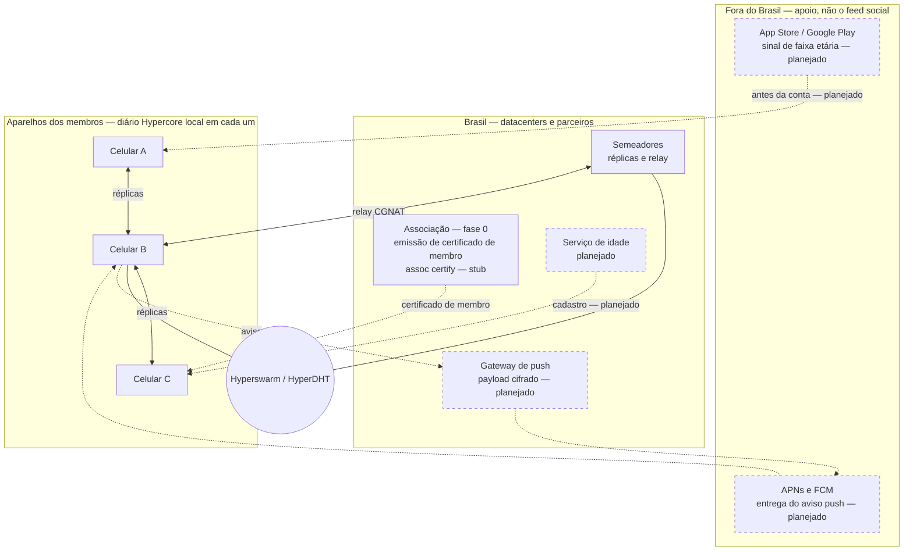
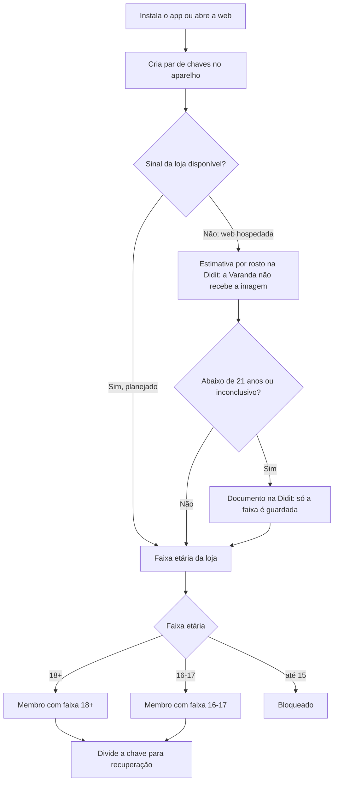
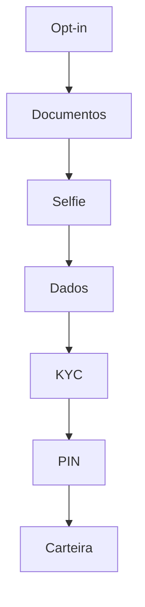
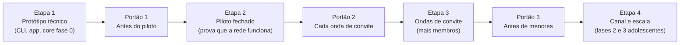

# Varanda — Documento de Design

19 de outubro de 2026 · Rodrigo S Pavezi

> Cópia em Markdown do documento de design (Claude Docs), exportada em 22 de outubro de 2026. Os três diagramas do original foram recriados em Mermaid abaixo.

A Varanda (varanda.app) é uma rede social que roda nos aparelhos dos próprios brasileiros: cada pessoa guarda as suas publicações e as de quem segue, e parceiros no Brasil mantêm semeadores sempre ligados. A idade é verificada antes de a conta existir, pelo sinal de idade das lojas de aplicativos, e o desenho segue a LGPD e o ECA Digital. É um rascunho para discussão; os pontos jurídicos ainda precisam de parecer de advogado.

## Objetivos e restrições

A rede precisa funcionar sem servidor central, nos celulares dos brasileiros, e cumprir a lei brasileira desde o primeiro usuário.

| Requisito | O que significa na prática |
| --- | --- |
| Roda nos aparelhos dos brasileiros | Cada celular guarda e repassa as próprias publicações e as de quem a pessoa segue; os semeadores guardam cópias dos diários públicos admitidos, e nenhum servidor tem os demais dados |
| Funciona com o celular desligado | Semeadores sempre ligados, mantidos por parceiros no Brasil, guardam cópias e ajudam nas conexões |
| Verificação de idade (ECA Digital) | A faixa etária é confirmada antes de a identidade valer na rede; na web hospedada, uma chave local nasce antes só para provar quem é o dono, e o vínculo com a conta e o certificado esperam o resultado da idade; autodeclaração não basta |
| LGPD | Coleta mínima, dados no Brasil sempre que possível, direitos dos titulares atendidos, encarregado nomeado |
| Recuperação de login | Perder o celular não pode significar perder a conta |
| Custo baixo | Nenhuma conta de servidor por usuário; a infraestrutura é doada por parceiros |
| Remoção de conteúdo | Atender notificações (decisão do STF sobre o Art. 19 do Marco Civil) e ordens judiciais |

**Fora do escopo do MVP:** publicidade. Quem tem 16 ou 17 anos entra, por enquanto, com as mesmas regras de quem tem 18 ou mais; o modo restritivo para adolescentes (issue #74) ainda está pendente.

Pagamentos são um recurso opcional da versão web hospedada, feito por um parceiro (Hodle; o BRLA é emitido pela Avenia). Decisão do dono do produto em 2026-10-30. O papel da associação ainda depende de parecer jurídico. O desenho está em Conta de pagamentos (opcional).

## Nomes no app

A rede se chama Varanda, no domínio varanda.app, e cada parte do app leva um nome da conversa brasileira na frente de casa.

| Nome no app | O que é | O que muda no desenho |
| --- | --- | --- |
| A Rua | O feed dos diários que a pessoa segue | Continua com os diários seguidos; a descoberta fica na Espiadinha |
| Cadeiras de Praia (Cadeiras) | Conversas em grupo e salas de áudio ao vivo, como as cadeiras de plástico puxadas para a calçada | Fica fora do piloto: grupo pede um diário com vários autores, e áudio ao vivo pede transmissão em tempo real entre aparelhos |
| Espiadinha | Espiar o que quem você não segue está publicando | No piloto web: uma publicação por diário por rodada, até três rodadas, sem algoritmo de engajamento; cidade e estado ficam para depois |
| Gente da Gente | O selo de membro real e construtivo, no lugar do selo azul corporativo | "Real" já vem do certificado de membro; "construtivo" precisa de critério e de quem concede, e o selo não deve revelar a faixa etária |

Os pontos em aberto de cada nome estão em Perguntas em aberto.

### Espiadinha: regra democrática

A Espiadinha mostra a publicação mais recente de cada diário que você não segue, da mais nova para a mais antiga; depois a segunda e, por fim, a terceira mais recente de cada um, do mesmo jeito: sem curtidas, sem sugestões e sem pesos escondidos.

"Mais recente" é a publicação (publicação, resposta, citação ou republicação ainda valendo; curtidas não aparecem) com maior `seq`, a última escrita. Os seguidos não entram, porque já estão em A Rua; o próprio diário é buscado como qualquer outro, para que o pedido ao semeador não identifique a pessoa, mas as publicações dele nunca aparecem na própria Espiadinha (já estão em A Rua); nas Espiadinhas das outras pessoas ele aparece como qualquer outro. Dentro de cada rodada, vale a data `at` informada pelo autor, com desempate pela chave do diário. A igualdade é por diário certificado, não por pessoa: publicar mais não dá mais lugares na rodada, e cada diário tem no máximo três publicações. A regra está em [packages/core/lib/peek.js](../packages/core/lib/peek.js). A lista exclui os bloqueados e o conjunto efetivo de seguidos, vindo dos registros `follow` do diário mais as operações pendentes; o diário próprio é buscado, mas não aparece. A pesquisa por assunto na Espiadinha ordena só pela data e inclui também os autores seguidos. Não se coleta cidade nem estado.

O navegador calcula a página a partir do inventário já enviado pelo semeador. Uma conexão curta, anônima no sentido de usar uma chave Noise efêmera e não anunciar a identidade, busca os outros diários; o semeador vê o mesmo IP pedindo o complemento dos seguidos, que já conhece pelo inventário da sincronização, e pode correlacionar as conexões. Ele registra uma linha `peer` por conexão; os logs têm rotação por tamanho em [deploy/seeder/compose.yaml](../deploy/seeder/compose.yaml). A leitura não chama a associação nem o serviço de conta. Nenhuma página de descoberta ou nova cópia de conteúdo é guardada em servidor; continuam existindo as réplicas e os logs normais do semeador. No aparelho, os registros dos diários espiados ficam só na memória do navegador: recarregar descarta; no nó, o retrato vence em 5 minutos, com descarte por temporizador mesmo sem outra leitura. As linhas já exibidas podem permanecer na interface até atualizar ou recarregar. Fotos usam a mesma rota `/media` de A Rua, sob demanda, conferidas por SHA-256, com endereços `blob:` mantidos só em memória; as fotos de quem a pessoa não segue são buscadas com `no-store` (`apps/app/src/media/fetch.js`), então não ficam no cache HTTP; só as próprias e as dos seguidos usam o cache longo.

O semeador pode omitir inventário, blocos ou um estado assinado mais novo, mas não forjar nem escolher a publicação dentro do histórico verificado. A janela usa o comprimento assinado que Hypercore verifica com o bloco 0, nunca o anunciado. Cada janela posterior precisa reproduzir o mesmo comprimento e `treeHash`; se mudou, seus blocos são descartados e o diário para de avançar nesse retrato, com a página incompleta. Certificados e registros de @nome são verificados de novo contra os emissores revogados em toda página. Qualquer nó pode refazer a regra com o mesmo inventário, históricos e filtros ([protocol.md](protocol.md), seção 6).

Limites do piloto: 30 itens na primeira página e 31 nas seguintes, custo linear no número de diários, até 64 blocos examinados por diário (registros que não são publicações podem esconder posts antigos). As buscas seguem ordem aleatória por retrato para distribuir o efeito dos cortes. Inventário que não completa em 5 s, corte pelo prazo de 25 s, orçamento de 16 MiB por página ou de 32 MiB de registros retidos deixam a lista incompleta; os núcleos em RAM usam páginas de 64 KiB. Os nomes são a melhor informação nos blocos lidos, podendo faltar ou estar antigos. A data vem do autor (mais de 24 h no futuro é ignorada), e um bloqueio novo só retira linhas já mostradas na próxima carga. Há uma conexão externa curta extra por página que precisa buscar dados, além da sincronização: ela disputa as 32 vagas externas do semeador, e cada membro hospedado já ocupa uma com sua sincronização. Medido em laço local (Apple M4 Pro, Node 24), com os limites de produção (64 no total, 32 externas), 40 membros conectados dão 32 admitidos e 8 recusados; com as vagas externas ocupadas (32 por padrão; o operador ajusta com `VARANDA_MAX_EXTERNAL`), a leitura da Espiadinha ou dos Avisos falha em poucos milissegundos com "Semeador ocupado; tente novamente em instantes." (o semeador fecha o WebSocket com o código 1013), e uma conexão curta segura uma vaga por cerca de 10 a 20 ms (cada ida e volta de rede soma a isso). Reaproveitar a ligação da sincronização para a espiadinha e uma subcota para conexões anônimas foram avaliados e não foram feitos. Os quadros recebidos do semeador também têm teto no navegador (detalhes em [protocol.md](protocol.md), seção 4). A Espiadinha não interrompe essa sincronização; só a consulta inicial da chave própria pode interromper uma vez quando ainda não está no cache. Só uma leitura da Espiadinha roda por vez, e desconectar libera a vaga imediatamente.

## Arquitetura

Os celulares guardam e trocam as publicações, e parceiros e serviços no Brasil dão apoio. Cada celular guarda só o próprio diário e os de quem a pessoa segue; o semeador guarda a cópia de todo diário que admitiu (os diários públicos dos membros). Fora desses diários públicos, nenhum componente tem todos os dados.

**Índice de engajamento do semeador.** Como o semeador já guarda todo diário admitido, ele monta em memória, a cada início, um índice de respostas, citações, curtidas, republicações e das publicações de cada membro, para que a conversa completa e as contagens apareçam mesmo de quem a pessoa não segue. O mesmo índice lista quem curtiu e quem republicou: ele só diz onde procurar e quantos são; cada publicação, nome ou bio mostrado é lido do diário do autor e conferido pelo nó (na versão web, uma leitura sob demanda na memória, sem guardar nada). Os celulares continuam guardando só os diários seguidos. Contagens e completude são afirmações do semeador; o índice tem limite de memória e avisa quando está incompleto. Detalhes em [protocol.md](protocol.md), seções 5 e 7. O semeador guarda também as palavras de cada publicação pública, só para dizer onde procurar na pesquisa por assunto da Espiadinha; o nó confere as palavras no texto que ele mesmo leu e verificou.

**Índice de nomes do semeador.** Para achar uma pessoa por nome ou @nome e seguir, o semeador guarda em memória, alimentado pela mesma varredura do índice de engajamento, só os tokens dobrados do nome (sem acentos, em minúsculas) e o @nome já conferido (assinatura e delegação do emissor); nunca o nome original, a bio, o e-mail nem a conta. A busca aceita de 1 a 4 palavras (mínimo de 2 letras), casa começo de palavras, devolve até 20 pessoas e fica atrás da mesma moderação: bloqueados nunca aparecem, e um @nome de emissor revogado deixa de casar na hora. O app confere o nome e o @nome de cada linha no diário da pessoa antes de mostrá-la. O semeador vê o texto dobrado da busca na rota (sem registrar), e a ordem, as omissões e a completude são afirmações dele. Não há opção de sair nesta versão. Detalhes em [protocol.md](protocol.md), seções 5 e 7.

Legenda: linhas sólidas = réplicas P2P (também entre outros pares) e descoberta na DHT (cada aparelho); linhas tracejadas = apoio (certificado de membro, idade, push). Nós com borda tracejada e etiqueta *(planejado)* são pós-fase-0; na fase 0, o certificado de membro vem de `assoc certify` (operador local, `method: stub`) no nó Associação. O conteúdo social não passa por servidor central: só cópias entre aparelhos e semeadores.

Só dois fluxos saem do Brasil: o sinal de idade das lojas e a entrega de avisos pela Apple e pelo Google.

**Tecnologia proposta: Holepunch**

- **Bare:** roda JavaScript no desktop e no celular, a base do app.
- **Hypercore:** o diário de cada pessoa, um registro assinado em que só se acrescenta.
- **Hyperswarm / HyperDHT:** acha quem tem cada diário e conecta os aparelhos atravessando NAT.
- **Keet**, o app de conversas da Holepunch, já mostra P2P funcionando em celulares. As APIs ainda mudam, então fixamos versões.

## Como funciona

Cada pessoa tem um diário assinado de publicações no próprio celular; quem a segue baixa uma cópia e repassa para outros, como num torrent.

**Cadastro**

1. A pessoa instala o app (iOS ou Android), que cria a identidade dela, um par de chaves, no próprio aparelho.
2. O app pede à loja (Apple ou Google) o sinal de faixa etária. Sem sinal, oferece a estimativa de idade por rosto.
3. O serviço de idade emite um certificado de membro para a chave pública, assinado pela associação. Guarda só a chave, a faixa, o método e a data.
4. A chave é dividida em partes para recuperação (ver Identidade e recuperação de login).

**Publicar**

1. O app assina a publicação e a acrescenta ao diário da pessoa, no aparelho.
2. O app anuncia o diário numa tabela distribuída (DHT) e entrega as novidades a seguidores online e aos semeadores.
3. Fotos e vídeos ficam em arquivos separados, baixados só quando alguém abre. Hoje: só fotos e GIFs, só pela versão web, num núcleo de fotos por aparelho; o semeador as serve por HTTP (vídeo espera a comparação com listas de hashes, em Moderação).

**Quem a pessoa segue é público.** A lista de seguidos fica no próprio diário (registros `follow`), para chegar igual a todos os aparelhos da pessoa. Por isso qualquer um que tenha o diário vê quem ela segue; o app diz isso em Seguindo.

**Curtidas e republicações são públicas.** Curtidas e republicações são registros públicos do diário (`like` e `repost`). Na versão web hospedada, o app lista, para quem pode ver a publicação, as pessoas cujo registro o nó conferiu.

**Quem foi seguido é avisado, em particular.** Quem começa a seguir alguém aparece para essa pessoa na aba Avisos do app, numa linha que abre o perfil de quem seguiu, onde fica o "Seguir". Isso é só dentro do app (versão web hospedada), sem contagem de seguidores e sem lista de seguidores: só quem acabou de seguir e ainda não foi seguido de volta, e a linha some depois que a pessoa segue de volta. O semeador responde apenas à própria pessoa (ela prova que tem a chave do diário) e o app confere cada seguidor no diário assinado dele. Respostas, citações e menções (`@nome` no texto da publicação) também aparecem em Avisos, com as mesmas regras: só dentro do app, na versão web hospedada, sem contagem e sem lista; o app confere cada uma na publicação assinada e no próprio diário. A lista de Avisos não usa push. Os avisos da versão web hospedada, em Notificações, são um caminho à parte (seguir, resposta, curtida e republicação) e não incluem citação nem menção. O aviso cifrado nativo (APNs e FCM) continua um desenho futuro.

**Ler e sincronizar**

1. O app conecta direto aos aparelhos de quem a pessoa segue. Se o CGNAT da operadora impedir, passa por um semeador.
2. Baixa só as novidades dos diários seguidos, de preferência no Wi-Fi, para poupar o plano de dados. Uma conversa ou um perfil de quem a pessoa não segue é lido sob demanda (hoje só na versão web), na memória, pelo índice do semeador (acima), e não fica guardado.
3. Apps e semeadores só aceitam diários com certificado de membro válido.

**Notificações**

1. Na versão web hospedada, a pessoa liga os avisos em Ajustes ("Avisos no aparelho"). Vêm desligados. São quatro eventos: alguém começou a seguir, respondeu, curtiu ou republicou. Cada aviso é uma frase com o nome e a ação. Citação, menção e o crescimento de um diário seguido não geram push. O app nativo, o `varanda-serve` e a CLI ficam na lista de Avisos.
2. O semeador, ao ver um desses registros num diário que serve, manda o candidato em loopback ao serviço de conta. O semeador não vê a inscrição do aparelho.
3. O serviço de conta monta "nome + ação" e cifra de ponta a ponta (RFC 8291). O serviço de push do navegador vê só o texto cifrado e o endereço do aparelho. O texto cifrado tem sempre o mesmo tamanho, mas o momento da entrega é visível para o serviço de push e pode ser cruzado com os registros públicos. O aparelho decifra e mostra. O aviso nativo pela Apple (APNs) e pelo Google (FCM) continua um desenho futuro.

## Identidade e recuperação de login

A chave de cada pessoa é dividida em três partes e quaisquer duas assinam: ninguém sozinho controla a conta, e perder o celular não apaga a identidade.

| Parte | Quem guarda | Para que serve |
| --- | --- | --- |
| 1 | O celular, no chip seguro do aparelho | Uso diário |
| 2 | Um parceiro guardião (provedor regional ou universidade) | Assina junto no dia a dia e ajuda na recuperação |
| 3 | Backup da pessoa, cifrado com passkey (sincronizada pelo iCloud ou Google) | Recuperação, ou assinar sem o guardião se ele sair do ar |

- **Celular perdido:** backup e guardião reconstroem uma nova parte no aparelho novo. A identidade e os seguidores continuam os mesmos.
- **Como o guardião confirma que é você:** passkey, e-mail e o registro da verificação de idade. Nunca só SMS, porque golpes de troca de chip são comuns no Brasil.
- **Técnica:** assinatura por limiar FROST ([RFC 9591](https://www.rfc-editor.org/rfc/rfc9591)), que suporta o tipo de chave (Ed25519) usado pelo Hypercore. O [FROSTR](https://opensats.org/projects/frostr) já aplica a mesma ideia a chaves Nostr.
- **No MVP:** só o backup cifrado por passkey. O guardião entra na fase 2.
- **Continuar conectado na versão web (troca consciente).** Na web, a chave vem da passkey. Antes ela ficava só na memória da página e cada recarga pedia a passkey de novo; agora a página guarda o resultado da passkey cifrado (AES-GCM com uma chave do navegador que não pode ser exportada, preso ao endereço e à identidade) e a pessoa continua conectada até tocar "Sair" ou ficar 30 dias sem abrir o app (aí a passkey é pedida de novo; cada abertura renova o prazo). Ganha-se uso de rede social de verdade (abrir e já estar dentro). Perde-se isto: a chave que cifra a sessão fica no mesmo perfil do navegador que a sessão cifrada, então uma cópia do perfil dá a identidade até "Sair" ou os 30 dias sem uso; um script que rode na origem da página pode usar a sessão guardada e agir como o membro; e quem pega o aparelho desbloqueado publica em nome dele. A cifra impede só que o resultado da passkey fique gravado em claro e que o registro, copiado sozinho, abra em outro endereço ou para outra identidade. Detalhes em `docs/rpc.md` seção 11.
- **Limite:** dois guardiões juntos poderiam assinar. Por isso a pessoa sempre guarda uma parte, e os guardiões são organizações independentes.

## Verificação de idade

A idade é confirmada antes de a identidade valer na rede, e a rede guarda só a faixa etária, nunca documento ou foto.

**Idade mínima: 16 anos.** Decisão do dono do produto (2026-10-29), com base no ECA Digital; é uma regra adotada pela Varanda, não um limite fixado pela lei, e está sujeita a parecer jurídico.

**Web hospedada (Didit).** O nó do navegador cria a chave local antes, só para provar quem é o dono nas rotas de idade; o vínculo com a conta Google e o certificado esperam o resultado. A verificação usa o fluxo hospedado da Didit: estimativa por rosto, com o documento como alternativa configurada no fluxo (workflow) da Didit. Uma estimativa por rosto abaixo de 21 anos nunca libera: pede documento. Só o documento pode recusar (menos de 16). O serviço de conta guarda no `age.json` só a faixa (`16-17` ou `18+`), o método (`didit`) e a data. O certificado v2 continua com `ageBand: 'unchecked'`. Todo membro da web hospedada, inclusive quem já tinha vínculo, fica bloqueado até verificar. O sinal da loja e a credencial do gov.br continuam planejados. O app nativo não muda: segue o certificado dado pelo operador.

Na web hospedada, as saídas 18+ e 16-17 existem e viram membro com a faixa guardada no `age.json`; até 15 anos fica bloqueado. O modo restritivo para 16 e 17 anos (issue #74) e a conta vinculada a um responsável ainda não existem.

| Método | Quando entra | O que a rede recebe | Custo |
| --- | --- | --- | --- |
| Sinal da loja ([Apple](https://9to5mac.com/2026/02/24/apple-expands-age-assurance-tools-as-new-app-store-requirements-roll-out-in-several-regions/) e [Google](https://www.drweb.de/alterspruefung-android-play-age-signals/)) | Padrão, no cadastro e a cada abertura do app | Só a faixa; no Google, 0–12, 13–15, 16–17 ou 18+ | Grátis |
| Estimativa por rosto | Sem sinal da loja, por exemplo quando a pessoa não autoriza compartilhar | Só a faixa; a imagem é apagada na hora | Cobrado por checagem; orçar com fornecedores |
| Documento e selfie | Resultado inconclusivo ou contestação | Só a faixa; o documento não é guardado | O mais caro; orçar |
| Credencial etária do gov.br (planejada) | Quando existir, vira o método preferido, ao lado do sinal da loja | Só se a pessoa está na faixa exigida, sem data de nascimento | A definir pelo governo |

**gov.br para idade, não para login.** O governo está montando uma credencial etária ligada ao gov.br, em que o serviço só fica sabendo se a pessoa está na faixa exigida ([TeleSíntese, 17/06/2026](https://telesintese.com.br/eca-digital-acelera-criacao-de-infraestrutura-nacional-de-credenciais-verificaveis/)). Ainda não há data de lançamento, nem regra clara sobre o uso por plataformas privadas.

Usar o gov.br como login seria diferente: a rede receberia CPF e nome de cada membro, cada publicação ficaria ligada a uma identidade oficial, e o gov.br veria cada entrada na rede. Isso cria um ponto central numa rede feita para não ter nenhum. O ideal é a credencial ser apresentada direto do celular, sem consultar o governo a cada uso.

**Regras que o desenho segue**

- Autodeclaração não basta, e informar só o CPF conta como autodeclaração ([orientação preliminar da ANPD](https://dataprivacy.com.br/escopo-e-afericao-de-idade-entenda-as-propostas-de-guias-da-anpd/)).
- Na estimativa por rosto, resultado perto do limite não libera o acesso: vai para documento e selfie.
- Se o sinal da loja e a avaliação do app divergirem, vale o resultado mais protetor (Decreto nº 12.880/2026).
- Para conteúdo impróprio para menores, a lei pede verificação confiável "a cada acesso" ([Senado](https://www12.senado.leg.br/noticias/materias/2026/03/17/eca-digital-para-protecao-on-line-de-criancas-e-adolescentes-entra-em-vigor)); o app reconsulta o sinal da loja sempre que abre, sem custo.
- A pessoa pode contestar o resultado e usar outro método.

**Fases 2 e 3: adolescentes**

- **16 e 17 anos:** privacidade mais restritiva ligada por padrão, sem contato de adultos não aprovados e sem compartilhar localização.
- **Até 16 anos:** conta vinculada à de um responsável, com ferramentas de supervisão (bloquear contato de adultos não autorizados, limitar uso excessivo, controlar recomendações). O vínculo não dá acesso às mensagens privadas. Se isso inclui quem tem 16 está em Perguntas em aberto.

**Fiscalização:** multas a partir de janeiro de 2027, de até 10% do faturamento no Brasil, limitadas a R$ 50 milhões por infração ([Exame](https://exame.com/tecnologia/examelab/verificacao-de-idade-nas-redes-o-que-o-eca-digital-exige-e-como-funciona-em-cada-app/)).

## Conta de pagamentos (opcional)

Decisão do dono do produto (2026-10-30): a web hospedada pode oferecer uma conta de pagamentos opcional, por um parceiro. O parceiro é a Hodle. O saldo fica em BRLA, uma moeda digital que vale 1 real, emitida pela Avenia, numa carteira em nome da pessoa. A rede é a Polygon, o padrão documentado da Hodle para essa carteira. A Varanda não é banco, o saldo não rende, e quem não abre a conta usa a rede como hoje. O app nativo, o `varanda-serve` e a CLI não oferecem a conta: `wallet.sign` neles responde que a assinatura só existe no navegador.

O papel da associação nas regras do Banco Central ainda depende de parecer. A ida ao ar depende do parecer jurídico. As perguntas estão no fim de Perguntas em aberto.

**O que a pessoa faz.** O opt-in é explícito ("Quero abrir a conta"). "Deixar para depois" não cria nada. O KYC vem antes de qualquer dinheiro se mover. A Hodle e os parceiros dela tratam o nome, o CPF, a data de nascimento, o e-mail, o endereço, a foto do documento e a selfie com prova de vida. A Varanda só encaminha o texto desse cadastro, no pedido daquela tentativa. As fotos nunca passam pelo serviço de conta: o navegador envia o documento direto para `uploads.hodle.com.br`, e a selfie abre uma página da Hodle (`app.hodle.com.br`), fora de um iframe. O app só segue para os dados quando o documento e a selfie estão prontos. A conta de pagamentos pede 18 anos: o app confere a data de nascimento e recusa quem tem menos. Quem tem 16 ou 17 anos continua na rede social. Se um dia essa faixa poderá abrir a conta de pagamentos está em aberto.

**Rede.** O cliente (`apps/cli/lib/account/hodle.js`) aceita `polygon` e `base`. O padrão é `polygon`. `VARANDA_HODLE_NETWORK` só vale antes da primeira carteira: cada criação na Hodle cunha uma carteira nova, presa à rede pedida, e a Varanda guarda a primeira para sempre. Trocar a variável depois não move o saldo. O sandbox da Hodle é a Base Sepolia (ativos de teste BRLH e USDH) e não exercita subcontas: as operações de teste valem para a conta principal da chave. Por isso os testes não falam com o sandbox nem com a API real. Usam um falso em `127.0.0.1` (`apps/cli/test/helpers/fake-hodle.js`), no modelo do falso da Didit.

**PIN.** Cada pessoa escolhe um PIN de 6 dígitos e o digita a cada operação. O app o repassa só naquele pedido, o serviço de conta o repassa só naquele pedido à Hodle, e ninguém o guarda nem o registra. Ele não entra na declaração assinada: `wallet.sign` recusa as chaves `pin`, `walletPin`, `protectedSymmetricKey`, `taxId`, `taxIdNumber` e `cpf`. O app recusa um PIN óbvio: o mesmo dígito seis vezes, ou seis dígitos seguidos subindo ou descendo. Três PINs errados bloqueiam a criação da carteira por 24 horas na Hodle. A chave simétrica que a Hodle devolve (`protectedSymmetricKey`) fica no `wallet.json` e não volta para o navegador. Sem o PIN ela não abre a carteira. Quem junta os dois move o dinheiro, então os dois nunca ficam guardados juntos.

**Bloqueio: PIN da plataforma e PIN da pessoa.** A documentação da Hodle descreve um PIN da plataforma: quem tem a chave de API define um PIN de 6 dígitos na própria Hodle, e uma subconta de referência herda esse PIN. Criar a carteira sem esse PIN da plataforma é erro. A decisão da Varanda é um PIN por pessoa, escolhido no app. Enquanto a Hodle não confirmar por escrito que `POST /api/wallet/create` com `subAccountId` e `walletPin` grava o PIN daquela pessoa, e não exige nem reaproveita o PIN da plataforma, a criação da carteira na API real fica bloqueada. O modo `cadastro` não cria carteira e não depende dessa confirmação. O falso de loopback não prova o que a Hodle faz com o PIN.

**Modos de ativação.** O operador escolhe `VARANDA_HODLE_MODE`, e o serviço anuncia o modo ao app (`policy.mode`). A ordem de ativação é `cadastro` < `carteira` < `pix` < `completo`. O padrão `cadastro` permite só subconta e KYC: após a aprovação, a tela diz que a carteira será liberada em breve. O modo `carteira` acrescenta a criação da carteira com o PIN da própria pessoa e só deve ser configurado depois que a Hodle confirmar por escrito o PIN por pessoa. Nesta versão existem apenas `cadastro` e `carteira`; `pix` e `completo` chegam nos próximos PRs. Pix para o CPF de outra pessoa entra no desenho desde o primeiro dia em que o Pix existir (na Hodle isso é operação de terceiro e precisa estar ligado na chave). Nesta etapa ninguém envia dinheiro. Não há rendimento.

**O que fica guardado.** Um arquivo, `wallet.json`, modo 0600, no volume `account-data` do serviço de conta, no Brasil, ao lado de `age.json` e `terms.json`. Por membro: `subAccountId`, a rede, o estado do KYC (`nenhum`, `documentos`, `pendente`, `aprovado`, `recusado`, `expirado`), o número da tentativa, `attemptId`, `documentId`, `selfieId` e, quando a carteira existe, o `walletId`, o endereço e a chave embrulhada. As marcas `subaccountUncertain` e `walletUncertain` são gravadas antes da chamada que cria, porque uma resposta perdida pode ter criado mesmo assim, e cada criação na Hodle cunha um id novo. Com a marca, a conta fica parada até uma leitura que dê para adotar, ou até o operador limpar a marca. O serviço não cria de novo sozinho. Nenhuma chamada que muda estado é repetida automaticamente. Uma falha que pode ter acontecido volta como resultado incerto (`uncertain`, resultado-incerto).

O `wallet-ops.json`, com as operações e a taxa pendente, é do PR2 e não existe nesta abertura.

**O que nunca fica na Varanda.** O PIN, o CPF, o nome, a data de nascimento, o e-mail, o endereço postal, as fotos, as URLs de envio e de prova de vida, o corpo cru da Hodle e os saldos. Nada disso vai para registro. A subconta, na Hodle, não pode ser apagada.

**Taxa, para quando o envio existir.** O operador define a taxa de cada tipo de operação. O padrão é zero. A conta é em centavos inteiros, e meio centavo arredonda para cima. A taxa da associação vai numa segunda transferência, para a tesouraria, depois que a transferência principal termina. Se essa segunda ficar pendente, ela é mostrada de novo dentro do próximo envio que a pessoa assinar com o PIN. Nada disso se repete sozinho. A taxa sobre o Pix de entrada fica desligada até a Hodle confirmar que um acréscimo pode ser creditado à associação.

**Contrato desta etapa.** Declaração `varanda-wallet-v1`, assinada com a chave do diário, método RPC `wallet.sign` (`docs/rpc.md` 5.35). As operações de abertura são `optin`, `kyc-document`, `kyc-submit`, `status` e `wallet-create`. A declaração leva o hash da operação, nunca o PIN, o CPF nem o valor em claro. Não é bloco do diário nem mensagem do enxame. O app fala só com o serviço de conta, por HTTPS. O serviço de conta é o único que chama a Hodle, nestas rotas: `POST /api/subaccount`, `GET /api/subaccount?name=` (recuperação), `POST /api/kyc/document`, `GET /api/kyc/document/<id>`, `POST /api/kyc`, `GET /api/kyc/<attemptId>`, `GET /api/kyc?subAccountId=` (recuperação), `POST /api/wallet/create`, `POST /api/wallet/keys` e `POST /api/wallet/get` (recuperação e conferência). A chave de API é `VARANDA_HODLE_API_KEY` (`hodle_live_` em produção, `hodle_test_` no sandbox). Sem ela, o recurso fica desligado. Termos de Uso e Política de Privacidade versão 7, com novo aceite. Roteiro em [verification.md](verification.md), seção 47. As operações de dinheiro ficam nas seções 49 e 50.

No modo `cadastro` o fluxo para no KYC. Nesta versão, o PIN e a carteira só aparecem no modo `carteira`, e na API real só depois que a Hodle confirmar por escrito o PIN por pessoa. Uma recusa ou um KYC expirado recomeça nos documentos, numa tentativa nova. Uma criação incerta não volta para o PIN: a pessoa confere, e nada é refeito sozinho.

## LGPD

**Hipóteses de desenho, não parecer.** As tabelas, bases legais e fluxos desta seção expressam o que o produto *pretende* fazer para cumprir a LGPD e o ECA Digital. São hipóteses para engenharia e para discussão com advogados; **não substituem parecer jurídico formal**. Onde o texto pede “parecer jurídico” ou lista itens em Perguntas em aberto, a validação legal ainda não foi fechada.

A proposta é que a associação que publica o app e mantém os serviços compartilhados seja a controladora, e que o desenho reduza ao mínimo o que ela vê. Quem é controlador numa rede P2P é uma dessas hipóteses e ainda precisa de parecer jurídico.

| Dado | Onde fica | Base legal proposta | Retenção |
| --- | --- | --- | --- |
| Publicações e perfil (inclui a foto do perfil, uma imagem 512x512 sem metadados) | Celulares de quem segue e semeadores no Brasil e, só em memória enquanto a aba Espiadinha está aberta, no navegador de quem espia. Nome e @nome podem ser encontrados pela busca do semeador, sem opção de sair por enquanto; o semeador guarda só tokens dobrados em memória | Execução de contrato (Art. 7º, V) | Até a pessoa apagar; na Espiadinha, até recarregar ou atualizar a lista, e no nó até 5 minutos; o índice de nomes some ao reiniciar o semeador |
| Lista de quem a pessoa segue (registros `follow` no diário), curtidas e republicações (registros `like` e `repost`) e fotos das publicações | Os mesmos lugares do diário: é pública para quem tem o diário. O app guarda a lista de quem curtiu ou republicou só na memória, enquanto a tela está aberta | Execução de contrato (Art. 7º, V) | Até a pessoa apagar; a lista na tela, só enquanto ela está aberta |
| Mensagens diretas | Só nos aparelhos dos participantes, cifradas de ponta a ponta | Execução de contrato | Até apagarem |
| Faixa etária do membro | `age.json` do serviço de conta (chave, faixa, método, data), no Brasil | Obrigação legal, ECA Digital (Art. 7º, II), a confirmar em parecer | Enquanto a conta existir |
| Imagem do rosto e documento, só na verificação de idade | Processada pelo parceiro (Didit); a Varanda nunca a recebe; a sessão é apagada no parceiro logo após a decisão (retenção mínima configurada) | Dado sensível: consentimento específico ou obrigação legal (Art. 11), a definir em parecer | Mínima no parceiro; nenhuma na Varanda |
| Vínculo com a conta Google (sub do Google, e-mail, chave do membro, @nome atual e os já usados, datas, certificado) | Serviço de conta, no Brasil | Execução de contrato (Art. 7º, V), para dar o certificado e o @nome; e atender pedidos legais e bloqueios | Em aberto (issue #38) |
| Denúncias de membros (chave de quem denuncia e de quem é denunciado, publicação, motivo, texto de quem denuncia, trecho citado, data, assinatura) e registro de decisões dos moderadores (e-mail do moderador, decisão, data) | Serviço de conta, no Brasil (`moderation.json`) | Moderação e pedido legal (a base legal ainda precisa de parecer) | Em aberto (issue #38); nada é apagado automaticamente |
| Precedentes humanos da triagem (texto verificado, motivo, decisão, hash e vetor quantizado; no máximo 4000) | Serviço de conta, no Brasil (`exemplars.json`, modo 0600, volume `account-data`) | Moderação (a base legal ainda precisa de parecer) | Em aberto (issue #38); uma linha inválida torna o arquivo indisponível e ele nunca é regravado |
| Marcas da triagem e leituras verificadas em cache (no máximo 2000) | Serviço de conta, no Brasil (`triage.json`, modo 0600, volume `account-data`) | Dado derivado da moderação (a base legal ainda precisa de parecer) | Se corrompido, renomeado para `triage.json.corrupt-<ms>` e recriado |
| Contagens agregadas de uso (membros, diários, ativos, conexões, armazenamento, cadastros por semana/mês) | Serviço de conta (usage.json, 0600, volume account-data); ativos só na memória do semeador | Não são dados pessoais: só contagens, sem chave, e-mail ou @nome; a data de cadastro já é pública no certificado (confirmar no parecer) | Até 400 dias, rotativo; ativos zeram ao reiniciar o semeador |
| Registro de aceite dos Termos de Uso e da Política de Privacidade (versão e data; no serviço de conta também chave do membro, nonce e assinatura) | Aparelho; serviço de conta, no Brasil (`terms.json`, modo 0600, volume `account-data`), só para membros com vínculo Google | Execução de contrato (a confirmar em parecer) | Em aberto (issue #38) |
| Convites de entrada (`invites.json`: chave de quem criou o convite, identificador aleatório, hash do código só enquanto não usado, data de criação, usado sim ou não; nada de quem recebeu nem de quem usou) | Serviço de conta, no Brasil (`invites.json`, modo 0600, volume `account-data`), só quando `VARANDA_INVITES_PER_WEEK` está definido | Execução de contrato (a confirmar em parecer); finalidade: entrada por convite | A semana atual e os convites ainda dentro dos 7 dias de validade (até 14 dias no total); o resto é apagado na próxima criação de convite |
| E-mail de recuperação | Guardião, no Brasil | Execução de contrato | Enquanto a conta existir |
| Inscrição de Web Push (endereço do aparelho, `endpoint`, e as chaves `p256dh` e `auth`) | Serviço de conta no Brasil (`push.json`, modo 0600, volume `account-data`). O texto cifrado atravessa o serviço de push do fabricante, que pode estar fora do Brasil | Consentimento (a confirmar no parecer) | Até a pessoa desligar ou o serviço responder 404 ou 410 |
| Identificadores da conta de pagamentos | Serviço de conta, no Brasil (`wallet.json`, modo 0600, volume `account-data`): `subAccountId`, `walletId`, endereço da carteira, chave embrulhada (`protectedSymmetricKey`, inútil sem o PIN), estado do KYC, `attemptId`, `documentId` e `selfieId`. O `wallet-ops.json` das operações é do PR2 e ainda não existe | Execução de contrato (Art. 7º, V), a confirmar em parecer | Enquanto a conta existir (issue #38). A subconta não pode ser apagada na Hodle |
| Dados de KYC | Tratados pela Hodle e pelos parceiros dela. O texto (nome, CPF, nascimento, e-mail, endereço) passa só em trânsito pelo serviço de conta. As fotos nunca: o documento sai do navegador direto para a Hodle e a selfie abre a página da Hodle. A Varanda não guarda nem registra esses dados | Dado pessoal e, na foto, dado sensível (Art. 7º e Art. 11), a confirmar em parecer | Nenhuma na Varanda |
| PIN da carteira | Digitado a cada operação e repassado só naquele pedido, do app ao serviço de conta e do serviço à Hodle. Nunca guardado e nunca registrado, nem no `wallet.json` nem na declaração assinada | O trânsito acompanha a execução do contrato, a confirmar em parecer. Não há retenção | Nenhuma |
| Registros de acesso (IP, data, hora) | Semeadores e serviços | Obrigação legal, se o Art. 15 do Marco Civil se aplicar | 6 meses, se aplicável |

**Vínculo com a conta Google (hipóteses de desenho).**

- O serviço de conta guarda, por membro, o identificador (`sub`) e o e-mail da conta Google, a chave do diário, o @nome atual e os que o membro já usou (o diretório guarda os nomes passados por membro, para nunca dar um nome usado a outra pessoa), as datas e o certificado. Esses dados ficam em três arquivos no volume do serviço, um retrato (`directory.json`), um diário de mudanças (`directory.journal.<id>`, nomeado pelo identificador que o retrato guarda) e uma marca d'água (`directory.hwm`, o maior `seq` confirmado e o número de vínculos e de @nomes naquele ponto, nunca reduzida), ver `docs/protocol.md`, "Files and replicas". O retrato guarda o identificador do seu diário: se o diário sumir ou não for o dele, o serviço recusa o diretório em vez de esquecer vínculos; se o diário ou o retrato mudarem por fora enquanto o serviço roda, se o lock se perder ou se o disco falhar ao confirmar uma linha, o serviço para de gravar. Compactar cria um diário novo e apaga o anterior; um diário nunca é truncado nem reescrito, e toda abertura do serviço compacta, para que um serviço que perdeu o lock sem perceber nunca compartilhe os arquivos com o novo. Nunca se gira nem se apaga um `directory.journal.*`, e o backup leva os três arquivos com o serviço parado. Restaurar um backup é um evento de segurança: só a cópia mais recente, os três arquivos juntos; um par restaurado abaixo da marca d'água é recusado (`diretório de contas restaurado de uma cópia antiga`; um retrato sem `seq`, de uma versão anterior, é comparado pelas contagens), e quem restaura uma cópia antiga de propósito reconhece isso apagando o `directory.hwm` (ver o README). A regra dos nomes não muda: um nome usado nunca vai para outra pessoa. A finalidade é só o contrato (dar certificado e @nome) e poder atender pedido judicial ou bloquear a conta. O e-mail nunca entra no diário, no certificado nem no navegador.
- A retenção está em aberto (issue #38): enquanto a conta existir é só uma proposta. A exclusão e a portabilidade (Art. 18) desses dados dependem do serviço de conta, não do diário; o `account export` é o ponto de partida.
- O @nome troca no máximo uma vez a cada 7 dias, e um nome já usado por um membro nunca é dado a outro. Um nó antigo ou um seguidor que ainda não sincronizou pode mostrar por um tempo o nome anterior.
- Com o teto de membros (`VARANDA_MAX_MEMBERS`), um vínculo recusado com "lista de espera" não é guardado: não fica linha pendente, nem `sub`, e-mail ou @nome escolhido, nem certificado ou registro de nome; a linha que a conclusão recusa é apagada. Quem já é membro não muda. Essa regra não altera as conclusões jurídicas desta seção: a base legal, a retenção (issue #38) e os papéis seguem como estão.
- Com o convite de entrada (`VARANDA_INVITES_PER_WEEK`), um convite recusado não guarda nada sobre a pessoa convidada e o Google não é chamado: a volta do Google é recusada antes de o código ser trocado, e a linha pendente é apagada. O código do convite não vai para o Google. O `invites.json` guarda a chave de quem convidou, mas nunca dado de quem recebeu o link. O registro de vínculo de quem entrou por convite guarda o hash do convite usado (dado novo no diretório). Quem convidou quem pode ser reconstruído a partir de uma cópia de `invites.json` anterior ao uso e, de forma aproximada, pelas datas. Essa regra também não altera as conclusões jurídicas desta seção: a base legal, a retenção (issue #38) e os papéis seguem como estão.
- O certificado v2 não afirma idade (`ageBand: 'unchecked'`): o vínculo com a conta Google não é verificação de idade. A faixa verificada fica no serviço de conta (`age.json`), não no certificado.
- Dois segredos, dois lugares: o segredo da associação (que certifica o emissor) fica na máquina do operador; o segredo do emissor (que assina certificados v2 e registros de @nome) fica só no serviço de conta.

**Denúncias e painel de moderação (hipóteses de desenho).**

- O serviço de conta guarda cada denúncia com a chave de quem denuncia, a chave denunciada, o número da publicação (quando há), o motivo, o texto opcional de quem denuncia, o trecho da publicação como o denunciante o enviou, a data e a assinatura. A finalidade é só moderar e atender pedido legal. Nada é apagado automaticamente, e a retenção está em aberto (issue #38).
- Os e-mails dos moderadores ficam no `.env` do servidor (`VARANDA_MODERATOR_EMAILS`) e, ao lado de cada decisão, no registro de decisões. O e-mail do vínculo Google de quem denuncia e de quem é denunciado não aparece no painel nem em registro: só sai por `account reports`, na máquina de operação do servidor, para atender um pedido legal.
- A pessoa denunciada não tem tela nem rota que mostre uma denúncia contra ela.
- Quem vê as estatísticas de uso (`VARANDA_STATS_EMAILS`) é um subconjunto dos moderadores. A aba nunca mostra contagem de denúncias.

**Direitos dos titulares (Art. 18) numa rede P2P**

- **Acesso e portabilidade:** o diário já está no celular da pessoa; o app exporta tudo num arquivo.
- **Correção:** a pessoa publica uma versão corrigida, que substitui a anterior nos apps.
- **Eliminação:** o app publica um pedido de exclusão assinado. Apps e semeadores da rede apagam suas cópias; cópias em apps modificados não podem ser garantidas, e a política de privacidade diz isso claramente.
- **Excluir a conta:** um certificado de membro não tem revogação própria; a conta é excluída bloqueando a chave na lista de bloqueio, e a partir daí os semeadores e apps atualizados apagam e recusam o diário.

**Onde os dados ficam**

- Semeadores, guardiões e o serviço de conta (onde ficam a inscrição de Web Push, `push.json`, a faixa etária, `age.json`, e os identificadores da conta de pagamentos, `wallet.json`) ficam em datacenters no Brasil. O serviço de push do navegador, o parceiro de verificação de idade (Didit) e o parceiro da conta de pagamentos (Hodle) podem estar fora.
- Saem do Brasil: o texto cifrado do aviso (de tamanho fixo, mas com o momento da entrega visível e cruzável com os registros públicos) e o endereço do aparelho, pelo serviço de push do navegador (Google, Mozilla, Apple ou Microsoft), a selfie e o documento da verificação de idade, tratados pela Didit, os dados e as fotos do KYC da conta de pagamentos, tratados pela Hodle e pelos parceiros dela (as fotos saem do navegador direto para a Hodle; a Varanda não as guarda), e cópias em celulares de membros que estejam no exterior. A LGPD permite transferência internacional com os mecanismos da Resolução CD/ANPD nº 19/2024. Qual mecanismo vale para essa transferência ainda será confirmado por parecer jurídico, como a Política de Privacidade diz (`apps/app/src/legal.js`). A política de privacidade informa a transferência.

**Antes do lançamento**

- [ ] Nomear o encarregado (Art. 41) e publicar o canal de contato
- [ ] Fazer o relatório de impacto (RIPD, Art. 38): há dado biométrico, menores e grande escala
- [ ] Política de privacidade em português simples (versão 4 no app, sujeita a revisão jurídica: `apps/app/src/legal.js`)
- [ ] Plano de resposta a incidentes, com aviso à ANPD e aos titulares (Art. 48)

## Moderação e obrigações legais

Numa rede P2P não dá para apagar uma cópia de todos os aparelhos, então a moderação funciona por uma lista assinada que os nós honestos obedecem. A lista existe desde a PR B2 (`docs/protocol.md` seção 3), e as denúncias de dentro do app e o painel da equipe, desde a PR B3 (`docs/verification.md` seção 14).

1. **Denúncia:** uma pessoa com a conta Google vinculada denuncia uma publicação ou uma conta pelo app oficial hospedado na web, e a denúncia é assinada com a chave do membro. O serviço de conta guarda a chave de quem denuncia, a chave denunciada, o número da publicação quando há, o motivo, o texto opcional, o trecho citado como o denunciante o enviou, a data e a assinatura. Quem é denunciado não tem tela nem rota que mostre isso. O trecho citado continua sendo o que quem denunciou enviou, e não é conferido. Com a triagem ligada (`VARANDA_AI`), o serviço de conta lê o bloco 0 e o bloco denunciado no semeador, pela rota local com token, reconfere os dois e mostra o texto verificado aos moderadores.
2. **Decisão:** os moderadores (e-mails em `VARANDA_MODERATOR_EMAILS`) entram com o Google no painel do serviço de conta e marcam cada denúncia como bloquear ou descartar, e desbloqueiam quem já foi bloqueado. O painel só admite moderador cuja conta Google esteja vinculada a um diário, e ninguém vê nem decide denúncias contra o próprio diário ou feitas por ele. O painel não assina nada: descartar vale na hora e não muda lista nenhuma, e bloquear ou desbloquear ficam pendentes até o operador rodar `mod apply` na própria máquina, que busca as decisões, mostra o que vai mudar e pede confirmação num terminal (desbloqueios de chaves bloqueadas fora do painel pedem uma segunda), assina uma lista nova com a chave da moderação (certificada pela associação) e a publica no semeador. Sem terminal, só `mod apply --yes` roda, e aplica no máximo 100 bloqueios por vez: desbloqueios esperam a revisão do operador e nunca saem sozinhos. Um login de moderador roubado (ou um servidor de conta comprometido) pode enfileirar decisões, mas não publicar um desbloqueio sem essa revisão. A chave secreta da moderação nunca vai para o servidor. Um bloqueio vale para a chave inteira: a lista não tem entrada por publicação.
3. **Triagem automática:** quando chega uma denúncia de publicação, a IA lê a publicação verdadeira no semeador, compara por similaridade semântica com casos que moderadores humanos já decidiram, e decide sozinha só quando tem certeza; senão a denúncia fica aberta para uma pessoa. Roda no serviço de conta, não no aparelho: um veredito calculado no aparelho poderia ser forjado por um app modificado. O modelo é `Xenova/paraphrase-multilingual-MiniLM-L12-v2` (exportação ONNX do sentence-transformers `paraphrase-multilingual-MiniLM-L12-v2`: cerca de 118 milhões de parâmetros, vetores de 384 dimensões, inclui português, até 128 wordpieces), versão quantizada q8, revisão fixa `2c4055b12046f11709e9df2c122e59ffbdc2f900`, num processo filho do serviço de conta, com `@huggingface/transformers` 3.8.1 e o binário de CPU nativo do `onnxruntime-node` 1.21.0. O filho nasce com o ambiente vazio (sem a chave do emissor de certificados, sem o segredo do Google, sem nenhuma `VARANDA_*`), com a saída descartada e conversa com o serviço só por IPC; o código nativo de ML nunca é carregado no processo que guarda os segredos. Prazos: 60 s para carregar, 10 s por texto; um filho travado ou que cai é morto e recriado, no máximo uma vez a cada 5 s. É isolamento de falhas e de segredos, não uma caixa de areia do sistema (mesmo usuário; o filho lê os arquivos do modelo). Os pesos ficam no volume `account-data` (no contêiner, `/data/ai-model`), baixados uma vez pelo operador com `node apps/cli/scripts/fetch-ai-model.js --dir <diretório fora do repositório>`, que confere o sha256 dos cinco arquivos. Em execução nada é baixado (download remoto e cache em disco desligados) e nenhum texto sai para API externa. Texto com mais de 128 wordpieces não é cortado: a IA não decide. O CI, o fluxo de deploy e `deploy/seeder/build-web.sh` instalam com `npm ci --ignore-scripts`, como a imagem Docker: nenhum script de instalação de dependência roda (os binários nativos usados já vêm nos pacotes). Uma checagem com o modelo real mostrou cosseno 0,86 entre duas paráfrases em português e 0,09 contra uma frase sem relação: com os limiares abaixo, a IA age sobretudo em textos quase idênticos (ondas de spam copiadas), não em paráfrases. `VARANDA_AI` vazio ou ausente desliga (padrão); `sombra` só registra o que a IA faria e mostra como sugestão no painel; `1` deixa a IA decidir. A recomendação é começar em `sombra` e passar a `1` quando as sugestões coincidirem com as decisões dos moderadores. Sem o modelo (`sem-modelo`) o serviço sobe sem triagem e a checagem de saúde continua verde; um valor inválido de `VARANDA_AI` é erro de uso antes de abrir a porta.

   A leitura é `GET /moderation-post/<diário de 64 hex>/<seq>` no mesmo ouvinte HTTP do semeador (127.0.0.1, `VARANDA_WS_PORT` 8789), só quando o semeador recebe `VARANDA_TRIAGE_TOKEN` (64 hex minúsculos, o mesmo valor no semeador e no serviço de conta). Sem o token a rota não existe (404 genérico). O Caddy não a encaminha (só `/seeder`, `/account/*`, `/media/*` e `/index/*`). `Seeder#postBlock` lê só blocos locais (`wait: false`), nunca baixa, não admite nem abre outro Corestore, e reconfere após cada espera que o diário continua admitido, servido, conferido, não derrubado, não bloqueado e que a geração de moderação não mudou. Fronteira de confiança: os blocos são os bytes que o próprio Hypercore do semeador conferiu ao recebê-los; o JSON pela rota local não é uma prova portátil, então a autenticidade depende do semeador local mais a rota com token. O serviço de conta reconfere o certificado do bloco 0 (incluindo emissores revogados pela lista), que o bloco pedido é uma publicação e que o texto é UTF-16 bem formado. Essa reconferência protege contra resposta malformada, de tipo errado, de fork errado, com certificado ruim ou emissor revogado. Não protege contra um semeador malicioso.

   A regra (constantes iniciais, não uma precisão medida) só olha denúncias de publicação e compara o texto verificado, nunca o trecho citado nem o comentário de quem denuncia: os dois são texto de quem denuncia. Precedentes são só decisões humanas com o mesmo motivo, de outros diários, um voto por diário; precedentes com fotos não contam. Na partida a frio fazem falta pelo menos 20 precedentes de cada lado (bloquear e descartar) no motivo. Bloquear exige pelo menos 5 precedentes de bloqueio de 5 diários distintos com cosseno ≥ 0,92, nenhum precedente de descarte com cosseno ≥ 0,92, e o melhor descarte pelo menos 0,12 abaixo do melhor bloqueio; só para o motivo `spam`. Descartar segue a mesma conta com cosseno ≥ 0,90, só para `spam` e `outro`. Texto idêntico (mesmo hash) a um caso já decidido: descartar basta com um outro diário; bloquear continua exigindo 5 diários distintos. Tetos por dia UTC: 20 bloqueios e 50 descartes automáticos. A semelhança mostrada é um cosseno, nunca uma porcentagem nem uma probabilidade. A IA deixa a denúncia `aberta`, com o motivo no painel, em `ilegal`, `assedio`, denúncia de conta, publicação com fotos ou que cita outra, texto curto (menos de 8 caracteres) ou acima de 128 wordpieces, publicação que a IA já decidiu (uma segunda denúncia é um recurso e vai para uma pessoa), alvo já bloqueado, com qualquer mudança pendente ou cujo bloqueio uma pessoa já cancelou ou desfez, tetos diários, precedentes insuficientes, divergentes ou sem margem, e qualquer falha de leitura, token, modelo ou arquivo. A IA nunca desbloqueia, cancela, revoga, assina nem roda `mod apply`. Um bloquear da IA é uma mudança pendente como a de um moderador, mas o `mod apply --yes` (o agendamento) nunca o assina: ele aparece como `bloquear <hex> (ia) — aguarda revisão no terminal` e só sai quando o operador roda `mod apply` num terminal e confirma, como os desbloqueios. O motivo: os precedentes podem ser envenenados (contas falsas copiam uma publicação inocente de alguém, parecem spam e são bloqueadas por moderadores, que decidem pela conta inteira), e um bloqueio que ninguém leu não deve ir para a lista sozinho. Bloqueios pedidos por pessoas continuam saindo pelo `--yes` (no máximo 100 por vez; desbloqueios nunca saem sozinhos). Um bloqueio continua valendo para a chave inteira. A chave secreta da moderação nunca vai para o servidor. Só uma decisão humana vira precedente, e só quando o texto verificado já estava guardado antes da decisão (o moderador podia vê-lo no painel). Publicação com fotos, citação, texto curto ou cortado não entra. Decisão da IA não ensina. Cancelar um bloqueio em Pendentes retira os precedentes correspondentes. Um desbloqueio pendente só suspende os precedentes de bloqueio daquela conta (a IA não os usa enquanto ele espera o `mod apply`, e eles voltam se o desbloqueio for cancelado); quando o desbloqueio é aplicado, eles saem. Na partida e a cada 10 minutos o serviço reconcilia: aprende decisões humanas cujo gancho não rodou, retira precedentes de bloqueios que não valem mais e descarta leituras de denúncias que sumiram ou já decididas que não podem ensinar (assim o texto de uma denúncia `ilegal` não fica guardado depois da decisão). A varredura das denúncias abertas é justa (cursor circular); falha de leitura espera 5 min, depois 1 h, 6 h e 24 h. No painel (`/account/mod/`), cada denúncia aberta mostra a sugestão ("Sugestão da IA: bloquear (semelhança 0,93)", com "modo de observação" em `sombra`) ou o motivo de não sugerir. O bloco "Publicação lida no semeador" mostra o texto verificado e avisa quando há fotos ou citação. O rótulo do trecho citado é "Texto enviado por quem denunciou, não conferido." O Histórico mostra "· pela IA" ou "· por uma pessoa". Pendentes mostra "pedido pela IA"; o botão de cancelar que já existe desfaz um bloqueio da IA antes do `mod apply`. Nenhum e-mail, vetor ou pontuação crua aparece. `mod apply` recebe `actor` (`ia` ou `pessoa`) em cada mudança e mostra `bloquear <hex> (ia)` quando todos os bloqueios pedidos para aquele membro são da IA (com `--yes`, esses ficam retidos). A resposta do pull é exatamente `{ changes: [{ id, op, member, at, actor }], published: { snapshot } }`; um `mod apply` de versão anterior recusa esse formato, então o programa do operador acompanha o servidor. `account status` mostra `Triagem IA: desligada`, `Triagem IA: <n> precedentes` ou `Triagem IA: indisponível (exemplars.json inválido)`. Os precedentes ficam em `exemplars.json` (no máximo 4000; uma linha inválida torna o arquivo indisponível e ele nunca é regravado) e o cache em `triage.json` (leituras verificadas, no máximo 2000; corrompido, é renomeado para `triage.json.corrupt-<ms>` e recriado), os dois no volume, modo 0600. Os registros levam só tokens: nunca texto, trecho, chave, token ou e-mail. `moderation.json` não muda de formato; uma decisão da IA tem `decidedBy: 'ia'`. Limites conhecidos, por extenso em `docs/verification.md` seção 27: a autenticidade do texto depende do semeador local; leituras além de 2000 perdem o texto em cache; o registro de eventos tem teto de 10000, então um desbloqueio pelo painel de uma chave bloqueada fora do painel pode ser esquecido depois que o evento sai do registro; um cancelamento de desbloqueio também conta como uma pessoa já ter mexido na conta, e a IA só se abstém; os limiares são iniciais e devem ser revistos com o Histórico; a IA não vê imagens (a comparação com listas de hashes de mídia ilegal, issue #79, continua não existindo).

4. **Efeito:** a lista bloqueia o diário por chave pública (não por publicação). Semeadores, membros da CLI e a versão web trocam a lista entre si no canal `varanda/blocklist/1`, guardam a mais nova que confere, apagam o que tinham desse diário e se recusam a buscá-lo, guardá-lo, anunciá-lo ou servi-lo de novo. Os semeadores também recusam a admissão de uma chave bloqueada.

**O que a lista garante e o que não garante**

- Um nó atualizado e honesto purga e recusa o diário bloqueado. Por isso um app modificado não consegue empurrar um diário bloqueado por meio dele.
- Um app modificado ainda pode falar direto com o autor bloqueado, e dois apps modificados podem trocar o diário entre si. A lista não alcança aparelhos que não a obedecem, e os nós de antes desta versão também não a aplicam.
- O app oficial da própria pessoa bloqueada mantém o diário no armazenamento dela e pode servi-lo a quem já conhece a chave de descoberta dele (o armazenamento do nó serve qualquer diário que guarda a quem o pede; `docs/protocol.md` seção 4, quarentena). Bloquear não apaga o diário do aparelho do autor.
- A versão web instalada (PWA) aplica sem rede a lista que tem guardada e só recebe uma lista mais nova pelo semeador. Os membros da CLI e os semeadores trocam a lista também pela DHT, sem depender de um semeador.
- A lista traz só chaves públicas, um número de sequência e datas: nunca o motivo da decisão, o nome, o e-mail ou a conta Google.
- Isto não é revogação de certificado de membro: o certificado individual continua válido, e o que sai é o diário, pelo bloqueio da chave. A revogação existe só para a chave de emissor do serviço de conta (`mod revoke-issuer`): se ela vazar, os certificados v2 e os @nomes que ela assinou deixam de valer em todos os nós atualizados.

- **Mídia ilegal:** antes de exibir ou repassar, o app compara fotos e vídeos com listas de hashes de material ilegal conhecido, obtidas com organizações especializadas (a definir). Abuso sexual infantil é denunciado à SaferNet Brasil e à Polícia Federal. **Isso ainda não existe.** A versão atual publica fotos e GIFs sem nenhuma comparação com listas de hashes; por esse motivo ela aceita só imagens e nenhum vídeo. Até a comparação existir, o que segura mídia ilegal é a denúncia e o bloqueio da conta: um diário bloqueado tem as fotos apagadas do semeador junto com ele, e o semeador deixa de servi-las. A IA da triagem não vê imagens.
- **Prazos:** desde a decisão do STF sobre o Art. 19 (junho de 2025), a plataforma responde por crimes e atos ilícitos que não remover após notificação, sem precisar de ordem judicial (lógica do Art. 21). Para crimes contra a honra vale o Art. 19: a responsabilidade depende de ordem judicial. Anúncios pagos e circulação em massa de crimes graves exigem cuidado ainda maior. A associação publica seus prazos de resposta. A triagem automática só encurta o tempo de resposta: a responsabilidade continua das pessoas, e `ilegal` sempre vai para uma pessoa.
- **Ordens judiciais:** cumpridas pela mesma lista. Mensagens cifradas e conteúdo que só existe nos aparelhos a associação não tem como entregar, e a política de privacidade diz isso.
- **Proteção de quem hospeda:** além do diário próprio, o aparelho mantém como réplicas persistentes só diários de quem a pessoa segue, e semeadores são organizações, não pessoas físicas. A Espiadinha lê outros diários pelo semeador sem gravá-los: ficam só em memória e somem ao recarregar. Conteúdo de quem a pessoa não segue, portanto, passa pela RAM do navegador. A limitação das cópias persistentes reduz o risco de guardar sem saber material ilegal, mas não elimina essa exposição durante a leitura; a avaliação jurídica continua necessária.
- **Limite:** um app modificado pode ignorar as listas. A associação responde pelos apps e serviços que publica; o alcance dessa responsabilidade precisa de parecer jurídico.

## Riscos e limitações

O maior risco é escala: nenhuma rede social P2P chegou a milhões de usuários até hoje, então o piloto existe para provar que funciona antes do convite ao canal.

| Risco | Impacto | Plano B |
| --- | --- | --- |
| P2P não aguenta a escala | A Rua lenta ou incompleta | Mais semeadores por região; se não bastar, migrar para Nostr com relays brasileiros |
| iPhone limita o segundo plano | Avisos atrasados, sincronização só com o app aberto | Avisos cifrados pelo push; sincronizar ao abrir o app |
| Plano de dados caro | Pessoas desistem | Sincronizar só no Wi-Fi por padrão; mídia sob demanda |
| App modificado ignora regras | Contorna moderação e proteção de adolescentes | Semeadores recusam diários sem certificado; parecer jurídico sobre responsabilidade |
| Parceiros não aparecem | Conteúdo some quando os celulares desligam | Começar com 1–2 semeadores da associação no plano gratuito da Oracle em São Paulo |
| Equipe de moderação pequena | Prazos legais estourados | Ondas de convite só quando houver moderação para elas |
| Holepunch muda as APIs | Retrabalho | Fixar versões e acompanhar a documentação oficial |
| Busca e assuntos do momento são difíceis sem servidor | Descoberta pobre | O inventário do `hello` do semeador já é um índice de diários; a Espiadinha usa esse índice e ordena no navegador, sem classificação no servidor. A busca de contas por nome e @nome existe pelo índice de nomes do semeador (começo de palavras, até 20 resultados, só na web hospedada), e a pesquisa por assunto da Espiadinha usa o índice de assuntos do semeador (issue #81: palavras inteiras, em ordem de data e sem classificação); "assuntos do momento" continua em aberto, porque qualquer ordem por popularidade é um peso escondido |
| Erro da triagem automática | Um bloqueio errado vale para a conta inteira | Regra estreita, modo `sombra`, tetos diários e o `mod apply` do operador |

## Fases

Ninguém do canal entra antes de o piloto provar que a rede funciona, e cada onda de convites só abre quando há semeadores e moderação para ela.

**Critérios dos portões** (do texto desta seção, de Moderação, de Riscos e de Perguntas em aberto):

| Portão | Quando | Critérios |
| --- | --- | --- |
| **1** | Antes do piloto fechado | A rede P2P e os semeadores funcionam de ponta a ponta (o piloto existe para provar isso antes do canal). As seis primeiras perguntas em aberto têm resposta de advogado. Checklist “Antes do lançamento” em LGPD (encarregado, RIPD, política, plano de incidentes). |
| **2** | Antes de cada onda de convite | Semeadores no Brasil com capacidade para a onda (parceiros ou fallback da associação; ver tabela de Riscos). Equipe de moderação suficiente para os prazos legais (“ondas de convite só quando houver moderação para elas”). |
| **3** | Antes de abrir contas de menores (fases 2 e 3) | Verificação de idade e produto para 16–17 e até 15 anos (privacidade restritiva, vínculo com responsável, supervisão), alinhados ao ECA Digital — fora do MVP, que só admite 18+. |

As fases ainda não têm datas: dependem de quem vai desenvolver e de quantos parceiros entrarem.

## Perguntas em aberto

As seis primeiras precisam de advogado antes do piloto; as demais, da comunidade. As perguntas da conta de pagamentos, no fim da lista, também precisam de advogado antes de o recurso ir ao ar. Elas não substituem as seis primeiras.

- [ ] Quem é o controlador LGPD numa rede P2P: a associação, cada parceiro semeador ou ambos?
- [ ] O Art. 15 do Marco Civil (guardar registros de acesso por 6 meses) se aplica a uma associação sem fins lucrativos?
- [ ] Sinal de idade das lojas mais estimativa por rosto atende à ANPD? A consulta pública do guia de aferição de idade da ANPD foi até 09/07/2026; conferir se a versão final já saiu.
- [ ] A imagem do rosto entra por consentimento específico ou por obrigação legal?
- [ ] Contas "de até 16 anos" precisam de vínculo com responsável: isso inclui quem tem 16?
- [ ] A associação responde por apps modificados que ignoram a moderação?
- [ ] Quais provedores regionais e universidades topam ser semeadores e guardiões?
- [ ] Quem financia o núcleo pago de moderação?
- [ ] Qual resultado do piloto nos faria trocar Holepunch por Nostr?
- [ ] Quando a credencial etária do gov.br fica pronta, e plataformas privadas vão poder usá-la?
- [x] Nome da rede: Varanda, no domínio varanda.app.
- [ ] Registrar varanda.app, se ainda não estiver registrado, e verificar a marca Varanda no INPI.
- [x] A Rua mantém os seguidos; a Espiadinha mostra uma publicação de cada diário não seguido por rodada, até três rodadas, da mais nova para a mais antiga dentro de cada rodada.
- [ ] Gente da Gente: qual o critério de "construtivo", quem concede o selo e como ele é retirado?
- [ ] Em que fase entra Cadeiras de Praia? (a Espiadinha entrou no piloto, só na versão web)
- [ ] Qual é o papel da associação nas regras do Banco Central para a conta de pagamentos opcional (parceiro Hodle, BRLA emitido pela Avenia)?
- [ ] Quem é o controlador e quem é o operador entre a associação e a Hodle?
- [ ] O Pix para o CPF de outra pessoa, previsto desde o primeiro dia em que o Pix existir, cabe no desenho?
- [ ] Quem tem 16 ou 17 anos pode abrir a conta de pagamentos? Nesta etapa o app só aceita 18 anos ou mais.
- [ ] A subconta na Hodle não pode ser apagada. Como cumprir a eliminação pedida pelo titular?
- [ ] A receita das taxas cabe no estatuto da associação sem fins lucrativos?

## Fontes

- [Senado Notícias – ECA Digital entra em vigor](https://www12.senado.leg.br/noticias/materias/2026/03/17/eca-digital-para-protecao-on-line-de-criancas-e-adolescentes-entra-em-vigor)
- [Exame – o que o ECA Digital exige na verificação de idade](https://exame.com/tecnologia/examelab/verificacao-de-idade-nas-redes-o-que-o-eca-digital-exige-e-como-funciona-em-cada-app/)
- [Data Privacy Brasil – propostas de guias da ANPD sobre aferição de idade](https://dataprivacy.com.br/escopo-e-afericao-de-idade-entenda-as-propostas-de-guias-da-anpd/)
- [9to5Mac – ferramentas de idade da Apple no Brasil](https://9to5mac.com/2026/02/24/apple-expands-age-assurance-tools-as-new-app-store-requirements-roll-out-in-several-regions/)
- [Dr. Web – Google Play Age Signals](https://www.drweb.de/alterspruefung-android-play-age-signals/)
- [Teletime – decisão do STF sobre o Art. 19](https://teletime.com.br/26/06/2025/art-19-stf-concilia-votos-e-plataformas-terao-responsabilizacao-parcial/)
- [Demarest – Resolução CD/ANPD nº 19/2024](https://www.demarest.com.br/anpd-aprova-o-regulamento-de-transferencia-internacional-de-dados/)
- [RFC 9591 – FROST](https://www.rfc-editor.org/rfc/rfc9591)
- [OpenSats – FROSTR](https://opensats.org/projects/frostr)
- [Holepunch – Bare](https://pears.com/news/introducing-bare-actually-run-javascript-everywhere/)
- [Apple Developer Forums – conexões em segundo plano no iOS](https://developer.apple.com/forums/thread/91625)
- [TeleSíntese – credencial etária nacional ligada ao gov.br](https://telesintese.com.br/eca-digital-acelera-criacao-de-infraestrutura-nacional-de-credenciais-verificaveis/)
- Textos das leis: [LGPD](https://www.planalto.gov.br/ccivil_03/_ato2015-2018/2018/lei/l13709.htm), [Marco Civil da Internet](https://www.planalto.gov.br/ccivil_03/_ato2011-2014/2014/lei/l12965.htm), [ECA](https://www.planalto.gov.br/ccivil_03/leis/l8069.htm). O site do Planalto não abriu durante a redação, então os números de artigo citados precisam ser conferidos.
