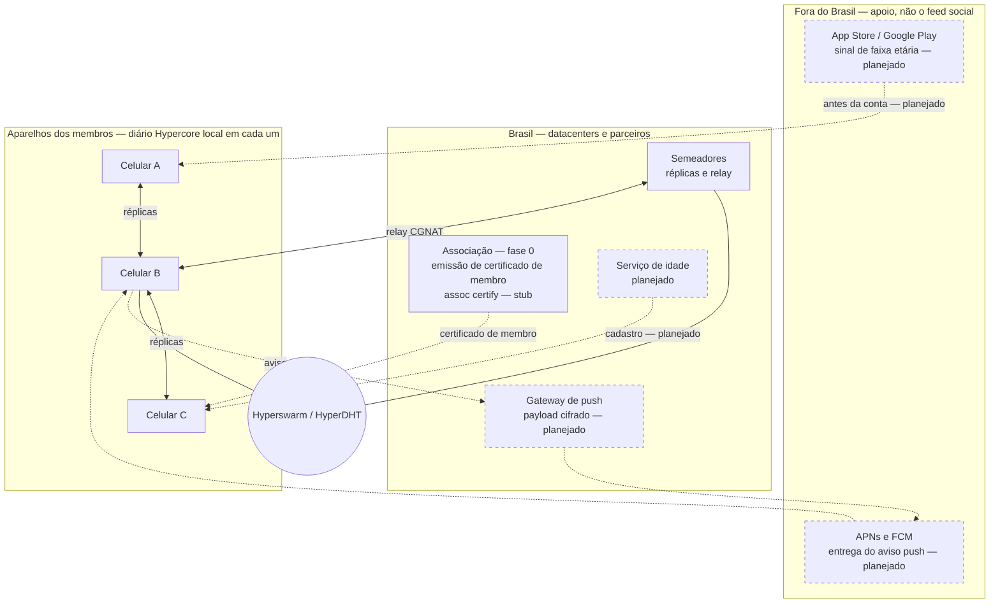
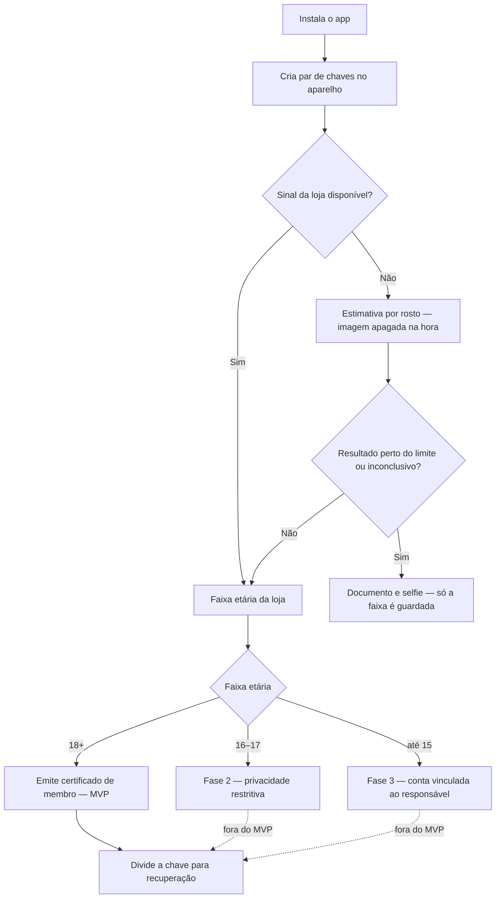
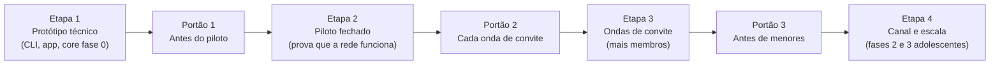

# Varanda — Documento de Design

19 de outubro de 2026 · Rodrigo S Pavezi

> Cópia em Markdown do documento de design (Claude Docs), exportada em 22 de outubro de 2026. Os três diagramas do original foram recriados em Mermaid abaixo.

A Varanda (varanda.app) é uma rede social que roda nos aparelhos dos próprios brasileiros: cada pessoa guarda as suas publicações e as de quem segue, e parceiros no Brasil mantêm semeadores sempre ligados. A idade é verificada antes de a conta existir, pelo sinal de idade das lojas de aplicativos, e o desenho segue a LGPD e o ECA Digital. É um rascunho para discussão; os pontos jurídicos ainda precisam de parecer de advogado.

## Objetivos e restrições

A rede precisa funcionar sem servidor central, nos celulares dos brasileiros, e cumprir a lei brasileira desde o primeiro usuário.

| Requisito | O que significa na prática |
| --- | --- |
| Roda nos aparelhos dos brasileiros | Cada celular guarda e repassa as próprias publicações e as de quem a pessoa segue; os semeadores guardam cópias dos diários públicos admitidos, e nenhum servidor tem os demais dados |
| Funciona com o celular desligado | Semeadores sempre ligados, mantidos por parceiros no Brasil, guardam cópias e ajudam nas conexões |
| Verificação de idade (ECA Digital) | A faixa etária é confirmada antes de a identidade existir; autodeclaração não basta |
| LGPD | Coleta mínima, dados no Brasil sempre que possível, direitos dos titulares atendidos, encarregado nomeado |
| Recuperação de login | Perder o celular não pode significar perder a conta |
| Custo baixo | Nenhuma conta de servidor por usuário; a infraestrutura é doada por parceiros |
| Remoção de conteúdo | Atender notificações (decisão do STF sobre o Art. 19 do Marco Civil) e ordens judiciais |

**Fora do escopo do MVP:** pagamentos e carteiras (evita as regras do Banco Central para ativos virtuais), publicidade e contas de menores de 18 anos, que entram numa fase seguinte.

## Nomes no app

A rede se chama Varanda, no domínio varanda.app, e cada parte do app leva um nome da conversa brasileira na frente de casa.

| Nome no app | O que é | O que muda no desenho |
| --- | --- | --- |
| A Rua | O feed dos diários que a pessoa segue | Continua com os diários seguidos; a descoberta fica na Espiadinha |
| Cadeiras de Praia (Cadeiras) | Conversas em grupo e salas de áudio ao vivo, como as cadeiras de plástico puxadas para a calçada | Fica fora do piloto: grupo pede um diário com vários autores, e áudio ao vivo pede transmissão em tempo real entre aparelhos |
| Espiadinha | Espiar o que quem você não segue está publicando | No piloto web: uma publicação por diário por rodada, até três rodadas, sem algoritmo de engajamento; cidade e estado ficam para depois |
| Gente da Gente | O selo de membro real e construtivo, no lugar do selo azul corporativo | "Real" já vem do certificado de membro; "construtivo" precisa de critério e de quem concede, e o selo não deve revelar a faixa etária |

Os pontos em aberto de cada nome estão em Perguntas em aberto.

### Espiadinha: regra democrática

A Espiadinha mostra a publicação mais recente de cada diário que você não segue, o seu incluído, da mais nova para a mais antiga; depois a segunda e, por fim, a terceira mais recente de cada um, do mesmo jeito: sem curtidas, sem sugestões e sem pesos escondidos.

"Mais recente" é a publicação (publicação, resposta, citação ou republicação ainda valendo; curtidas não aparecem) com maior `seq`, a última escrita. O próprio diário entra (a pessoa vê as próprias publicações); os seguidos não, porque já estão em A Rua. Dentro de cada rodada, vale a data `at` informada pelo autor, com desempate pela chave do diário. A igualdade é por diário certificado, não por pessoa: publicar mais não dá mais lugares na rodada, e cada diário tem no máximo três publicações. A regra está em [packages/core/lib/peek.js](../packages/core/lib/peek.js). A lista exclui os bloqueados e o conjunto efetivo de seguidos, vindo dos registros `follow` do diário mais as operações pendentes. Não se coleta cidade nem estado.

O navegador calcula a página a partir do inventário já enviado pelo semeador. Uma conexão curta, anônima no sentido de usar uma chave Noise efêmera e não anunciar a identidade, busca os outros diários; o semeador vê o mesmo IP pedindo o complemento dos seguidos, que já conhece pelo inventário da sincronização, e pode correlacionar as conexões. Ele registra uma linha `peer` por conexão; os logs têm rotação por tamanho em [deploy/seeder/compose.yaml](../deploy/seeder/compose.yaml). A leitura não chama a associação nem o serviço de conta. Nenhuma página de descoberta ou nova cópia de conteúdo é guardada em servidor; continuam existindo as réplicas e os logs normais do semeador. No aparelho, os registros dos diários espiados ficam só na memória do navegador: recarregar descarta; no nó, o retrato vence em 5 minutos, com descarte por temporizador mesmo sem outra leitura. As linhas já exibidas podem permanecer na interface até atualizar ou recarregar. Fotos usam a mesma rota `/media` de A Rua, sob demanda, conferidas por SHA-256, com endereços `blob:` mantidos só em memória; as fotos de quem a pessoa não segue são buscadas com `no-store` (`apps/app/src/media/fetch.js`), então não ficam no cache HTTP; só as próprias e as dos seguidos usam o cache longo.

O semeador pode omitir inventário, blocos ou um estado assinado mais novo, mas não forjar nem escolher a publicação dentro do histórico verificado. A janela usa o comprimento assinado que Hypercore verifica com o bloco 0, nunca o anunciado. Cada janela posterior precisa reproduzir o mesmo comprimento e `treeHash`; se mudou, seus blocos são descartados e o diário para de avançar nesse retrato, com a página incompleta. Certificados e registros de @nome são verificados de novo contra os emissores revogados em toda página. Qualquer nó pode refazer a regra com o mesmo inventário, históricos e filtros ([protocol.md](protocol.md), seção 6).

Limites do piloto: 30 itens na primeira página e 31 nas seguintes, custo linear no número de diários, até 64 blocos examinados por diário (registros que não são publicações podem esconder posts antigos). As buscas seguem ordem aleatória por retrato para distribuir o efeito dos cortes. Inventário que não completa em 5 s, corte pelo prazo de 25 s, orçamento de 16 MiB por página ou de 32 MiB de registros retidos deixam a lista incompleta; os núcleos em RAM usam páginas de 64 KiB. Os nomes são a melhor informação nos blocos lidos, podendo faltar ou estar antigos. A data vem do autor (mais de 24 h no futuro é ignorada), e um bloqueio novo só retira linhas já mostradas na próxima carga. Há uma conexão externa curta extra por página que precisa buscar dados, além da sincronização: ela disputa as 32 vagas externas do semeador, e cada membro hospedado já ocupa uma com sua sincronização. A Espiadinha não interrompe essa sincronização; só a consulta inicial da chave própria pode interromper uma vez quando ainda não está no cache. Só uma leitura da Espiadinha roda por vez, e desconectar libera a vaga imediatamente.

## Arquitetura

Os celulares guardam e trocam as publicações, e parceiros e serviços no Brasil dão apoio. Cada celular guarda só o próprio diário e os de quem a pessoa segue; o semeador guarda a cópia de todo diário que admitiu (os diários públicos dos membros). Fora desses diários públicos, nenhum componente tem todos os dados.

**Índice de engajamento do semeador.** Como o semeador já guarda todo diário admitido, ele monta em memória, a cada início, um índice de respostas, citações, curtidas, republicações e das publicações de cada membro, para que a conversa completa e as contagens apareçam mesmo de quem a pessoa não segue. O índice só diz onde procurar e quantos são; cada publicação, nome ou bio mostrado é lido do diário do autor e conferido pelo nó (na versão web, uma leitura sob demanda na memória, sem guardar nada). Os celulares continuam guardando só os diários seguidos. Contagens e completude são afirmações do semeador; o índice tem limite de memória e avisa quando está incompleto. Detalhes em [protocol.md](protocol.md), seções 5 e 7.

**Índice de nomes do semeador.** Para achar uma pessoa por nome ou @nome e seguir, o semeador guarda em memória, alimentado pela mesma varredura do índice de engajamento, só os tokens dobrados do nome (sem acentos, em minúsculas) e o @nome já conferido (assinatura e delegação do emissor); nunca o nome original, a bio, o e-mail nem a conta. A busca aceita de 1 a 4 palavras (mínimo de 2 letras), casa começo de palavras, devolve até 20 pessoas e fica atrás da mesma moderação: bloqueados nunca aparecem, e um @nome de emissor revogado deixa de casar na hora. O app confere o nome e o @nome de cada linha no diário da pessoa antes de mostrá-la. O semeador vê o texto dobrado da busca na rota (sem registrar), e a ordem, as omissões e a completude são afirmações dele. Não há opção de sair nesta versão. Detalhes em [protocol.md](protocol.md), seções 5 e 7.

Legenda: linhas sólidas = réplicas P2P (também entre outros pares) e descoberta na DHT (cada aparelho); linhas tracejadas = apoio (certificado de membro, idade, push). Nós com borda tracejada e etiqueta *(planejado)* são pós-fase-0; na fase 0, o certificado de membro vem de `assoc certify` (operador local, `method: stub`) no nó Associação. O conteúdo social não passa por servidor central: só cópias entre aparelhos e semeadores.

Só dois fluxos saem do Brasil: o sinal de idade das lojas e a entrega de avisos pela Apple e pelo Google.

**Tecnologia proposta: Holepunch**

- **Bare:** roda JavaScript no desktop e no celular, a base do app.
- **Hypercore:** o diário de cada pessoa, um registro assinado em que só se acrescenta.
- **Hyperswarm / HyperDHT:** acha quem tem cada diário e conecta os aparelhos atravessando NAT.
- **Keet**, o app de conversas da Holepunch, já mostra P2P funcionando em celulares. As APIs ainda mudam, então fixamos versões.

## Como funciona

Cada pessoa tem um diário assinado de publicações no próprio celular; quem a segue baixa uma cópia e repassa para outros, como num torrent.

**Cadastro**

1. A pessoa instala o app (iOS ou Android), que cria a identidade dela, um par de chaves, no próprio aparelho.
2. O app pede à loja (Apple ou Google) o sinal de faixa etária. Sem sinal, oferece a estimativa de idade por rosto.
3. O serviço de idade emite um certificado de membro para a chave pública, assinado pela associação. Guarda só a chave, a faixa, o método e a data.
4. A chave é dividida em partes para recuperação (ver Identidade e recuperação de login).

**Publicar**

1. O app assina a publicação e a acrescenta ao diário da pessoa, no aparelho.
2. O app anuncia o diário numa tabela distribuída (DHT) e entrega as novidades a seguidores online e aos semeadores.
3. Fotos e vídeos ficam em arquivos separados, baixados só quando alguém abre. Hoje: só fotos e GIFs, só pela versão web, num núcleo de fotos por aparelho; o semeador as serve por HTTP (vídeo espera a comparação com listas de hashes, em Moderação).

**Quem a pessoa segue é público.** A lista de seguidos fica no próprio diário (registros `follow`), para chegar igual a todos os aparelhos da pessoa. Por isso qualquer um que tenha o diário vê quem ela segue; o app diz isso em Seguindo.

**Quem foi seguido é avisado, em particular.** Quem começa a seguir alguém aparece para essa pessoa na aba Avisos do app, com "Seguir de volta". Isso é só dentro do app (versão web hospedada), sem contagem de seguidores e sem lista de seguidores: só quem acabou de seguir e ainda não foi seguido de volta, e a linha some ao seguir de volta. O semeador responde apenas à própria pessoa (ela prova que tem a chave do diário) e o app confere cada seguidor no diário assinado dele. Isso não substitui as notificações abaixo: o aviso cifrado por push (APNs e FCM) continua um desenho futuro, e os Avisos não o usam.

**Ler e sincronizar**

1. O app conecta direto aos aparelhos de quem a pessoa segue. Se o CGNAT da operadora impedir, passa por um semeador.
2. Baixa só as novidades dos diários seguidos, de preferência no Wi-Fi, para poupar o plano de dados. Uma conversa ou um perfil de quem a pessoa não segue é lido sob demanda (hoje só na versão web), na memória, pelo índice do semeador (acima), e não fica guardado.
3. Apps e semeadores só aceitam diários com certificado de membro válido.

**Notificações**

1. O iPhone corta conexões em segundo plano, então avisos precisam passar pela Apple (APNs) e pelo Google (FCM).
2. Quem responde, menciona ou manda mensagem pede ao serviço de push um aviso cifrado para o destinatário.
3. O serviço vê só a chave do destinatário e um texto cifrado; o celular decifra antes de mostrar e depois sincroniza por P2P.

## Identidade e recuperação de login

A chave de cada pessoa é dividida em três partes e quaisquer duas assinam: ninguém sozinho controla a conta, e perder o celular não apaga a identidade.

| Parte | Quem guarda | Para que serve |
| --- | --- | --- |
| 1 | O celular, no chip seguro do aparelho | Uso diário |
| 2 | Um parceiro guardião (provedor regional ou universidade) | Assina junto no dia a dia e ajuda na recuperação |
| 3 | Backup da pessoa, cifrado com passkey (sincronizada pelo iCloud ou Google) | Recuperação, ou assinar sem o guardião se ele sair do ar |

- **Celular perdido:** backup e guardião reconstroem uma nova parte no aparelho novo. A identidade e os seguidores continuam os mesmos.
- **Como o guardião confirma que é você:** passkey, e-mail e o registro da verificação de idade. Nunca só SMS, porque golpes de troca de chip são comuns no Brasil.
- **Técnica:** assinatura por limiar FROST ([RFC 9591](https://www.rfc-editor.org/rfc/rfc9591)), que suporta o tipo de chave (Ed25519) usado pelo Hypercore. O [FROSTR](https://opensats.org/projects/frostr) já aplica a mesma ideia a chaves Nostr.
- **No MVP:** só o backup cifrado por passkey. O guardião entra na fase 2.
- **Continuar conectado na versão web (troca consciente).** Na web, a chave vem da passkey. Antes ela ficava só na memória da página e cada recarga pedia a passkey de novo; agora a página guarda o resultado da passkey cifrado (AES-GCM com uma chave do navegador que não pode ser exportada, preso ao endereço e à identidade) e a pessoa continua conectada até tocar "Sair" ou ficar 30 dias sem abrir o app (aí a passkey é pedida de novo; cada abertura renova o prazo). Ganha-se uso de rede social de verdade (abrir e já estar dentro). Perde-se isto: a chave que cifra a sessão fica no mesmo perfil do navegador que a sessão cifrada, então uma cópia do perfil dá a identidade até "Sair" ou os 30 dias sem uso; um script que rode na origem da página pode usar a sessão guardada e agir como o membro; e quem pega o aparelho desbloqueado publica em nome dele. A cifra impede só que o resultado da passkey fique gravado em claro e que o registro, copiado sozinho, abra em outro endereço ou para outra identidade. Detalhes em `docs/rpc.md` seção 11.
- **Limite:** dois guardiões juntos poderiam assinar. Por isso a pessoa sempre guarda uma parte, e os guardiões são organizações independentes.

## Verificação de idade

A idade é confirmada antes de a identidade existir, e a rede guarda só a faixa etária, nunca documento ou foto.

No MVP só a saída de 18 anos ou mais existe; as saídas tracejadas (fases 2 e 3) entram depois.

| Método | Quando entra | O que a rede recebe | Custo |
| --- | --- | --- | --- |
| Sinal da loja ([Apple](https://9to5mac.com/2026/02/24/apple-expands-age-assurance-tools-as-new-app-store-requirements-roll-out-in-several-regions/) e [Google](https://www.drweb.de/alterspruefung-android-play-age-signals/)) | Padrão, no cadastro e a cada abertura do app | Só a faixa; no Google, 0–12, 13–15, 16–17 ou 18+ | Grátis |
| Estimativa por rosto | Sem sinal da loja, por exemplo quando a pessoa não autoriza compartilhar | Só a faixa; a imagem é apagada na hora | Cobrado por checagem; orçar com fornecedores |
| Documento e selfie | Resultado inconclusivo ou contestação | Só a faixa; o documento não é guardado | O mais caro; orçar |
| Credencial etária do gov.br (planejada) | Quando existir, vira o método preferido, ao lado do sinal da loja | Só se a pessoa está na faixa exigida, sem data de nascimento | A definir pelo governo |

**gov.br para idade, não para login.** O governo está montando uma credencial etária ligada ao gov.br, em que o serviço só fica sabendo se a pessoa está na faixa exigida ([TeleSíntese, 17/06/2026](https://telesintese.com.br/eca-digital-acelera-criacao-de-infraestrutura-nacional-de-credenciais-verificaveis/)). Ainda não há data de lançamento, nem regra clara sobre o uso por plataformas privadas.

Usar o gov.br como login seria diferente: a rede receberia CPF e nome de cada membro, cada publicação ficaria ligada a uma identidade oficial, e o gov.br veria cada entrada na rede. Isso cria um ponto central numa rede feita para não ter nenhum. O ideal é a credencial ser apresentada direto do celular, sem consultar o governo a cada uso.

**Regras que o desenho segue**

- Autodeclaração não basta, e informar só o CPF conta como autodeclaração ([orientação preliminar da ANPD](https://dataprivacy.com.br/escopo-e-afericao-de-idade-entenda-as-propostas-de-guias-da-anpd/)).
- Na estimativa por rosto, resultado perto do limite não libera o acesso: vai para documento e selfie.
- Se o sinal da loja e a avaliação do app divergirem, vale o resultado mais protetor (Decreto nº 12.880/2026).
- Para conteúdo impróprio para menores, a lei pede verificação confiável "a cada acesso" ([Senado](https://www12.senado.leg.br/noticias/materias/2026/03/17/eca-digital-para-protecao-on-line-de-criancas-e-adolescentes-entra-em-vigor)); o app reconsulta o sinal da loja sempre que abre, sem custo.
- A pessoa pode contestar o resultado e usar outro método.

**Fases 2 e 3: adolescentes**

- **16 e 17 anos:** privacidade mais restritiva ligada por padrão, sem contato de adultos não aprovados e sem compartilhar localização.
- **Até 16 anos:** conta vinculada à de um responsável, com ferramentas de supervisão (bloquear contato de adultos não autorizados, limitar uso excessivo, controlar recomendações). O vínculo não dá acesso às mensagens privadas. Se isso inclui quem tem 16 está em Perguntas em aberto.

**Fiscalização:** multas a partir de janeiro de 2027, de até 10% do faturamento no Brasil, limitadas a R$ 50 milhões por infração ([Exame](https://exame.com/tecnologia/examelab/verificacao-de-idade-nas-redes-o-que-o-eca-digital-exige-e-como-funciona-em-cada-app/)).

## LGPD

**Hipóteses de desenho, não parecer.** As tabelas, bases legais e fluxos desta seção expressam o que o produto *pretende* fazer para cumprir a LGPD e o ECA Digital. São hipóteses para engenharia e para discussão com advogados; **não substituem parecer jurídico formal**. Onde o texto pede “parecer jurídico” ou lista itens em Perguntas em aberto, a validação legal ainda não foi fechada.

A proposta é que a associação que publica o app e mantém os serviços compartilhados seja a controladora, e que o desenho reduza ao mínimo o que ela vê. Quem é controlador numa rede P2P é uma dessas hipóteses e ainda precisa de parecer jurídico.

| Dado | Onde fica | Base legal proposta | Retenção |
| --- | --- | --- | --- |
| Publicações e perfil | Celulares de quem segue e semeadores no Brasil e, só em memória enquanto a aba Espiadinha está aberta, no navegador de quem espia. Nome e @nome podem ser encontrados pela busca do semeador, sem opção de sair por enquanto; o semeador guarda só tokens dobrados em memória | Execução de contrato (Art. 7º, V) | Até a pessoa apagar; na Espiadinha, até recarregar ou atualizar a lista, e no nó até 5 minutos; o índice de nomes some ao reiniciar o semeador |
| Lista de quem a pessoa segue (registros `follow` no diário) e fotos das publicações | Os mesmos lugares do diário: é pública para quem tem o diário | Execução de contrato (Art. 7º, V) | Até a pessoa apagar |
| Mensagens diretas | Só nos aparelhos dos participantes, cifradas de ponta a ponta | Execução de contrato | Até apagarem |
| Certificado de membro (chave, faixa etária, método, data) | Serviço de idade, no Brasil | Obrigação legal, ECA Digital (Art. 7º, II) | Enquanto a conta existir |
| Imagem do rosto, só na estimativa de idade | Processada e apagada na hora | Dado sensível: consentimento específico ou obrigação legal (Art. 11), a definir | Nenhuma |
| Vínculo com a conta Google (sub do Google, e-mail, chave do membro, @nome atual e os já usados, datas, certificado) | Serviço de conta, no Brasil | Execução de contrato (Art. 7º, V), para dar o certificado e o @nome; e atender pedidos legais e bloqueios | Em aberto (issue #38) |
| Denúncias de membros (chave de quem denuncia e de quem é denunciado, publicação, motivo, texto de quem denuncia, trecho citado, data, assinatura) e registro de decisões dos moderadores (e-mail do moderador, decisão, data) | Serviço de conta, no Brasil (`moderation.json`) | Moderação e pedido legal (a base legal ainda precisa de parecer) | Em aberto (issue #38); nada é apagado automaticamente |
| E-mail de recuperação | Guardião, no Brasil | Execução de contrato | Enquanto a conta existir |
| Token de push | Serviço de push no Brasil; passa por Apple e Google | Execução de contrato | Até a pessoa desligar os avisos |
| Registros de acesso (IP, data, hora) | Semeadores e serviços | Obrigação legal, se o Art. 15 do Marco Civil se aplicar | 6 meses, se aplicável |

**Vínculo com a conta Google (hipóteses de desenho).**

- O serviço de conta guarda, por membro, o identificador (`sub`) e o e-mail da conta Google, a chave do diário, o @nome atual e os que o membro já usou (o diretório guarda os nomes passados por membro, para nunca dar um nome usado a outra pessoa), as datas e o certificado. A finalidade é só o contrato (dar certificado e @nome) e poder atender pedido judicial ou bloquear a conta. O e-mail nunca entra no diário, no certificado nem no navegador.
- A retenção está em aberto (issue #38): enquanto a conta existir é só uma proposta. A exclusão e a portabilidade (Art. 18) desses dados dependem do serviço de conta, não do diário; o `account export` é o ponto de partida.
- O @nome troca no máximo uma vez a cada 7 dias, e um nome já usado por um membro nunca é dado a outro. Um nó antigo ou um seguidor que ainda não sincronizou pode mostrar por um tempo o nome anterior.
- O certificado v2 não afirma idade (`ageBand: 'unchecked'`): o vínculo com a conta Google não é verificação de idade, e a lacuna do ECA Digital descrita acima continua aberta.
- Dois segredos, dois lugares: o segredo da associação (que certifica o emissor) fica na máquina do operador; o segredo do emissor (que assina certificados v2 e registros de @nome) fica só no serviço de conta.

**Denúncias e painel de moderação (hipóteses de desenho).**

- O serviço de conta guarda cada denúncia com a chave de quem denuncia, a chave denunciada, o número da publicação (quando há), o motivo, o texto opcional de quem denuncia, o trecho da publicação como o denunciante o enviou, a data e a assinatura. A finalidade é só moderar e atender pedido legal. Nada é apagado automaticamente, e a retenção está em aberto (issue #38).
- Os e-mails dos moderadores ficam no `.env` do servidor (`VARANDA_MODERATOR_EMAILS`) e, ao lado de cada decisão, no registro de decisões. O e-mail do vínculo Google de quem denuncia e de quem é denunciado não aparece no painel nem em registro: só sai por `account reports`, na máquina de operação do servidor, para atender um pedido legal.
- A pessoa denunciada não tem tela nem rota que mostre uma denúncia contra ela.

**Direitos dos titulares (Art. 18) numa rede P2P**

- **Acesso e portabilidade:** o diário já está no celular da pessoa; o app exporta tudo num arquivo.
- **Correção:** a pessoa publica uma versão corrigida, que substitui a anterior nos apps.
- **Eliminação:** o app publica um pedido de exclusão assinado. Apps e semeadores da rede apagam suas cópias; cópias em apps modificados não podem ser garantidas, e a política de privacidade diz isso claramente.
- **Excluir a conta:** um certificado de membro não tem revogação própria; a conta é excluída bloqueando a chave na lista de bloqueio, e a partir daí os semeadores e apps atualizados apagam e recusam o diário.

**Onde os dados ficam**

- Semeadores, serviço de idade, guardiões e push ficam em datacenters no Brasil.
- Saem do Brasil: avisos pela Apple e pelo Google, e cópias em celulares de membros que estejam no exterior. A LGPD permite transferência internacional com os mecanismos da Resolução CD/ANPD nº 19/2024; a política de privacidade informa isso.

**Antes do lançamento**

- [ ] Nomear o encarregado (Art. 41) e publicar o canal de contato
- [ ] Fazer o relatório de impacto (RIPD, Art. 38): há dado biométrico, menores e grande escala
- [ ] Política de privacidade em português simples
- [ ] Plano de resposta a incidentes, com aviso à ANPD e aos titulares (Art. 48)

## Moderação e obrigações legais

Numa rede P2P não dá para apagar uma cópia de todos os aparelhos, então a moderação funciona por uma lista assinada que os nós honestos obedecem. A lista existe desde a PR B2 (`docs/protocol.md` seção 3), e as denúncias de dentro do app e o painel da equipe, desde a PR B3 (`docs/verification.md` seção 14).

1. **Denúncia:** uma pessoa com a conta Google vinculada denuncia uma publicação ou uma conta pelo app oficial hospedado na web, e a denúncia é assinada com a chave do membro. O serviço de conta guarda a chave de quem denuncia, a chave denunciada, o número da publicação quando há, o motivo, o texto opcional, o trecho citado como o denunciante o enviou, a data e a assinatura. Quem é denunciado não tem tela nem rota que mostre isso. O trecho citado não é conferido: o serviço de conta não lê o diário do semeador, então o moderador confere a publicação por conta própria.
2. **Decisão:** os moderadores (e-mails em `VARANDA_MODERATOR_EMAILS`) entram com o Google no painel do serviço de conta e marcam cada denúncia como bloquear ou descartar, e desbloqueiam quem já foi bloqueado. O painel só admite moderador cuja conta Google esteja vinculada a um diário, e ninguém vê nem decide denúncias contra o próprio diário ou feitas por ele. O painel não assina nada: descartar vale na hora e não muda lista nenhuma, e bloquear ou desbloquear ficam pendentes até o operador rodar `mod apply` na própria máquina, que busca as decisões, mostra o que vai mudar e pede confirmação num terminal (desbloqueios de chaves bloqueadas fora do painel pedem uma segunda), assina uma lista nova com a chave da moderação (certificada pela associação) e a publica no semeador. Sem terminal, só `mod apply --yes` roda, e aplica no máximo 100 bloqueios por vez: desbloqueios esperam a revisão do operador e nunca saem sozinhos. Um login de moderador roubado (ou um servidor de conta comprometido) pode enfileirar decisões, mas não publicar um desbloqueio sem essa revisão. A chave secreta da moderação nunca vai para o servidor. Um bloqueio vale para a chave inteira: a lista não tem entrada por publicação.
3. **Efeito:** a lista bloqueia o diário por chave pública (não por publicação). Semeadores, membros da CLI e a versão web trocam a lista entre si no canal `varanda/blocklist/1`, guardam a mais nova que confere, apagam o que tinham desse diário e se recusam a buscá-lo, guardá-lo, anunciá-lo ou servi-lo de novo. Os semeadores também recusam a admissão de uma chave bloqueada.

**O que a lista garante e o que não garante**

- Um nó atualizado e honesto purga e recusa o diário bloqueado. Por isso um app modificado não consegue empurrar um diário bloqueado por meio dele.
- Um app modificado ainda pode falar direto com o autor bloqueado, e dois apps modificados podem trocar o diário entre si. A lista não alcança aparelhos que não a obedecem, e os nós de antes desta versão também não a aplicam.
- O app oficial da própria pessoa bloqueada mantém o diário no armazenamento dela e pode servi-lo a quem já conhece a chave de descoberta dele (o armazenamento do nó serve qualquer diário que guarda a quem o pede; `docs/protocol.md` seção 4, quarentena). Bloquear não apaga o diário do aparelho do autor.
- A versão web instalada (PWA) aplica sem rede a lista que tem guardada e só recebe uma lista mais nova pelo semeador. Os membros da CLI e os semeadores trocam a lista também pela DHT, sem depender de um semeador.
- A lista traz só chaves públicas, um número de sequência e datas: nunca o motivo da decisão, o nome, o e-mail ou a conta Google.
- Isto não é revogação de certificado de membro: o certificado individual continua válido, e o que sai é o diário, pelo bloqueio da chave. A revogação existe só para a chave de emissor do serviço de conta (`mod revoke-issuer`): se ela vazar, os certificados v2 e os @nomes que ela assinou deixam de valer em todos os nós atualizados.

- **Mídia ilegal:** antes de exibir ou repassar, o app compara fotos e vídeos com listas de hashes de material ilegal conhecido, obtidas com organizações especializadas (a definir). Abuso sexual infantil é denunciado à SaferNet Brasil e à Polícia Federal. **Isso ainda não existe.** A versão atual publica fotos e GIFs sem nenhuma comparação com listas de hashes; por esse motivo ela aceita só imagens e nenhum vídeo. Até a comparação existir, o que segura mídia ilegal é a denúncia e o bloqueio da conta: um diário bloqueado tem as fotos apagadas do semeador junto com ele, e o semeador deixa de servi-las.
- **Prazos:** desde a decisão do STF sobre o Art. 19 (junho de 2025), a plataforma responde por crimes e atos ilícitos que não remover após notificação, sem precisar de ordem judicial (lógica do Art. 21). Para crimes contra a honra vale o Art. 19: a responsabilidade depende de ordem judicial. Anúncios pagos e circulação em massa de crimes graves exigem cuidado ainda maior. A associação publica seus prazos de resposta.
- **Ordens judiciais:** cumpridas pela mesma lista. Mensagens cifradas e conteúdo que só existe nos aparelhos a associação não tem como entregar, e a política de privacidade diz isso.
- **Proteção de quem hospeda:** além do diário próprio, o aparelho mantém como réplicas persistentes só diários de quem a pessoa segue, e semeadores são organizações, não pessoas físicas. A Espiadinha lê outros diários pelo semeador sem gravá-los: ficam só em memória e somem ao recarregar. Conteúdo de quem a pessoa não segue, portanto, passa pela RAM do navegador. A limitação das cópias persistentes reduz o risco de guardar sem saber material ilegal, mas não elimina essa exposição durante a leitura; a avaliação jurídica continua necessária.
- **Limite:** um app modificado pode ignorar as listas. A associação responde pelos apps e serviços que publica; o alcance dessa responsabilidade precisa de parecer jurídico.

## Riscos e limitações

O maior risco é escala: nenhuma rede social P2P chegou a milhões de usuários até hoje, então o piloto existe para provar que funciona antes do convite ao canal.

| Risco | Impacto | Plano B |
| --- | --- | --- |
| P2P não aguenta a escala | A Rua lenta ou incompleta | Mais semeadores por região; se não bastar, migrar para Nostr com relays brasileiros |
| iPhone limita o segundo plano | Avisos atrasados, sincronização só com o app aberto | Avisos cifrados pelo push; sincronizar ao abrir o app |
| Plano de dados caro | Pessoas desistem | Sincronizar só no Wi-Fi por padrão; mídia sob demanda |
| App modificado ignora regras | Contorna moderação e proteção de adolescentes | Semeadores recusam diários sem certificado; parecer jurídico sobre responsabilidade |
| Parceiros não aparecem | Conteúdo some quando os celulares desligam | Começar com 1–2 semeadores da associação no plano gratuito da Oracle em São Paulo |
| Equipe de moderação pequena | Prazos legais estourados | Ondas de convite só quando houver moderação para elas |
| Holepunch muda as APIs | Retrabalho | Fixar versões e acompanhar a documentação oficial |
| Busca e assuntos do momento são difíceis sem servidor | Descoberta pobre | O inventário do `hello` do semeador já é um índice de diários; a Espiadinha usa esse índice e ordena no navegador, sem classificação no servidor. A busca de contas por nome e @nome agora existe pelo índice do semeador (começo de palavras, até 20 resultados, só na web hospedada); assuntos do momento continuam fora |

## Fases

Ninguém do canal entra antes de o piloto provar que a rede funciona, e cada onda de convites só abre quando há semeadores e moderação para ela.

**Critérios dos portões** (do texto desta seção, de Moderação, de Riscos e de Perguntas em aberto):

| Portão | Quando | Critérios |
| --- | --- | --- |
| **1** | Antes do piloto fechado | A rede P2P e os semeadores funcionam de ponta a ponta (o piloto existe para provar isso antes do canal). As seis primeiras perguntas em aberto têm resposta de advogado. Checklist “Antes do lançamento” em LGPD (encarregado, RIPD, política, plano de incidentes). |
| **2** | Antes de cada onda de convite | Semeadores no Brasil com capacidade para a onda (parceiros ou fallback da associação; ver tabela de Riscos). Equipe de moderação suficiente para os prazos legais (“ondas de convite só quando houver moderação para elas”). |
| **3** | Antes de abrir contas de menores (fases 2 e 3) | Verificação de idade e produto para 16–17 e até 15 anos (privacidade restritiva, vínculo com responsável, supervisão), alinhados ao ECA Digital — fora do MVP, que só admite 18+. |

As fases ainda não têm datas: dependem de quem vai desenvolver e de quantos parceiros entrarem.

## Perguntas em aberto

As seis primeiras precisam de advogado antes do piloto; as demais, da comunidade.

- [ ] Quem é o controlador LGPD numa rede P2P: a associação, cada parceiro semeador ou ambos?
- [ ] O Art. 15 do Marco Civil (guardar registros de acesso por 6 meses) se aplica a uma associação sem fins lucrativos?
- [ ] Sinal de idade das lojas mais estimativa por rosto atende à ANPD? A consulta pública do guia de aferição de idade da ANPD foi até 09/07/2026; conferir se a versão final já saiu.
- [ ] A imagem do rosto entra por consentimento específico ou por obrigação legal?
- [ ] Contas "de até 16 anos" precisam de vínculo com responsável: isso inclui quem tem 16?
- [ ] A associação responde por apps modificados que ignoram a moderação?
- [ ] Quais provedores regionais e universidades topam ser semeadores e guardiões?
- [ ] Quem financia o núcleo pago de moderação?
- [ ] Qual resultado do piloto nos faria trocar Holepunch por Nostr?
- [ ] Quando a credencial etária do gov.br fica pronta, e plataformas privadas vão poder usá-la?
- [x] Nome da rede: Varanda, no domínio varanda.app.
- [ ] Registrar varanda.app, se ainda não estiver registrado, e verificar a marca Varanda no INPI.
- [x] A Rua mantém os seguidos; a Espiadinha mostra uma publicação de cada diário não seguido por rodada, até três rodadas, da mais nova para a mais antiga dentro de cada rodada.
- [ ] Gente da Gente: qual o critério de "construtivo", quem concede o selo e como ele é retirado?
- [ ] Em que fase entra Cadeiras de Praia? (a Espiadinha entrou no piloto, só na versão web)

## Fontes

- [Senado Notícias – ECA Digital entra em vigor](https://www12.senado.leg.br/noticias/materias/2026/03/17/eca-digital-para-protecao-on-line-de-criancas-e-adolescentes-entra-em-vigor)
- [Exame – o que o ECA Digital exige na verificação de idade](https://exame.com/tecnologia/examelab/verificacao-de-idade-nas-redes-o-que-o-eca-digital-exige-e-como-funciona-em-cada-app/)
- [Data Privacy Brasil – propostas de guias da ANPD sobre aferição de idade](https://dataprivacy.com.br/escopo-e-afericao-de-idade-entenda-as-propostas-de-guias-da-anpd/)
- [9to5Mac – ferramentas de idade da Apple no Brasil](https://9to5mac.com/2026/02/24/apple-expands-age-assurance-tools-as-new-app-store-requirements-roll-out-in-several-regions/)
- [Dr. Web – Google Play Age Signals](https://www.drweb.de/alterspruefung-android-play-age-signals/)
- [Teletime – decisão do STF sobre o Art. 19](https://teletime.com.br/26/06/2025/art-19-stf-concilia-votos-e-plataformas-terao-responsabilizacao-parcial/)
- [Demarest – Resolução CD/ANPD nº 19/2024](https://www.demarest.com.br/anpd-aprova-o-regulamento-de-transferencia-internacional-de-dados/)
- [RFC 9591 – FROST](https://www.rfc-editor.org/rfc/rfc9591)
- [OpenSats – FROSTR](https://opensats.org/projects/frostr)
- [Holepunch – Bare](https://pears.com/news/introducing-bare-actually-run-javascript-everywhere/)
- [Apple Developer Forums – conexões em segundo plano no iOS](https://developer.apple.com/forums/thread/91625)
- [TeleSíntese – credencial etária nacional ligada ao gov.br](https://telesintese.com.br/eca-digital-acelera-criacao-de-infraestrutura-nacional-de-credenciais-verificaveis/)
- Textos das leis: [LGPD](https://www.planalto.gov.br/ccivil_03/_ato2015-2018/2018/lei/l13709.htm), [Marco Civil da Internet](https://www.planalto.gov.br/ccivil_03/_ato2011-2014/2014/lei/l12965.htm), [ECA](https://www.planalto.gov.br/ccivil_03/leis/l8069.htm). O site do Planalto não abriu durante a redação, então os números de artigo citados precisam ser conferidos.
